# Tables: input and output, page by page

Status: draft — all seven test pages written as of 2026-10-12, for review.

This file puts each test page's tables next to what the candidate tools
made of them. For each page: the table as published on docs.cloudfoundry.org
today, the text an author writes in each tool, and the page that tool builds
from it. The *test pages* are five pages the Docs WG lead picked because
their tables are hard to express outside HTML, plus two pages added later:
`uaa-performance`, a second table style, and `_oss_roles_table`, a table
wider than the content column (see the [glossary](../glossary.md#test-pages)). How the work was done is in
the [README](README.md); the full grids and measurements are in
[results.md](../concepts/tables/results.md).

How to read the comparisons:

- **Modes.** Each page was converted by hand in up to four ways (see the
  [glossary](../glossary.md#mode) for more). *Passthrough* keeps the page's
  HTML, after the cleanup listed in its intent file (the page's record of
  what each table needs; closing unclosed tags and similar fixes) and the
  changes a tool forces. *Native* uses the
  tool's own table syntax and whatever width or alignment settings that syntax
  offers. *Native-plain* is native with no width or alignment settings.
  *Extension* writes the table in a list-like syntax (one cell per line)
  and adds options for what the table asks for, such as row headers and
  key columns that do not wrap. A small piece of code or CSS added to the
  site once, such as a plugin or a custom block, gives those options their
  effect. This file shows native, passthrough and extension; native-plain
  is linked.
- **Hints.** What a table asks for, independent of any tool: a column's
  width, whether it should avoid wrapping, whether the first column labels
  its row (a *row header*), and so on. Widths are hints, not exact values
  ([R-03](../requirements/README.md#r-03) column widths as hints; requirement IDs are listed in
  [requirements](../requirements/README.md)).
- **Intent and spot checks.** Each page has an intent file: what each of
  its tables asks for, the cleanup it needs, and its spot checks, which are
  checkable statements such as "7 body rows, each with 2 cells", run on
  every build ([glossary](../glossary.md#spot-check)).
- **Screenshots.** Taken in a browser with a 1280-pixel window, each tool
  using its default *theme* (the fonts, colors, borders and spacing a tool
  ships with). Colors and fonts belong to the theme and are not compared;
  what is compared is content, structure and the hints.

## `_oss_scale_table`

- Published: not a page of its own. It is a *partial* (a file of shared
  content included into other pages), included by the `high-availability`
  page, <https://docs.cloudfoundry.org/concepts/high-availability.html>
  ([include line](https://github.com/cloudfoundry/docs-cloudfoundry-concepts/blob/4ac2fb19a0a44534a8469de100af7dd91706e9b7/high-availability.html.md.erb#L108) in the host page's source).
  The table on the page: [Recommended instance counts for high availability](https://docs.cloudfoundry.org/concepts/high-availability.html#instance-counts)
- Upstream source: [`_oss_scale_table.html.md.erb` in cloudfoundry/docs-cloudfoundry-concepts, commit `4ac2fb1`](https://github.com/cloudfoundry/docs-cloudfoundry-concepts/blob/4ac2fb19a0a44534a8469de100af7dd91706e9b7/_oss_scale_table.html.md.erb)
- Snapshot: [source/_oss_scale_table.html.md.erb](../concepts/tables/source/_oss_scale_table.html.md.erb) in this repo
  is a copy of that file at that commit. The per-tool versions are
  modified from it. Details: [SOURCES.md](../concepts/tables/source/SOURCES.md).

The partial, from docs-cloudfoundry-concepts, holds one table:
Component / Total Instances / Notes. The source sets widths 25/25/50. The
key column's longest entry, "Cloud Controller Worker", pushes against its
25% in the tools where the no-wrap hint wins.

- Intent and spot checks: [intent/_oss_scale_table.md](../concepts/tables/intent/_oss_scale_table.md)
- Results per tool: [Docusaurus](../concepts/tables/results.md#docusaurus-3102),
  [Zensical](../concepts/tables/results.md#zensical-0069),
  [Starlight](../concepts/tables/results.md#starlight-0426),
  [Antora](../concepts/tables/results.md#antora-321)

What the table asks for ([R-02](../requirements/README.md#r-02) rich tables):

- Columns about 25%, 25% and 50% wide. The source writes them as three
  `<col width="…">` elements before the header
  ([R-03](../requirements/README.md#r-03) column widths as hints).
- Column 1 names the component, so it is a *key* column and could be row
  headers. Column 2 is a *value* column of short counts, and `≥ 2` should
  not break between `≥` and `2`. Column 3 is *prose*.
- The `<col>` elements are not closed. `<col>` is a void element (one with
  no closing tag), so browsers accept that, but XML and JSX parsers do not.
  Every passthrough version closes them, `<col width="25%" />`
  ([R-24](../requirements/README.md#r-24) markup cleanup before conversion).
- The table has no class. Every passthrough version adds `class="table"`,
  the standard style, as every HTML table names its style
  ([R-09](../requirements/README.md#r-09) table styles by class).
- The header text is wrapped in `<strong>`. The intent file drops it, since
  bold header cells are a template convention, and every converted input
  drops it. (Until 2026-10-12 the passthrough inputs kept it and Antora's
  AsciiDoc wrote it as `*Component*`; the inputs and screenshots were
  corrected.)
- The NATS Server row holds a variable, `<%= vars.recommended_by %>`, which
  renders as "Cloud Foundry"
  ([R-04](../requirements/README.md#r-04) variables everywhere).
- The table reaches readers only through a host page. Each site here
  includes the partial from a small host page, `scale-table-host`, instead
  of copying all of `high-availability`
  ([R-05](../requirements/README.md#r-05) partials and reuse;
  [SOURCES.md](../concepts/tables/source/SOURCES.md), "The partial and its host").

At a glance, from the screenshots below. Column widths are the measured
values in [results.md](../concepts/tables/results.md), percent of the table;
results.md has no measurement for the published page, so its cell is empty:

| Output | Column widths | Header cells | Body cells, vertically | Component cells as row headers | "Cloud Controller Worker" on one line | Rule between the columns |
|---|---|---|---|---|---|---|
| Published | | left | centered | no | no | yes |
| Docusaurus native | 18/15/67, sized by content | centered | centered | no | no | yes |
| Docusaurus passthrough | 25/25/50 | centered | centered | no | no | yes |
| Zensical native and passthrough | 25/25/50 | left | top | no | no | no |
| Starlight native and passthrough | 25/25/50 | left | top | no | no | no |
| Antora native | 25/25/50 | left | top | yes (bold) | yes | yes |
| Antora passthrough | 25/25/50 | left | centered | no | yes | yes |
| Docusaurus extension | 30/24/46 | "Component" left, the other two centered | top | yes (bold) | yes | yes |
| Zensical extension | 26/25/49 | left | top | yes (bold) | yes | no |
| Starlight extension | 31/24/45 | left | top | yes (bold) | yes | no |
| Antora extension | 25/25/50 | left | top | yes (bold) | yes | yes |

All thirteen rows and three columns are present in every output. `≥`
renders twelve times, the `0` in the PostgreSQL Server row renders as code,
the NATS Server row reads "Cloud Foundry recommends …", the two empty Notes
cells keep their rows at three cells, and the table renders inside its host
page: the spot checks (per-table checks listed in the intent file and run on
every build) pass in every mode of every tool.

### Published

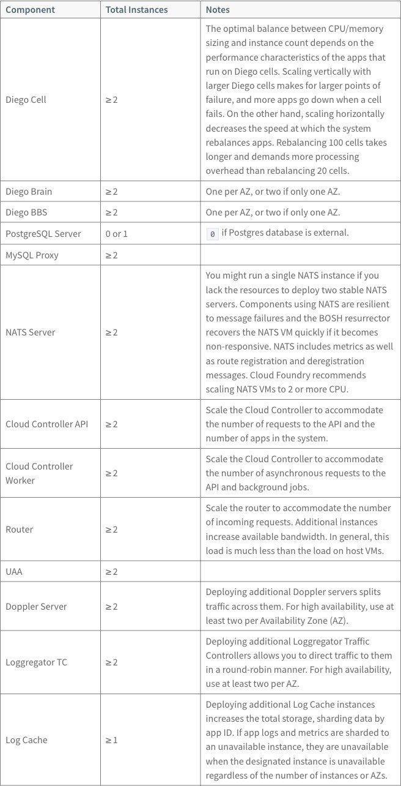

The source asks for 25, 25 and 50%. Header cells are bold and on
the left. Cells sit in the vertical middle of their row, and every cell has
a border. "Cloud Controller Worker" wraps onto two lines.

<details><summary>Source as written (HTML in an ERB partial; note the unclosed <code>&lt;col&gt;</code> elements)</summary>

```html
The following table provides recommended instance counts for a high-availability deployment. You can
decrease the footprint of your deployment by specifying fewer instances and combining multiple components onto a
single VM.

<table>
<col width="25%">
<col width="25%">
<col width="50%">
<thead>
        <tr>
                <th><strong>Component</strong></th>
                <th><strong>Total Instances</strong></th>
                <th><strong>Notes</strong></th>
        </tr>
</thead>
<tbody>
        <tr>
                <td>Diego Cell</td>
                <td>&ge; 2</td>
                <td>The optimal balance between CPU/memory sizing and instance count depends on the performance characteristics of the apps that run on Diego cells. Scaling vertically with larger Diego cells makes for larger points of failure, and more apps go down when a cell fails. On the other hand, scaling horizontally decreases the speed at which the system rebalances apps. Rebalancing 100 cells takes longer and demands more processing overhead than rebalancing 20 cells.</td>
        </tr>
        <tr>
                <td>Diego Brain</td>
                <td>&ge; 2</td>
                <td>One per AZ, or two if only one AZ.</td>
        </tr>
        <tr>
                <td>Diego BBS</td>
                <td>&ge; 2</td>
                <td>One per AZ, or two if only one AZ.</td>
        </tr>
        <tr>
                <td>PostgreSQL Server</td>
                <td>0 or 1</td>
                <td><code>0</code> if Postgres database is external.</td>
        </tr>
        <tr>
                <td>MySQL Proxy</td>
                <td>&ge; 2</td>
                <td></td>
        </tr>
        <tr>
                <td>NATS Server</td>
                <td>&ge; 2</td>
                <td>You might run a single NATS instance if you lack the resources to deploy two stable NATS servers. Components using NATS are resilient to message failures and the BOSH resurrector recovers the NATS VM quickly if it becomes non-responsive. NATS includes metrics as well as route registration and deregistration messages. <%= vars.recommended_by %> recommends scaling NATS VMs to 2 or more CPU.</td>
        </tr>
        <tr>
                <td>Cloud Controller API</td>
                <td>&ge; 2</td>
                <td>Scale the Cloud Controller to accommodate the number of requests to the API and the number of apps in the system.</td>
        </tr>
        <tr>
                <td>Cloud Controller Worker</td>
                <td>&ge; 2</td>
                <td>Scale the Cloud Controller to accommodate the number of asynchronous requests to the API and background jobs.</td>
        </tr>
        <tr>
                <td>Router</td>
                <td>&ge; 2</td>
                <td>Scale the router to accommodate the number of incoming requests. Additional instances increase available bandwidth. In general, this load is much less than the load on host VMs.</td>
        </tr>
        <tr>
                <td>UAA</td>
                <td>&ge; 2</td>
                <td></td>
        </tr>
        <tr>
                <td>Doppler Server</td>
                <td>&ge; 2</td>
                <td>Deploying additional Doppler servers splits traffic across them. For high availability, use at least two per Availability Zone (AZ).</td>
        </tr>
        <tr>
                <td>Loggregator TC</td>
                <td>&ge; 2</td>
                <td>Deploying additional Loggregator Traffic Controllers allows you to direct traffic to them in a round-robin manner. For high availability, use at least two per AZ.</td>
        </tr>
        <tr>
                <td>Log Cache</td>
                <td>&ge; 1</td>
                <td>Deploying additional Log Cache instances increases the total storage, sharding data by app ID. If app logs and metrics are sharded to an unavailable instance, they are unavailable when the designated instance is unavailable regardless of the number of instances or AZs.</td>
        </tr>
</tbody>
</table>
```

</details>

ERB (Embedded Ruby, `<%= … %>` tags in a page; see the
[glossary](../glossary.md#erb)) is how today's pages insert variables and
partials. This partial uses one variable, `<%= vars.recommended_by %>`, and
the `high-availability` page includes it with
`<%= partial 'oss_scale_table' %>`
([glossary: partial](../glossary.md#partial)).

### Docusaurus 3.10.2

Pages are MDX: Markdown that also accepts JSX, the HTML-like syntax of
React components (see the [glossary](../glossary.md#mdx)). A partial is an
MDX file whose name starts with `_`, so it has no page of its own. The host
page imports it and uses it as a component; the partial imports the
variables itself (`import vars from '@site/vars.json';`, its first line)
([conventions](../concepts/tables/sites/docusaurus/CONVENTIONS.md),
"Partials").

<details><summary>Host page: the partial imported as a component</summary>

```mdx
---
title: Scale table host
---

import OssScaleTable from './_oss_scale_table.mdx';

Host page for the `_oss_scale_table` partial, standing in for
`high-availability.html.md.erb`, which includes it with
`<%= partial 'oss_scale_table' %>`.

<OssScaleTable />
```

The host page is the same in every mode.

</details>

<details><summary>Native input: a pipe table in MDX</summary>

```markdown
| Component | Total Instances | Notes |
| --- | --- | --- |
| Diego Cell | &ge; 2 | The optimal balance between CPU/memory sizing and instance count depends on the performance characteristics of the apps that run on Diego cells. Scaling vertically with larger Diego cells makes for larger points of failure, and more apps go down when a cell fails. On the other hand, scaling horizontally decreases the speed at which the system rebalances apps. Rebalancing 100 cells takes longer and demands more processing overhead than rebalancing 20 cells. |
| Diego Brain | &ge; 2 | One per AZ, or two if only one AZ. |
| Diego BBS | &ge; 2 | One per AZ, or two if only one AZ. |
| PostgreSQL Server | 0 or 1 | `0` if Postgres database is external. |
| MySQL Proxy | &ge; 2 |  |
| NATS Server | &ge; 2 | You might run a single NATS instance if you lack the resources to deploy two stable NATS servers. Components using NATS are resilient to message failures and the BOSH resurrector recovers the NATS VM quickly if it becomes non-responsive. NATS includes metrics as well as route registration and deregistration messages. {vars.recommended_by} recommends scaling NATS VMs to 2 or more CPU. |
| Cloud Controller API | &ge; 2 | Scale the Cloud Controller to accommodate the number of requests to the API and the number of apps in the system. |
| Cloud Controller Worker | &ge; 2 | Scale the Cloud Controller to accommodate the number of asynchronous requests to the API and background jobs. |
| Router | &ge; 2 | Scale the router to accommodate the number of incoming requests. Additional instances increase available bandwidth. In general, this load is much less than the load on host VMs. |
| UAA | &ge; 2 |  |
| Doppler Server | &ge; 2 | Deploying additional Doppler servers splits traffic across them. For high availability, use at least two per Availability Zone (AZ). |
| Loggregator TC | &ge; 2 | Deploying additional Loggregator Traffic Controllers allows you to direct traffic to them in a round-robin manner. For high availability, use at least two per AZ. |
| Log Cache | &ge; 1 | Deploying additional Log Cache instances increases the total storage, sharding data by app ID. If app logs and metrics are sharded to an unavailable instance, they are unavailable when the designated instance is unavailable regardless of the number of instances or AZs. |
```

</details>

<details><summary>Passthrough input: the HTML with <code>&lt;col /&gt;</code> closed and wrapped in <code>&lt;colgroup&gt;</code></summary>

```jsx
<table class="table">
<colgroup>
<col width="25%" />
<col width="25%" />
<col width="50%" />
</colgroup>
<thead>
        <tr>
                <th>Component</th>
                <th>Total Instances</th>
                <th>Notes</th>
        </tr>
</thead>
<tbody>
        <tr>
                <td>Diego Cell</td>
                <td>&ge; 2</td>
                <td>The optimal balance between CPU/memory sizing and instance count depends on the performance characteristics of the apps that run on Diego cells. Scaling vertically with larger Diego cells makes for larger points of failure, and more apps go down when a cell fails. On the other hand, scaling horizontally decreases the speed at which the system rebalances apps. Rebalancing 100 cells takes longer and demands more processing overhead than rebalancing 20 cells.</td>
        </tr>
        <tr>
                <td>Diego Brain</td>
                <td>&ge; 2</td>
                <td>One per AZ, or two if only one AZ.</td>
        </tr>
        <tr>
                <td>Diego BBS</td>
                <td>&ge; 2</td>
                <td>One per AZ, or two if only one AZ.</td>
        </tr>
        <tr>
                <td>PostgreSQL Server</td>
                <td>0 or 1</td>
                <td><code>0</code> if Postgres database is external.</td>
        </tr>
        <tr>
                <td>MySQL Proxy</td>
                <td>&ge; 2</td>
                <td></td>
        </tr>
        <tr>
                <td>NATS Server</td>
                <td>&ge; 2</td>
                <td>You might run a single NATS instance if you lack the resources to deploy two stable NATS servers. Components using NATS are resilient to message failures and the BOSH resurrector recovers the NATS VM quickly if it becomes non-responsive. NATS includes metrics as well as route registration and deregistration messages. {vars.recommended_by} recommends scaling NATS VMs to 2 or more CPU.</td>
        </tr>
        <tr>
                <td>Cloud Controller API</td>
                <td>&ge; 2</td>
                <td>Scale the Cloud Controller to accommodate the number of requests to the API and the number of apps in the system.</td>
        </tr>
        <tr>
                <td>Cloud Controller Worker</td>
                <td>&ge; 2</td>
                <td>Scale the Cloud Controller to accommodate the number of asynchronous requests to the API and background jobs.</td>
        </tr>
        <tr>
                <td>Router</td>
                <td>&ge; 2</td>
                <td>Scale the router to accommodate the number of incoming requests. Additional instances increase available bandwidth. In general, this load is much less than the load on host VMs.</td>
        </tr>
        <tr>
                <td>UAA</td>
                <td>&ge; 2</td>
                <td></td>
        </tr>
        <tr>
                <td>Doppler Server</td>
                <td>&ge; 2</td>
                <td>Deploying additional Doppler servers splits traffic across them. For high availability, use at least two per Availability Zone (AZ).</td>
        </tr>
        <tr>
                <td>Loggregator TC</td>
                <td>&ge; 2</td>
                <td>Deploying additional Loggregator Traffic Controllers allows you to direct traffic to them in a round-robin manner. For high availability, use at least two per AZ.</td>
        </tr>
        <tr>
                <td>Log Cache</td>
                <td>&ge; 1</td>
                <td>Deploying additional Log Cache instances increases the total storage, sharding data by app ID. If app logs and metrics are sharded to an unavailable instance, they are unavailable when the designated instance is unavailable regardless of the number of instances or AZs.</td>
        </tr>
</tbody>
</table>
```

</details>

The variable is written `{vars.recommended_by}` in every mode, a JSX
expression.

Files: [native](../concepts/tables/sites/docusaurus/docs/native/_oss_scale_table.mdx),
[passthrough](../concepts/tables/sites/docusaurus/docs/passthrough/_oss_scale_table.mdx),
[passthrough as written](../concepts/tables/sites/docusaurus/docs/passthrough-raw/_oss_scale_table.mdx),
[extension](../concepts/tables/sites/docusaurus/docs/extension/_oss_scale_table.mdx);
[host page](../concepts/tables/sites/docusaurus/docs/native/scale-table-host.mdx).
Docusaurus has no native-plain page: its native page already has no width
settings.

**Native output:**

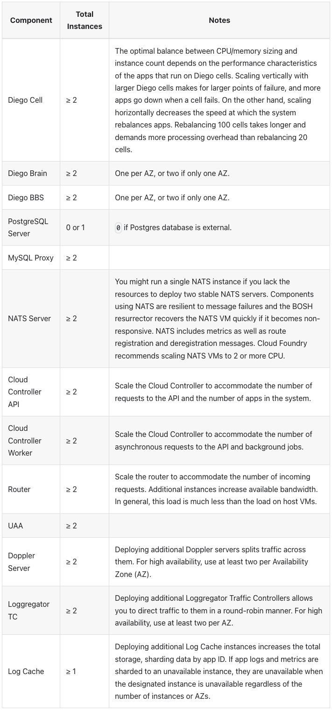

**Passthrough output:**

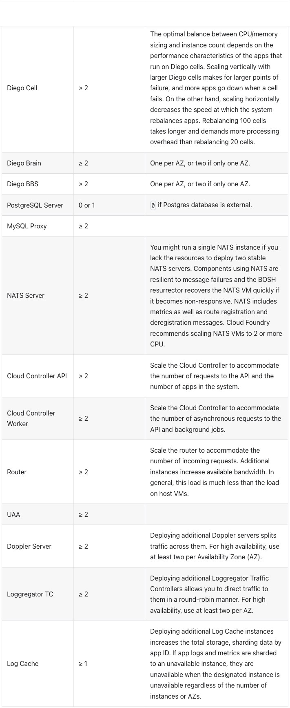

Differences seen:

- **The page does not build with the HTML as written.** MDX stops at the
  first `<col>` because it is not closed. Passthrough also needed the
  `<col />` elements wrapped in `<colgroup>`
  ([R-24](../requirements/README.md#r-24) markup cleanup before conversion;
  [raw passthrough errors](../concepts/tables/results.md#raw-passthrough-errors)).
- **Native has no column widths.** A pipe table (a Markdown table written
  with `|` between cells; see the [glossary](../glossary.md#pipe-table))
  carries none, so the columns are sized by their content, 18/15/67. Column
  1 is too narrow for most component names: "PostgreSQL Server" takes two
  lines and "Cloud Controller Worker" three. The "Total Instances" header
  takes two lines. Passthrough keeps 25/25/50.
- **Header cells are centered**, in both modes; the published page has them
  on the left. The theme sets no alignment, so the browser's default shows
  ([checked after review](../concepts/tables/results.md#widths-alignment-and-font-size)).
- **Alternate body rows are shaded**, in both modes. The published table
  has no shading.
- **"non-responsive" breaks after its hyphen** in native, at the end of a
  line ("non-" / "responsive."). Passthrough and the published page keep it
  whole. The text itself is unchanged.
- Body cells are vertically centered, as on the published page. No row
  headers in either mode.

**Extension mode.** A `:::list-table` block, read by a remark plugin added
to the site:
[plugins/list-table.js](../concepts/tables/sites/docusaurus/plugins/list-table.js),
with [hints.css](../concepts/tables/sites/docusaurus/src/css/hints.css).

<details><summary>Extension input: a list-table directive</summary>

```markdown
:::list-table{widths="25 25 50" header-rows="1" stub-columns="1" roles="key value prose"}
- - Component
  - Total Instances
  - Notes
- - Diego Cell
  - &ge; 2
  - The optimal balance between CPU/memory sizing and instance count depends on the performance characteristics of the apps that run on Diego cells. Scaling vertically with larger Diego cells makes for larger points of failure, and more apps go down when a cell fails. On the other hand, scaling horizontally decreases the speed at which the system rebalances apps. Rebalancing 100 cells takes longer and demands more processing overhead than rebalancing 20 cells.
- - Diego Brain
  - &ge; 2
  - One per AZ, or two if only one AZ.
- - Diego BBS
  - &ge; 2
  - One per AZ, or two if only one AZ.
- - PostgreSQL Server
  - 0 or 1
  - `0` if Postgres database is external.
- - MySQL Proxy
  - &ge; 2
  -
- - NATS Server
  - &ge; 2
  - You might run a single NATS instance if you lack the resources to deploy two stable NATS servers. Components using NATS are resilient to message failures and the BOSH resurrector recovers the NATS VM quickly if it becomes non-responsive. NATS includes metrics as well as route registration and deregistration messages. {vars.recommended_by} recommends scaling NATS VMs to 2 or more CPU.
- - Cloud Controller API
  - &ge; 2
  - Scale the Cloud Controller to accommodate the number of requests to the API and the number of apps in the system.
- - Cloud Controller Worker
  - &ge; 2
  - Scale the Cloud Controller to accommodate the number of asynchronous requests to the API and background jobs.
- - Router
  - &ge; 2
  - Scale the router to accommodate the number of incoming requests. Additional instances increase available bandwidth. In general, this load is much less than the load on host VMs.
- - UAA
  - &ge; 2
  -
- - Doppler Server
  - &ge; 2
  - Deploying additional Doppler servers splits traffic across them. For high availability, use at least two per Availability Zone (AZ).
- - Loggregator TC
  - &ge; 2
  - Deploying additional Loggregator Traffic Controllers allows you to direct traffic to them in a round-robin manner. For high availability, use at least two per AZ.
- - Log Cache
  - &ge; 1
  - Deploying additional Log Cache instances increases the total storage, sharding data by app ID. If app logs and metrics are sharded to an unavailable instance, they are unavailable when the designated instance is unavailable regardless of the number of instances or AZs.
:::
```

`widths` sets 25/25/50, `header-rows="1"` makes the first row the header,
`stub-columns="1"` makes column 1 row headers, and `roles` names column 1 a
key column, column 2 a value column and column 3 prose. A key column does
not wrap, up to a cap. An empty cell is a bare `-`.

</details>

**Extension output:**

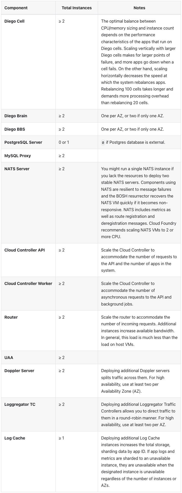

Differences seen, against the published page and the other two modes:

- **Column 1 is 30%, not 25%** (30/24/46). "Cloud Controller Worker" does
  not fit in 25% without wrapping, and the key column's no-wrap wins over
  its width. **Decided:** "don't wrap" wins, so a column's width varies
  with its content, but only up to a cap (`--table-nowrap-max`, 16em);
  past it the text wraps between words
  ([Docusaurus finding 1](../concepts/tables/results.md#docusaurus-3102);
  [screenshot](../concepts/tables/results/docusaurus-oss-extension-nowrap-beats-width.png)).
- **The component cells are row headers**, drawn in bold.
- **Body cells are aligned to the top**; native, passthrough and the
  published page center them.
- **"Component" is on the left and the other two headers are centered**, as
  in [`credential-types`](#credential-types).
- "non-responsive" breaks after its hyphen, as in native. Alternate body
  rows are still shaded.

### Zensical 0.0.69

Pages are Markdown read by Python-Markdown, which passes HTML blocks through
unchanged (see the [glossary](../glossary.md#python-markdown)). An
*attribute list*, `{: … }` after a cell's text, sets HTML attributes on that
cell. A partial lives in `partials/<mode>/`, outside `docs/`, so it never
becomes a page. The host includes it with the template engine's `include`,
which also renders the partial's variables; a `--8<--` snippet include
would leave `<%= vars.recommended_by %>` as literal text
([Zensical finding 7](../concepts/tables/results.md#zensical-0069)).

<details><summary>Host page: the partial included by the template engine</summary>

```markdown
---
title: Scale table host
---

Host page for the `_oss_scale_table` partial, standing in for
`high-availability.html.md.erb`, which includes it with
an ERB `partial 'oss_scale_table'` call.

<% include "native/_oss_scale_table.md" %>
```

Each mode's host page includes that mode's partial. The host page names the
ERB call in words, not as a tag: every `<%= … %>` on a page goes through the
template engine, and an earlier draft that showed the tag produced a page
that said "Macro Syntax Error" while the build reported success
([Zensical finding 3](../concepts/tables/results.md#zensical-0069)).

</details>

<details><summary>Native input: a pipe table with widths on the header cells</summary>

```markdown
| Component {: style="width:25%" } | Total Instances {: style="width:25%" } | Notes {: style="width:50%" } |
| --- | --- | --- |
| Diego Cell | &ge; 2 | The optimal balance between CPU/memory sizing and instance count depends on the performance characteristics of the apps that run on Diego cells. Scaling vertically with larger Diego cells makes for larger points of failure, and more apps go down when a cell fails. On the other hand, scaling horizontally decreases the speed at which the system rebalances apps. Rebalancing 100 cells takes longer and demands more processing overhead than rebalancing 20 cells. |
| Diego Brain | &ge; 2 | One per AZ, or two if only one AZ. |
| Diego BBS | &ge; 2 | One per AZ, or two if only one AZ. |
| PostgreSQL Server | 0 or 1 | `0` if Postgres database is external. |
| MySQL Proxy | &ge; 2 |  |
| NATS Server | &ge; 2 | You might run a single NATS instance if you lack the resources to deploy two stable NATS servers. Components using NATS are resilient to message failures and the BOSH resurrector recovers the NATS VM quickly if it becomes non-responsive. NATS includes metrics as well as route registration and deregistration messages. <%= vars.recommended_by %> recommends scaling NATS VMs to 2 or more CPU. |
| Cloud Controller API | &ge; 2 | Scale the Cloud Controller to accommodate the number of requests to the API and the number of apps in the system. |
| Cloud Controller Worker | &ge; 2 | Scale the Cloud Controller to accommodate the number of asynchronous requests to the API and background jobs. |
| Router | &ge; 2 | Scale the router to accommodate the number of incoming requests. Additional instances increase available bandwidth. In general, this load is much less than the load on host VMs. |
| UAA | &ge; 2 |  |
| Doppler Server | &ge; 2 | Deploying additional Doppler servers splits traffic across them. For high availability, use at least two per Availability Zone (AZ). |
| Loggregator TC | &ge; 2 | Deploying additional Loggregator Traffic Controllers allows you to direct traffic to them in a round-robin manner. For high availability, use at least two per AZ. |
| Log Cache | &ge; 1 | Deploying additional Log Cache instances increases the total storage, sharding data by app ID. If app logs and metrics are sharded to an unavailable instance, they are unavailable when the designated instance is unavailable regardless of the number of instances or AZs. |
```

</details>

<details><summary>Passthrough input: the HTML with <code>&lt;col /&gt;</code> closed and the class added</summary>

```html
<table class="table">
<col width="25%" />
<col width="25%" />
<col width="50%" />
<thead>
        <tr>
                <th>Component</th>
                <th>Total Instances</th>
                <th>Notes</th>
        </tr>
</thead>
<tbody>
        <tr>
                <td>Diego Cell</td>
                <td>&ge; 2</td>
                <td>The optimal balance between CPU/memory sizing and instance count depends on the performance characteristics of the apps that run on Diego cells. Scaling vertically with larger Diego cells makes for larger points of failure, and more apps go down when a cell fails. On the other hand, scaling horizontally decreases the speed at which the system rebalances apps. Rebalancing 100 cells takes longer and demands more processing overhead than rebalancing 20 cells.</td>
        </tr>
        <tr>
                <td>Diego Brain</td>
                <td>&ge; 2</td>
                <td>One per AZ, or two if only one AZ.</td>
        </tr>
        <tr>
                <td>Diego BBS</td>
                <td>&ge; 2</td>
                <td>One per AZ, or two if only one AZ.</td>
        </tr>
        <tr>
                <td>PostgreSQL Server</td>
                <td>0 or 1</td>
                <td><code>0</code> if Postgres database is external.</td>
        </tr>
        <tr>
                <td>MySQL Proxy</td>
                <td>&ge; 2</td>
                <td></td>
        </tr>
        <tr>
                <td>NATS Server</td>
                <td>&ge; 2</td>
                <td>You might run a single NATS instance if you lack the resources to deploy two stable NATS servers. Components using NATS are resilient to message failures and the BOSH resurrector recovers the NATS VM quickly if it becomes non-responsive. NATS includes metrics as well as route registration and deregistration messages. <%= vars.recommended_by %> recommends scaling NATS VMs to 2 or more CPU.</td>
        </tr>
        <tr>
                <td>Cloud Controller API</td>
                <td>&ge; 2</td>
                <td>Scale the Cloud Controller to accommodate the number of requests to the API and the number of apps in the system.</td>
        </tr>
        <tr>
                <td>Cloud Controller Worker</td>
                <td>&ge; 2</td>
                <td>Scale the Cloud Controller to accommodate the number of asynchronous requests to the API and background jobs.</td>
        </tr>
        <tr>
                <td>Router</td>
                <td>&ge; 2</td>
                <td>Scale the router to accommodate the number of incoming requests. Additional instances increase available bandwidth. In general, this load is much less than the load on host VMs.</td>
        </tr>
        <tr>
                <td>UAA</td>
                <td>&ge; 2</td>
                <td></td>
        </tr>
        <tr>
                <td>Doppler Server</td>
                <td>&ge; 2</td>
                <td>Deploying additional Doppler servers splits traffic across them. For high availability, use at least two per Availability Zone (AZ).</td>
        </tr>
        <tr>
                <td>Loggregator TC</td>
                <td>&ge; 2</td>
                <td>Deploying additional Loggregator Traffic Controllers allows you to direct traffic to them in a round-robin manner. For high availability, use at least two per AZ.</td>
        </tr>
        <tr>
                <td>Log Cache</td>
                <td>&ge; 1</td>
                <td>Deploying additional Log Cache instances increases the total storage, sharding data by app ID. If app logs and metrics are sharded to an unavailable instance, they are unavailable when the designated instance is unavailable regardless of the number of instances or AZs.</td>
        </tr>
</tbody>
</table>
```

</details>

The variable keeps its ERB form, `<%= vars.recommended_by %>`, in every
mode.

Files: [native](../concepts/tables/sites/zensical/partials/native/_oss_scale_table.md),
[native-plain](../concepts/tables/sites/zensical/partials/native-plain/_oss_scale_table.md),
[passthrough](../concepts/tables/sites/zensical/partials/passthrough/_oss_scale_table.md),
[passthrough as written](../concepts/tables/sites/zensical/partials/passthrough-raw/_oss_scale_table.md),
[extension](../concepts/tables/sites/zensical/partials/extension/_oss_scale_table.md);
[host page](../concepts/tables/sites/zensical/docs/native/scale-table-host.md).

**Native and passthrough output** (the two screenshots differ only by
image-compression noise):

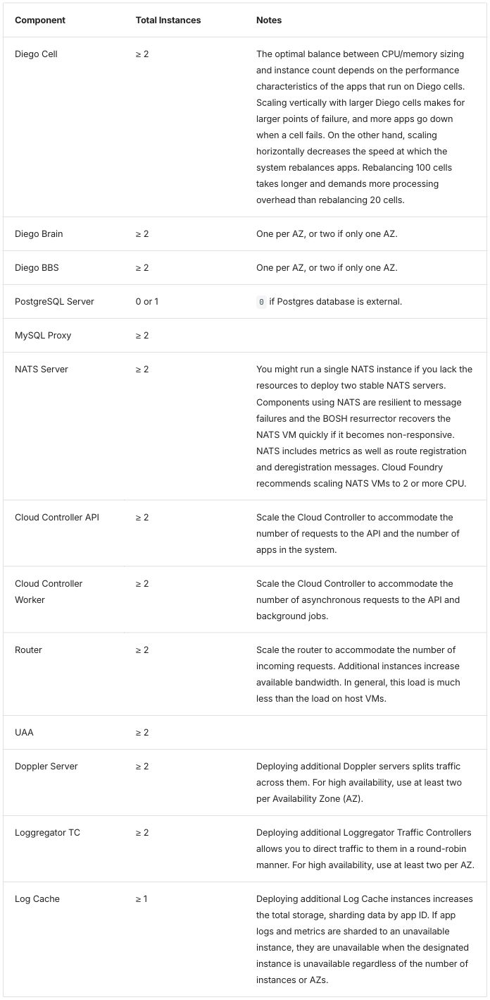

Differences seen:

- **The page builds with the HTML as written.** Closing the `<col>`
  elements is the intent file's cleanup, not something Zensical forces.
- **The columns are 25/25/50 in both modes.** Native gets them from the
  attributes on the header cells. Without them (native-plain), the columns
  are 17/15/68
  ([native with and without widths](../concepts/tables/results.md#native-with-and-without-widths)).
- **"Cloud Controller Worker" wraps onto two lines**, as on the published
  page.
- **No rule between the columns.** Rows are separated by horizontal rules
  inside a thin outer frame.
- **Body cells are aligned to the top**; the published page centers them.
- No row headers. The site's stylesheet gives `table.table` the theme's
  table look ([Zensical finding 1](../concepts/tables/results.md#zensical-0069)),
  so the two modes look the same.

**Extension mode.** A `/// list-table` block, read by a Python-Markdown
extension added to the site,
[list_table.py](../concepts/tables/sites/zensical/list_table.py), with
[hints.css](../concepts/tables/sites/zensical/docs/stylesheets/hints.css).

<details><summary>Extension input: a list-table block</summary>

```markdown
/// list-table
    widths: 25 25 50
    header-rows: 1
    stub-columns: 1
    roles: key value prose

-   - Component
    - Total Instances
    - Notes

-   - Diego Cell
    - &ge; 2
    - The optimal balance between CPU/memory sizing and instance count depends on the performance characteristics of the apps that run on Diego cells. Scaling vertically with larger Diego cells makes for larger points of failure, and more apps go down when a cell fails. On the other hand, scaling horizontally decreases the speed at which the system rebalances apps. Rebalancing 100 cells takes longer and demands more processing overhead than rebalancing 20 cells.

-   - Diego Brain
    - &ge; 2
    - One per AZ, or two if only one AZ.

-   - Diego BBS
    - &ge; 2
    - One per AZ, or two if only one AZ.

-   - PostgreSQL Server
    - 0 or 1
    - `0` if Postgres database is external.

-   - MySQL Proxy
    - &ge; 2
    - <!-- -->

-   - NATS Server
    - &ge; 2
    - You might run a single NATS instance if you lack the resources to deploy two stable NATS servers. Components using NATS are resilient to message failures and the BOSH resurrector recovers the NATS VM quickly if it becomes non-responsive. NATS includes metrics as well as route registration and deregistration messages. <%= vars.recommended_by %> recommends scaling NATS VMs to 2 or more CPU.

-   - Cloud Controller API
    - &ge; 2
    - Scale the Cloud Controller to accommodate the number of requests to the API and the number of apps in the system.

-   - Cloud Controller Worker
    - &ge; 2
    - Scale the Cloud Controller to accommodate the number of asynchronous requests to the API and background jobs.

-   - Router
    - &ge; 2
    - Scale the router to accommodate the number of incoming requests. Additional instances increase available bandwidth. In general, this load is much less than the load on host VMs.

-   - UAA
    - &ge; 2
    - <!-- -->

-   - Doppler Server
    - &ge; 2
    - Deploying additional Doppler servers splits traffic across them. For high availability, use at least two per Availability Zone (AZ).

-   - Loggregator TC
    - &ge; 2
    - Deploying additional Loggregator Traffic Controllers allows you to direct traffic to them in a round-robin manner. For high availability, use at least two per AZ.

-   - Log Cache
    - &ge; 1
    - Deploying additional Log Cache instances increases the total storage, sharding data by app ID. If app logs and metrics are sharded to an unavailable instance, they are unavailable when the designated instance is unavailable regardless of the number of instances or AZs.
///
```

The options mean the same as in the Docusaurus directive. An empty cell is
written `- <!-- -->`: a bare `-` under a line turns that line into a
heading, so the row loses a cell and the build reports nothing
([Zensical finding 5](../concepts/tables/results.md#zensical-0069)).

</details>

**Extension output:**

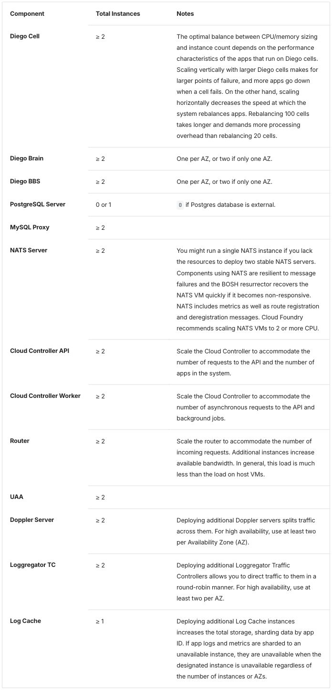

Differences seen, against native and passthrough:

- **The component names are bold**: they are row headers.
- **"Cloud Controller Worker" stays on one line**, so column 1 is 26% and
  the table is 26/25/49. The name fits the 16em cap, so the no-wrap wins
  over the 25% width by one point
  ([Zensical column widths](../concepts/tables/results.md#zensical-0069)).
- Cells aligned to the top and no rule between the columns, as in the other
  two modes.

### Starlight 0.42.6

Starlight is a documentation theme for the Astro site builder
([depends on `astro`](https://github.com/withastro/starlight/blob/67de74077524001c79ec233e1b113e86b2b800b0/packages/starlight/package.json#L51)).
These pages
are Markdoc, Markdown with `` tags, with HTML allowed (see the
[glossary](../glossary.md#markdoc)). Markdoc's `` tag writes each
cell as a list item and each row break as `---`. A partial is a file whose
name starts with `_`; the host includes it with Markdoc's `partial` tag,
and Markdoc wraps it in its own `<article>`
([conventions](../concepts/tables/sites/starlight/CONVENTIONS.md),
"Partials").

<details><summary>Host page: the partial included by Markdoc's partial tag</summary>

```markdown
---
title: Scale table host
---

Host page for the `_oss_scale_table` partial, standing in for
`high-availability.html.md.erb`, which includes it with
an ERB `partial 'oss_scale_table'` call.


```

The host page is the same in every mode.

</details>

<details><summary>Native input: Markdoc's table tag with a width on each header cell</summary>

```markdown

* Component {% width="25%" %}
* Total Instances {% width="25%" %}
* Notes {% width="50%" %}
---
* Diego Cell
* &ge; 2
* The optimal balance between CPU/memory sizing and instance count depends on the performance characteristics of the apps that run on Diego cells. Scaling vertically with larger Diego cells makes for larger points of failure, and more apps go down when a cell fails. On the other hand, scaling horizontally decreases the speed at which the system rebalances apps. Rebalancing 100 cells takes longer and demands more processing overhead than rebalancing 20 cells.
---
* Diego Brain
* &ge; 2
* One per AZ, or two if only one AZ.
---
* Diego BBS
* &ge; 2
* One per AZ, or two if only one AZ.
---
* PostgreSQL Server
* 0 or 1
* `0` if Postgres database is external.
---
* MySQL Proxy
* &ge; 2
* <!-- -->
---
* NATS Server
* &ge; 2
* You might run a single NATS instance if you lack the resources to deploy two stable NATS servers. Components using NATS are resilient to message failures and the BOSH resurrector recovers the NATS VM quickly if it becomes non-responsive. NATS includes metrics as well as route registration and deregistration messages.  recommends scaling NATS VMs to 2 or more CPU.
---
* Cloud Controller API
* &ge; 2
* Scale the Cloud Controller to accommodate the number of requests to the API and the number of apps in the system.
---
* Cloud Controller Worker
* &ge; 2
* Scale the Cloud Controller to accommodate the number of asynchronous requests to the API and background jobs.
---
* Router
* &ge; 2
* Scale the router to accommodate the number of incoming requests. Additional instances increase available bandwidth. In general, this load is much less than the load on host VMs.
---
* UAA
* &ge; 2
* <!-- -->
---
* Doppler Server
* &ge; 2
* Deploying additional Doppler servers splits traffic across them. For high availability, use at least two per Availability Zone (AZ).
---
* Loggregator TC
* &ge; 2
* Deploying additional Loggregator Traffic Controllers allows you to direct traffic to them in a round-robin manner. For high availability, use at least two per AZ.
---
* Log Cache
* &ge; 1
* Deploying additional Log Cache instances increases the total storage, sharding data by app ID. If app logs and metrics are sharded to an unavailable instance, they are unavailable when the designated instance is unavailable regardless of the number of instances or AZs.

```

The two empty Notes cells are written `* <!-- -->`.

</details>

<details><summary>Passthrough input: the HTML with <code>&lt;col /&gt;</code> closed and the class added</summary>

```html
<table class="table">
<col width="25%" />
<col width="25%" />
<col width="50%" />
<thead>
        <tr>
                <th>Component</th>
                <th>Total Instances</th>
                <th>Notes</th>
        </tr>
</thead>
<tbody>
        <tr>
                <td>Diego Cell</td>
                <td>&ge; 2</td>
                <td>The optimal balance between CPU/memory sizing and instance count depends on the performance characteristics of the apps that run on Diego cells. Scaling vertically with larger Diego cells makes for larger points of failure, and more apps go down when a cell fails. On the other hand, scaling horizontally decreases the speed at which the system rebalances apps. Rebalancing 100 cells takes longer and demands more processing overhead than rebalancing 20 cells.</td>
        </tr>
        <tr>
                <td>Diego Brain</td>
                <td>&ge; 2</td>
                <td>One per AZ, or two if only one AZ.</td>
        </tr>
        <tr>
                <td>Diego BBS</td>
                <td>&ge; 2</td>
                <td>One per AZ, or two if only one AZ.</td>
        </tr>
        <tr>
                <td>PostgreSQL Server</td>
                <td>0 or 1</td>
                <td><code>0</code> if Postgres database is external.</td>
        </tr>
        <tr>
                <td>MySQL Proxy</td>
                <td>&ge; 2</td>
                <td></td>
        </tr>
        <tr>
                <td>NATS Server</td>
                <td>&ge; 2</td>
                <td>You might run a single NATS instance if you lack the resources to deploy two stable NATS servers. Components using NATS are resilient to message failures and the BOSH resurrector recovers the NATS VM quickly if it becomes non-responsive. NATS includes metrics as well as route registration and deregistration messages.  recommends scaling NATS VMs to 2 or more CPU.</td>
        </tr>
        <tr>
                <td>Cloud Controller API</td>
                <td>&ge; 2</td>
                <td>Scale the Cloud Controller to accommodate the number of requests to the API and the number of apps in the system.</td>
        </tr>
        <tr>
                <td>Cloud Controller Worker</td>
                <td>&ge; 2</td>
                <td>Scale the Cloud Controller to accommodate the number of asynchronous requests to the API and background jobs.</td>
        </tr>
        <tr>
                <td>Router</td>
                <td>&ge; 2</td>
                <td>Scale the router to accommodate the number of incoming requests. Additional instances increase available bandwidth. In general, this load is much less than the load on host VMs.</td>
        </tr>
        <tr>
                <td>UAA</td>
                <td>&ge; 2</td>
                <td></td>
        </tr>
        <tr>
                <td>Doppler Server</td>
                <td>&ge; 2</td>
                <td>Deploying additional Doppler servers splits traffic across them. For high availability, use at least two per Availability Zone (AZ).</td>
        </tr>
        <tr>
                <td>Loggregator TC</td>
                <td>&ge; 2</td>
                <td>Deploying additional Loggregator Traffic Controllers allows you to direct traffic to them in a round-robin manner. For high availability, use at least two per AZ.</td>
        </tr>
        <tr>
                <td>Log Cache</td>
                <td>&ge; 1</td>
                <td>Deploying additional Log Cache instances increases the total storage, sharding data by app ID. If app logs and metrics are sharded to an unavailable instance, they are unavailable when the designated instance is unavailable regardless of the number of instances or AZs.</td>
        </tr>
</tbody>
</table>
```

</details>

The variable is written `` in every mode.

Files: [native](../concepts/tables/sites/starlight/src/content/docs/native/_oss_scale_table.mdoc),
[native-plain](../concepts/tables/sites/starlight/src/content/docs/native-plain/_oss_scale_table.mdoc),
[passthrough](../concepts/tables/sites/starlight/src/content/docs/passthrough/_oss_scale_table.mdoc),
[passthrough as written](../concepts/tables/sites/starlight/src/content/docs/passthrough-raw/_oss_scale_table.mdoc),
[extension](../concepts/tables/sites/starlight/src/content/docs/extension/_oss_scale_table.mdoc);
[host page](../concepts/tables/sites/starlight/src/content/docs/native/scale-table-host.mdoc).

**Native output:**

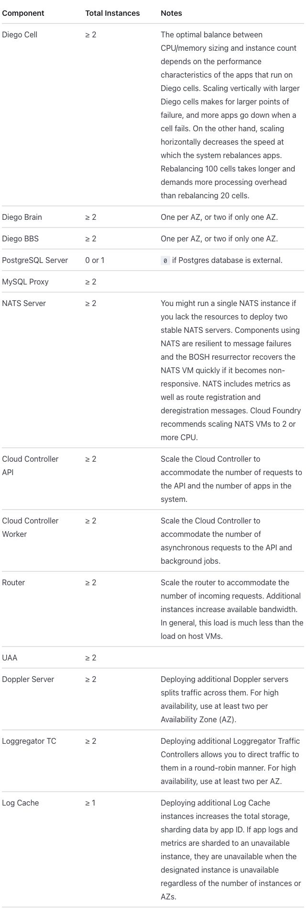

**Passthrough output:**

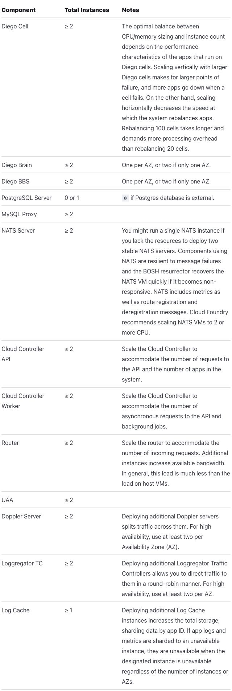

Differences seen:

- **The page builds with the HTML as written.** This table has nothing
  inside its HTML that Markdoc reads as Markdown and changes.
- **The columns are 25/25/50 in both modes.** Native gets them from `width`
  on the header cells. Without them (native-plain, a pipe table), the
  columns are 18/17/65.
- **Passthrough and native look the same.** Compared pixel by pixel, the
  two screenshots match.
- **"Cloud Controller API" and "Cloud Controller Worker" wrap onto two
  lines**; the content column is narrower here (632 pixels). The published
  page wraps only "Cloud Controller Worker".
- **Only horizontal rules:** no rule between the columns and no outer border.
- **Body cells are aligned to the top**; the published page centers them.
- **"non-responsive" breaks after its hyphen** ("non-" / "responsive."),
  where the published page keeps it whole. The text itself is unchanged.
- No row headers.

**Extension mode.** Markdoc's own `` tag with extra attributes,
declared for the site in
[list-table.mjs](../concepts/tables/sites/starlight/list-table.mjs), with
[hints.css](../concepts/tables/sites/starlight/src/styles/hints.css).

<details><summary>Extension input: the table tag with hint attributes</summary>

```markdown

* Component
* Total Instances
* Notes
---
* Diego Cell
* &ge; 2
* The optimal balance between CPU/memory sizing and instance count depends on the performance characteristics of the apps that run on Diego cells. Scaling vertically with larger Diego cells makes for larger points of failure, and more apps go down when a cell fails. On the other hand, scaling horizontally decreases the speed at which the system rebalances apps. Rebalancing 100 cells takes longer and demands more processing overhead than rebalancing 20 cells.
---
* Diego Brain
* &ge; 2
* One per AZ, or two if only one AZ.
---
* Diego BBS
* &ge; 2
* One per AZ, or two if only one AZ.
---
* PostgreSQL Server
* 0 or 1
* `0` if Postgres database is external.
---
* MySQL Proxy
* &ge; 2
* <!-- -->
---
* NATS Server
* &ge; 2
* You might run a single NATS instance if you lack the resources to deploy two stable NATS servers. Components using NATS are resilient to message failures and the BOSH resurrector recovers the NATS VM quickly if it becomes non-responsive. NATS includes metrics as well as route registration and deregistration messages.  recommends scaling NATS VMs to 2 or more CPU.
---
* Cloud Controller API
* &ge; 2
* Scale the Cloud Controller to accommodate the number of requests to the API and the number of apps in the system.
---
* Cloud Controller Worker
* &ge; 2
* Scale the Cloud Controller to accommodate the number of asynchronous requests to the API and background jobs.
---
* Router
* &ge; 2
* Scale the router to accommodate the number of incoming requests. Additional instances increase available bandwidth. In general, this load is much less than the load on host VMs.
---
* UAA
* &ge; 2
* <!-- -->
---
* Doppler Server
* &ge; 2
* Deploying additional Doppler servers splits traffic across them. For high availability, use at least two per Availability Zone (AZ).
---
* Loggregator TC
* &ge; 2
* Deploying additional Loggregator Traffic Controllers allows you to direct traffic to them in a round-robin manner. For high availability, use at least two per AZ.
---
* Log Cache
* &ge; 1
* Deploying additional Log Cache instances increases the total storage, sharding data by app ID. If app logs and metrics are sharded to an unavailable instance, they are unavailable when the designated instance is unavailable regardless of the number of instances or AZs.

```

The attributes mean the same as in the Docusaurus directive.

</details>

**Extension output:**

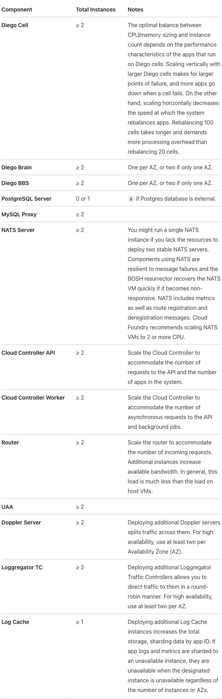

Differences seen, against native and passthrough:

- **The component names are bold**: they are row headers.
- **Column 1 is 31%** (31/24/45). "Cloud Controller Worker" fits the 16em
  cap, so the no-wrap wins over the 25% width, as in Docusaurus
  ([Starlight column widths](../concepts/tables/results.md#starlight-0426)).
  The Notes column is narrower, so the table is taller.
- "non-responsive" still breaks after its hyphen, and so does "round-robin"
  in the Loggregator TC row.

### Antora 3.2.1

Antora builds sites from AsciiDoc, a plain-text markup with its own table
syntax (see the [glossary](../glossary.md#asciidoc)). The whole page is
rewritten from Markdown to AsciiDoc in every mode, including passthrough. In
passthrough the HTML sits inside a passthrough block (`++++`), which
AsciiDoc hands to the browser without reading it. The partial lives in
`modules/ROOT/partials/`, and the host page includes it with `include::`;
its attributes (AsciiDoc's variables) render
([conventions](../concepts/tables/sites/antora/CONVENTIONS.md), "Partials").
On this host page there is no table of contents beside the article, so
tables are 792 pixels wide, against 686 on the other pages
([Antora](../concepts/tables/results.md#antora-321)).

<details><summary>Host page: the partial included with include::</summary>

```asciidoc
= Scale table host

Host page for the `+_oss_scale_table+` partial, standing in for
`high-availability.html.md.erb`, which includes it with
an ERB `partial 'oss_scale_table'` call.

include::partial$_oss_scale_table.adoc[]
```

The host page is the same in every mode.

</details>

<details><summary>Native input: an AsciiDoc table with column specs</summary>

```asciidoc
[%header,cols=".<25%h,.<25%,.<50%"]
|===
|Component |Total Instances |Notes

|Diego Cell
|&ge; 2
|The optimal balance between CPU/memory sizing and instance count depends on the performance characteristics of the apps that run on Diego cells. Scaling vertically with larger Diego cells makes for larger points of failure, and more apps go down when a cell fails. On the other hand, scaling horizontally decreases the speed at which the system rebalances apps. Rebalancing 100 cells takes longer and demands more processing overhead than rebalancing 20 cells.

|Diego Brain
|&ge; 2
|One per AZ, or two if only one AZ.

|Diego BBS
|&ge; 2
|One per AZ, or two if only one AZ.

|PostgreSQL Server
|0 or 1
|`0` if Postgres database is external.

|MySQL Proxy
|&ge; 2
|

|NATS Server
|&ge; 2
|You might run a single NATS instance if you lack the resources to deploy two stable NATS servers. Components using NATS are resilient to message failures and the BOSH resurrector recovers the NATS VM quickly if it becomes non-responsive. NATS includes metrics as well as route registration and deregistration messages. {recommended_by} recommends scaling NATS VMs to 2 or more CPU.

|Cloud Controller API
|&ge; 2
|Scale the Cloud Controller to accommodate the number of requests to the API and the number of apps in the system.

|Cloud Controller Worker
|&ge; 2
|Scale the Cloud Controller to accommodate the number of asynchronous requests to the API and background jobs.

|Router
|&ge; 2
|Scale the router to accommodate the number of incoming requests. Additional instances increase available bandwidth. In general, this load is much less than the load on host VMs.

|UAA
|&ge; 2
|

|Doppler Server
|&ge; 2
|Deploying additional Doppler servers splits traffic across them. For high availability, use at least two per Availability Zone (AZ).

|Loggregator TC
|&ge; 2
|Deploying additional Loggregator Traffic Controllers allows you to direct traffic to them in a round-robin manner. For high availability, use at least two per AZ.

|Log Cache
|&ge; 1
|Deploying additional Log Cache instances increases the total storage, sharding data by app ID. If app logs and metrics are sharded to an unavailable instance, they are unavailable when the designated instance is unavailable regardless of the number of instances or AZs.
|===
```

`%header` makes the first row the header row. In `cols`, `.<` aligns a
column to the top, the percentage is its width, and `h` styles column 1's
cells as headers (row headers). The variable is the attribute `{recommended_by}`.

</details>

<details><summary>Passthrough input: the HTML inside a passthrough block</summary>

```asciidoc
[subs=attributes+]
++++
<table class="table">
<col width="25%" />
<col width="25%" />
<col width="50%" />
<thead>
        <tr>
                <th>Component</th>
                <th>Total Instances</th>
                <th>Notes</th>
        </tr>
</thead>
<tbody>
        <tr>
                <td>Diego Cell</td>
                <td>&ge; 2</td>
                <td>The optimal balance between CPU/memory sizing and instance count depends on the performance characteristics of the apps that run on Diego cells. Scaling vertically with larger Diego cells makes for larger points of failure, and more apps go down when a cell fails. On the other hand, scaling horizontally decreases the speed at which the system rebalances apps. Rebalancing 100 cells takes longer and demands more processing overhead than rebalancing 20 cells.</td>
        </tr>
        <tr>
                <td>Diego Brain</td>
                <td>&ge; 2</td>
                <td>One per AZ, or two if only one AZ.</td>
        </tr>
        <tr>
                <td>Diego BBS</td>
                <td>&ge; 2</td>
                <td>One per AZ, or two if only one AZ.</td>
        </tr>
        <tr>
                <td>PostgreSQL Server</td>
                <td>0 or 1</td>
                <td><code>0</code> if Postgres database is external.</td>
        </tr>
        <tr>
                <td>MySQL Proxy</td>
                <td>&ge; 2</td>
                <td></td>
        </tr>
        <tr>
                <td>NATS Server</td>
                <td>&ge; 2</td>
                <td>You might run a single NATS instance if you lack the resources to deploy two stable NATS servers. Components using NATS are resilient to message failures and the BOSH resurrector recovers the NATS VM quickly if it becomes non-responsive. NATS includes metrics as well as route registration and deregistration messages. {recommended_by} recommends scaling NATS VMs to 2 or more CPU.</td>
        </tr>
        <tr>
                <td>Cloud Controller API</td>
                <td>&ge; 2</td>
                <td>Scale the Cloud Controller to accommodate the number of requests to the API and the number of apps in the system.</td>
        </tr>
        <tr>
                <td>Cloud Controller Worker</td>
                <td>&ge; 2</td>
                <td>Scale the Cloud Controller to accommodate the number of asynchronous requests to the API and background jobs.</td>
        </tr>
        <tr>
                <td>Router</td>
                <td>&ge; 2</td>
                <td>Scale the router to accommodate the number of incoming requests. Additional instances increase available bandwidth. In general, this load is much less than the load on host VMs.</td>
        </tr>
        <tr>
                <td>UAA</td>
                <td>&ge; 2</td>
                <td></td>
        </tr>
        <tr>
                <td>Doppler Server</td>
                <td>&ge; 2</td>
                <td>Deploying additional Doppler servers splits traffic across them. For high availability, use at least two per Availability Zone (AZ).</td>
        </tr>
        <tr>
                <td>Loggregator TC</td>
                <td>&ge; 2</td>
                <td>Deploying additional Loggregator Traffic Controllers allows you to direct traffic to them in a round-robin manner. For high availability, use at least two per AZ.</td>
        </tr>
        <tr>
                <td>Log Cache</td>
                <td>&ge; 1</td>
                <td>Deploying additional Log Cache instances increases the total storage, sharding data by app ID. If app logs and metrics are sharded to an unavailable instance, they are unavailable when the designated instance is unavailable regardless of the number of instances or AZs.</td>
        </tr>
</tbody>
</table>
++++
```

`[subs=attributes+]` lets the attribute `{recommended_by}` render inside the
block, which otherwise gets no substitutions
([Asciidoctor](https://github.com/asciidoctor/asciidoctor/blob/30fb8cd5f7145c57274b04524ceaa99812f830e0/lib/asciidoctor/substitutors.rb#L1294-L1296)).
It is the only addition the HTML needed.

</details>

Files: [native](../concepts/tables/sites/antora/native/modules/ROOT/partials/_oss_scale_table.adoc),
[native-plain](../concepts/tables/sites/antora/native-plain/modules/ROOT/partials/_oss_scale_table.adoc),
[passthrough](../concepts/tables/sites/antora/passthrough/modules/ROOT/partials/_oss_scale_table.adoc),
[passthrough as written](../concepts/tables/sites/antora/passthrough-raw/modules/ROOT/partials/_oss_scale_table.adoc),
[extension](../concepts/tables/sites/antora/extension/modules/ROOT/partials/_oss_scale_table.adoc);
[host page](../concepts/tables/sites/antora/native/modules/ROOT/pages/scale-table-host.adoc).

**Native output:**

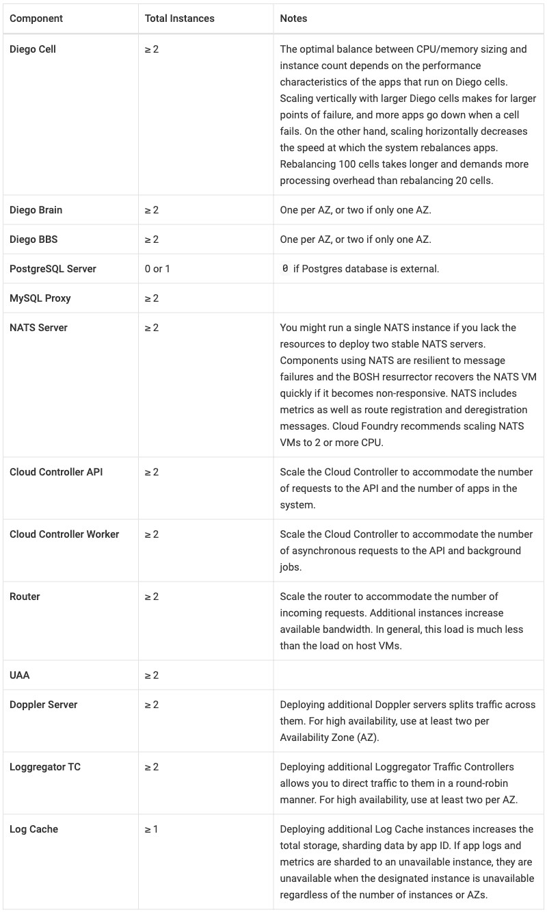

**Passthrough output:**

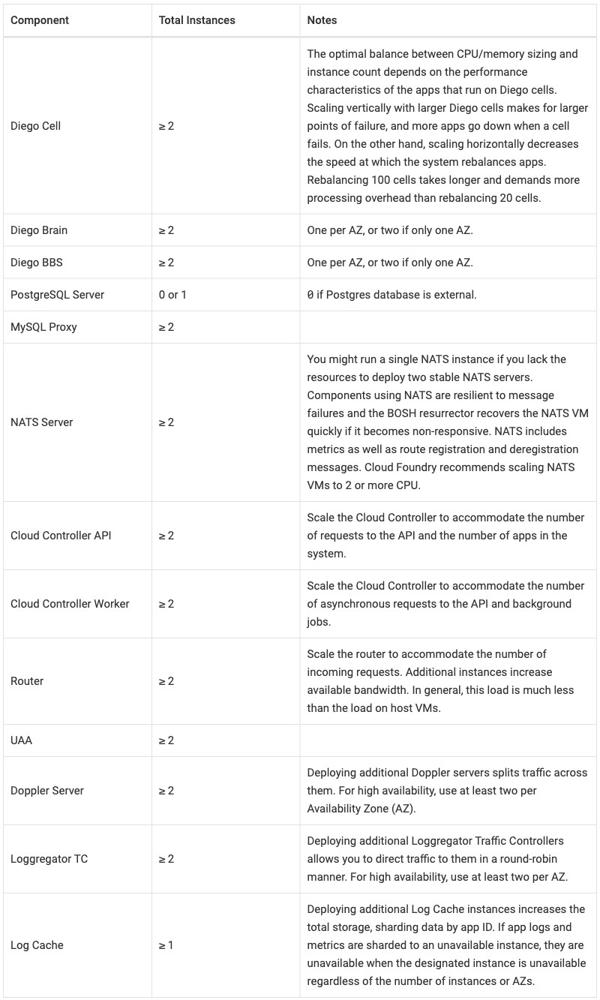

Differences seen:

- **The columns are 25/25/50 in both modes.** Native gets them from `cols`.
  An AsciiDoc table with no `cols` (native-plain) splits the columns
  equally, 33/33/33
  ([screenshot](img/antora-native-plain-scale-table-host-t1.jpg)).
- **"Cloud Controller Worker" fits on one line** at 25%, in both modes,
  because the table is wider here.
- **Native makes the component cells row headers**, drawn in bold, from the
  `h` in `cols`. Passthrough keeps them ordinary cells.
- **Native aligns body cells to the top** (the `.<` specs); passthrough
  centers them vertically, as on the published page.
- Header cells on the left and a rule around every cell, in both modes. As
  in [`credential-types`](#credential-types), the site's stylesheet gives
  `table.table` the look of the native table
  ([R-09](../requirements/README.md#r-09) table styles by class).
- **The source around the table changes.** The host page and the partial's
  prose are AsciiDoc in every mode, not only the table
  ([Antora finding 1](../concepts/tables/results.md#antora-321)).

**Extension mode.** The native AsciiDoc table with *roles* (AsciiDoc's
names for classes, written `[.name]`) added before it. No code: the roles
get their meaning from the site's stylesheet,
[hints.css](../concepts/tables/sites/antora/supplemental-ui/css/hints.css).

<details><summary>Extension input: the AsciiDoc table with roles</summary>

```asciidoc
[.hinted.col1-key.col2-value.col3-prose.col1-nowrap%header,cols=".<25%h,.<25%,.<50%"]
|===
|Component |Total Instances |Notes

|Diego Cell
|&ge; 2
|The optimal balance between CPU/memory sizing and instance count depends on the performance characteristics of the apps that run on Diego cells. Scaling vertically with larger Diego cells makes for larger points of failure, and more apps go down when a cell fails. On the other hand, scaling horizontally decreases the speed at which the system rebalances apps. Rebalancing 100 cells takes longer and demands more processing overhead than rebalancing 20 cells.

|Diego Brain
|&ge; 2
|One per AZ, or two if only one AZ.

|Diego BBS
|&ge; 2
|One per AZ, or two if only one AZ.

|PostgreSQL Server
|0 or 1
|`0` if Postgres database is external.

|MySQL Proxy
|&ge; 2
|

|NATS Server
|&ge; 2
|You might run a single NATS instance if you lack the resources to deploy two stable NATS servers. Components using NATS are resilient to message failures and the BOSH resurrector recovers the NATS VM quickly if it becomes non-responsive. NATS includes metrics as well as route registration and deregistration messages. {recommended_by} recommends scaling NATS VMs to 2 or more CPU.

|Cloud Controller API
|&ge; 2
|Scale the Cloud Controller to accommodate the number of requests to the API and the number of apps in the system.

|Cloud Controller Worker
|&ge; 2
|Scale the Cloud Controller to accommodate the number of asynchronous requests to the API and background jobs.

|Router
|&ge; 2
|Scale the router to accommodate the number of incoming requests. Additional instances increase available bandwidth. In general, this load is much less than the load on host VMs.

|UAA
|&ge; 2
|

|Doppler Server
|&ge; 2
|Deploying additional Doppler servers splits traffic across them. For high availability, use at least two per Availability Zone (AZ).

|Loggregator TC
|&ge; 2
|Deploying additional Loggregator Traffic Controllers allows you to direct traffic to them in a round-robin manner. For high availability, use at least two per AZ.

|Log Cache
|&ge; 1
|Deploying additional Log Cache instances increases the total storage, sharding data by app ID. If app logs and metrics are sharded to an unavailable instance, they are unavailable when the designated instance is unavailable regardless of the number of instances or AZs.
|===
```

`.hinted` marks the table as carrying hints; `.col1-key`, `.col2-value` and
`.col3-prose` name the column roles; `.col1-nowrap` keeps column 1 on one
line, up to a cap. The rest is the native table.

</details>

**Extension output** (the same as native; the two screenshots differ only
by a one-pixel shift in where the table sits on the page):

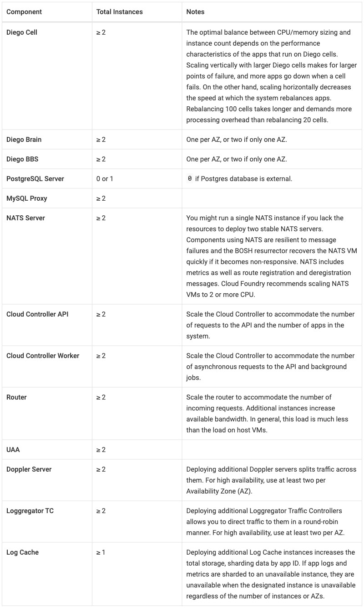

Differences seen:

- **None against native.** Native already has the widths, the row headers
  and the top alignment, and "Cloud Controller Worker" already fits in 25%,
  so the no-wrap role changes nothing
  ([Antora column widths](../concepts/tables/results.md#antora-321)).

### Across the tools

- Every converted table is taller than the published one (1284 pixels in
  the screenshot): 1332 pixels in Antora native, 1418 in Zensical, 1521 in
  Docusaurus native and 1898 in Starlight. Docusaurus passthrough, at
  25/25/50, is 1732: native's wider Notes column takes fewer lines. Each
  theme's cell padding, line height and font size set the height; they
  belong to the template, not to the table
  ([font size](../concepts/tables/results.md#widths-alignment-and-font-size)).
- The width hints survive in passthrough everywhere, and in native wherever
  the tool's own table syntax takes a width: Zensical, Starlight and Antora.
  Without widths, pipe tables size the columns by their content (Docusaurus
  native 18/15/67, Zensical native-plain 17/15/68, Starlight native-plain
  18/17/65) and AsciiDoc makes them equal (Antora native-plain 33/33/33).
- The key column's no-wrap and its 25% width conflict when "Cloud
  Controller Worker" does not fit. Extension mode lets the no-wrap win, up
  to a cap (decided): column 1 grows to 30% in Docusaurus, 31% in Starlight
  and 26% in Zensical, and stays at 25% in Antora, whose table is wider. The
  published page wraps the name, as do the native and passthrough modes of
  Docusaurus, Zensical and Starlight.
- Only Antora native shows row headers. Extension mode adds them in every
  tool, along with top alignment and a key column that does not wrap. Each
  extension is code for the whole site, not for one page.
- Every tool includes the partial from the host page, and the partial's
  variable renders as "Cloud Foundry" in every mode. Zensical, Starlight
  and Antora write the call in one line with the file's name in it;
  Docusaurus writes an import at the top and a component where the table
  goes ([how a partial reads in the source](../concepts/partials/results.md#how-a-partial-reads-in-the-source)).
- Source readability ([R-11](../requirements/README.md#r-11) readable source):
  results.md rates the Docusaurus and Zensical native pipe tables as having
  very long rows, and notes long cells on one line in the Docusaurus,
  Zensical and Starlight extension forms. Starlight native is a Markdoc
  table and Antora's is an AsciiDoc table. Passthrough is HTML in every
  tool.

## `credential-types`

- Published: <https://docs.cloudfoundry.org/credhub/credential-types.html>
  The table on the page: [Credential types](https://docs.cloudfoundry.org/credhub/credential-types.html#cred-types)
- Upstream source: [`credential-types.html.md.erb` in cloudfoundry/docs-credhub, commit `e074f74`](https://github.com/cloudfoundry/docs-credhub/blob/e074f74717422c0082ca24a2a6da7fbbf8114999/credential-types.html.md.erb)
- Snapshot: [source/credential-types.html.md.erb](../concepts/tables/source/credential-types.html.md.erb) in this repo
  is a copy of that file at that commit. The per-tool versions are
  modified from it. Details: [SOURCES.md](../concepts/tables/source/SOURCES.md).

From docs-credhub, one table: Type / Description, seven rows, one per CredHub
credential type ([intent](../concepts/tables/intent/credential-types.md)).

What the table asks for ([R-02](../requirements/README.md#r-02) rich tables):

- Column 1 about 20% wide. The source writes it as `<th style="width:20%">`.
- Column 1 names the type, so it is a *key* column (short identifiers that
  should not wrap) and could be row headers. Column 2 is *prose*.
- The source writes the class with typographic quotes, `class=“table”`.
  Browsers read that as a class named `“table”`, quotes included (a
  typographic quote is not an attribute quote, so the value is an
  [unquoted attribute value](https://html.spec.whatwg.org/multipage/syntax.html#unquoted)),
  so the published page never applied the `table` class. Every conversion makes the
  quotes straight first ([R-24](../requirements/README.md#r-24) markup cleanup before conversion), so
  `class="table"` names the standard table style ([R-09](../requirements/README.md#r-09) table styles by
  class).

At a glance, from the screenshots below. Column 1 widths are the measured
values in [results.md](../concepts/tables/results.md), percent of the table:

| Output | Column 1 width | Header cells | Body cells, vertically | Type cells as row headers | Rule between the columns |
|---|---|---|---|---|---|
| Published | 20% | left | centered | no | yes |
| Docusaurus native | 18%, sized by content | centered | centered | no | yes |
| Docusaurus passthrough | 20% | centered | centered | no | yes |
| Zensical native and passthrough | 20% | left | top | no | no |
| Starlight native and passthrough | 20% | left | top | no | no |
| Antora native | 20% | left | top | yes (bold) | yes |
| Antora passthrough | 20% | left | centered | no | yes |
| Docusaurus extension | 20% | "Type" left, "Description" centered | top | yes (bold) | yes |
| Zensical extension | 20% | left | top | yes (bold) | no |
| Starlight extension | 20% | left | top | yes (bold) | no |
| Antora extension | 20% | left | top | yes (bold) | yes |

All seven rows and both columns are present in every output, and every type
name renders as code: the spot checks (per-table checks listed in the intent
file and run on every build) pass in every mode of every tool.

### Published

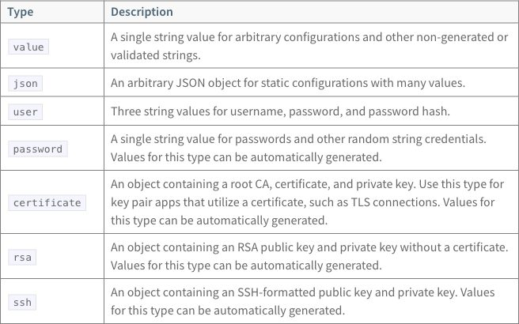

Column 1 is 20% of the table. Header cells are on the left. A type name sits
in the vertical middle of its row when the description takes two or three
lines. Every cell has a border.

<details><summary>Source as written (HTML in an ERB page; note the typographic quotes on the class)</summary>

```html
<table class=“table”>
<thead>
  <tr>
    <th style="width:20%">Type</th>
    <th>Description</th>
  </tr>
  </thead>
  <tr>
    <td><code>value</code></td>
    <td>A single string value for arbitrary configurations and other non-generated or validated strings.</td>
  </tr><tr>
    <td><code>json</code></td>
    <td>An arbitrary JSON object for static configurations with many values.</td>
  </tr><tr>
    <td><code>user</code></td>
    <td>Three string values for username, password, and password hash.</td>
  </tr><tr>
    <td><code>password</code></td>
    <td>A single string value for passwords and other random string credentials. Values for this type can be automatically generated.</td>
  </tr><tr>
    <td><code>certificate</code></td>
    <td>An object containing a root CA, certificate, and private key. Use this type for key pair apps that utilize a certificate, such as TLS connections. Values for this type can be automatically generated.</td>
  </tr><tr>
    <td><code>rsa</code></td>
    <td>An object containing an RSA public key and private key without a certificate. Values for this type can be automatically generated.</td>
  </tr><tr>
    <td><code>ssh</code></td>
    <td>An object containing an SSH-formatted public key and private key. Values for this type can be automatically generated.</td>
  </tr>
</table>
```

</details>

ERB (Embedded Ruby, `<%= … %>` tags in a page; see the
[glossary](../glossary.md#erb)) is how today's pages insert variables and
partials. This table uses neither.

### Docusaurus 3.10.2

Pages are MDX: Markdown that also accepts JSX, the HTML-like syntax of
React components (see the [glossary](../glossary.md#mdx)). MDX parses HTML
as JSX, which is stricter than a browser (the MDX project's own
[documentation](https://github.com/mdx-js/mdx/blob/52285a6758fa078ec57f3d4bd8803d9cbfb12065/docs/docs/what-is-mdx.mdx#L165-L171)).

<details><summary>Native input: a pipe table in MDX</summary>

```markdown
| Type | Description |
| --- | --- |
| `value` | A single string value for arbitrary configurations and other non-generated or validated strings. |
| `json` | An arbitrary JSON object for static configurations with many values. |
| `user` | Three string values for username, password, and password hash. |
| `password` | A single string value for passwords and other random string credentials. Values for this type can be automatically generated. |
| `certificate` | An object containing a root CA, certificate, and private key. Use this type for key pair apps that utilize a certificate, such as TLS connections. Values for this type can be automatically generated. |
| `rsa` | An object containing an RSA public key and private key without a certificate. Values for this type can be automatically generated. |
| `ssh` | An object containing an SSH-formatted public key and private key. Values for this type can be automatically generated. |
```

</details>

<details><summary>Passthrough input: the HTML written as JSX (style object, added tbody)</summary>

```jsx
<table class="table">
<thead>
  <tr>
    <th style={{width: '20%'}}>Type</th>
    <th>Description</th>
  </tr>
  </thead>
  <tbody>
<tr>
    <td><code>value</code></td>
    <td>A single string value for arbitrary configurations and other non-generated or validated strings.</td>
  </tr><tr>
    <td><code>json</code></td>
    <td>An arbitrary JSON object for static configurations with many values.</td>
  </tr><tr>
    <td><code>user</code></td>
    <td>Three string values for username, password, and password hash.</td>
  </tr><tr>
    <td><code>password</code></td>
    <td>A single string value for passwords and other random string credentials. Values for this type can be automatically generated.</td>
  </tr><tr>
    <td><code>certificate</code></td>
    <td>An object containing a root CA, certificate, and private key. Use this type for key pair apps that utilize a certificate, such as TLS connections. Values for this type can be automatically generated.</td>
  </tr><tr>
    <td><code>rsa</code></td>
    <td>An object containing an RSA public key and private key without a certificate. Values for this type can be automatically generated.</td>
  </tr><tr>
    <td><code>ssh</code></td>
    <td>An object containing an SSH-formatted public key and private key. Values for this type can be automatically generated.</td>
  </tr>
</tbody>

</table>
```

</details>

Files: [native](../concepts/tables/sites/docusaurus/docs/native/credential-types.mdx),
[passthrough](../concepts/tables/sites/docusaurus/docs/passthrough/credential-types.mdx),
[passthrough as written](../concepts/tables/sites/docusaurus/docs/passthrough-raw/credential-types.mdx),
[extension](../concepts/tables/sites/docusaurus/docs/extension/credential-types.mdx).
Docusaurus has no native-plain page: its native page already has no width
settings.

**Native output:**

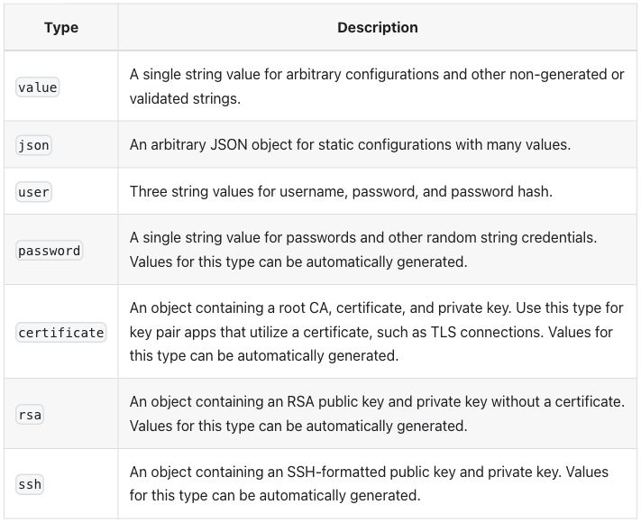

**Passthrough output:**

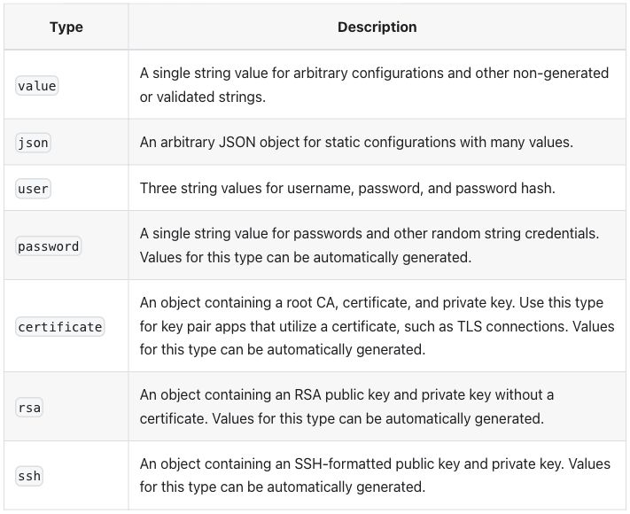

Differences seen:

- **The page does not build with the HTML as written.** MDX stops at the
  `“` before the class value. Passthrough also needed `style` written as a
  JSX object (`style={{width: '20%'}}`) and the rows wrapped in `<tbody>`
  ([R-24](../requirements/README.md#r-24) markup cleanup before conversion;
  [raw passthrough errors](../concepts/tables/results.md#raw-passthrough-errors)).
- **Native has no column width.** A pipe table (a Markdown table written with
  `|` between cells; see the [glossary](../glossary.md#pipe-table)) carries
  no widths, so column 1 is sized by its content, 18% here. Passthrough keeps
  the 20%. Without the 20%, passthrough and extension also size column 1
  by its content, to the same 18%
  ([checked after review](../concepts/tables/results.md#widths-alignment-and-font-size)).
- **Header cells are centered**, in both modes; the published page has them
  on the left. The theme sets no alignment, so the browser's default shows.
  Colons in the delimiter row (`| :--- | :--- |`) align a pipe table's
  columns, and one rule in the site's stylesheet aligns every table
  ([checked after review](../concepts/tables/results.md#widths-alignment-and-font-size)).
- **Alternate body rows are shaded** (`json`, `password`, `rsa`), in both
  modes. The published table has no shading.
- Body cells are vertically centered, as on the published page. No row
  headers in either mode.

Both modes use no plugin: native is MDX's own pipe table, passthrough is
HTML written as JSX inside MDX.

**Extension mode.** A `:::list-table` block, read by a remark plugin
(remark is the Markdown parser under MDX:
[`@mdx-js/mdx` dependencies](https://github.com/mdx-js/mdx/blob/52285a6758fa078ec57f3d4bd8803d9cbfb12065/packages/mdx/package.json#L62-L64)) added to the site:
[plugins/list-table.js](../concepts/tables/sites/docusaurus/plugins/list-table.js),
with [hints.css](../concepts/tables/sites/docusaurus/src/css/hints.css).

<details><summary>Extension input: a list-table directive</summary>

```markdown
:::list-table{widths="20 auto" header-rows="1" stub-columns="1" roles="key prose"}
- - Type
  - Description
- - `value`
  - A single string value for arbitrary configurations and other non-generated or validated strings.
- - `json`
  - An arbitrary JSON object for static configurations with many values.
- - `user`
  - Three string values for username, password, and password hash.
- - `password`
  - A single string value for passwords and other random string credentials. Values for this type can be automatically generated.
- - `certificate`
  - An object containing a root CA, certificate, and private key. Use this type for key pair apps that utilize a certificate, such as TLS connections. Values for this type can be automatically generated.
- - `rsa`
  - An object containing an RSA public key and private key without a certificate. Values for this type can be automatically generated.
- - `ssh`
  - An object containing an SSH-formatted public key and private key. Values for this type can be automatically generated.
:::
```

`widths` sets column 1 to 20% and sizes column 2 by its content,
`header-rows="1"` makes the first row the header, `stub-columns="1"` makes
column 1 row headers, and `roles` names column 1 a key column and column 2
prose.

</details>

**Extension output:**

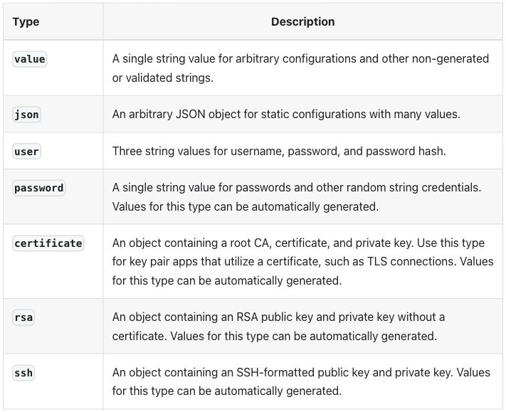

Differences seen, against the published page and the other two modes:

- **Column 1 is 20%**, as in passthrough.
- **The type cells are row headers**, drawn in bold.
- **Body cells are aligned to the top**; native, passthrough and the
  published page center them.
- **The "Type" header is on the left and "Description" is centered**, so the
  two header cells no longer match. The reason has not been looked into.
- Alternate body rows are still shaded, as in the other two modes.

### Zensical 0.0.69

Pages are Markdown read by Python-Markdown, which passes HTML blocks through
unchanged (see the [glossary](../glossary.md#python-markdown);
[HTML block stash](https://github.com/Python-Markdown/markdown/blob/0bf535bc406c95dad66050f07c8402af03fe07d5/markdown/preprocessors.py#L78-L84)
in Python-Markdown's source). An
*attribute list*, `{: … }` after a cell's text, sets HTML attributes on that
cell
([`attr_list.py`](https://github.com/Python-Markdown/markdown/blob/0bf535bc406c95dad66050f07c8402af03fe07d5/markdown/extensions/attr_list.py#L104-L110)).

<details><summary>Native input: a pipe table with a width on the header cell</summary>

```markdown
| Type {: style="width:20%" } | Description |
| --- | --- |
| `value` | A single string value for arbitrary configurations and other non-generated or validated strings. |
| `json` | An arbitrary JSON object for static configurations with many values. |
| `user` | Three string values for username, password, and password hash. |
| `password` | A single string value for passwords and other random string credentials. Values for this type can be automatically generated. |
| `certificate` | An object containing a root CA, certificate, and private key. Use this type for key pair apps that utilize a certificate, such as TLS connections. Values for this type can be automatically generated. |
| `rsa` | An object containing an RSA public key and private key without a certificate. Values for this type can be automatically generated. |
| `ssh` | An object containing an SSH-formatted public key and private key. Values for this type can be automatically generated. |
```

</details>

<details><summary>Passthrough input: the HTML as written, quotes made straight</summary>

```html
<table class="table">
<thead>
  <tr>
    <th style="width:20%">Type</th>
    <th>Description</th>
  </tr>
  </thead>
  <tr>
    <td><code>value</code></td>
    <td>A single string value for arbitrary configurations and other non-generated or validated strings.</td>
  </tr><tr>
    <td><code>json</code></td>
    <td>An arbitrary JSON object for static configurations with many values.</td>
  </tr><tr>
    <td><code>user</code></td>
    <td>Three string values for username, password, and password hash.</td>
  </tr><tr>
    <td><code>password</code></td>
    <td>A single string value for passwords and other random string credentials. Values for this type can be automatically generated.</td>
  </tr><tr>
    <td><code>certificate</code></td>
    <td>An object containing a root CA, certificate, and private key. Use this type for key pair apps that utilize a certificate, such as TLS connections. Values for this type can be automatically generated.</td>
  </tr><tr>
    <td><code>rsa</code></td>
    <td>An object containing an RSA public key and private key without a certificate. Values for this type can be automatically generated.</td>
  </tr><tr>
    <td><code>ssh</code></td>
    <td>An object containing an SSH-formatted public key and private key. Values for this type can be automatically generated.</td>
  </tr>
</table>
```

</details>

Files: [native](../concepts/tables/sites/zensical/docs/native/credential-types.md),
[native-plain](../concepts/tables/sites/zensical/docs/native-plain/credential-types.md),
[passthrough](../concepts/tables/sites/zensical/docs/passthrough/credential-types.md),
[passthrough as written](../concepts/tables/sites/zensical/docs/passthrough-raw/credential-types.md),
[extension](../concepts/tables/sites/zensical/docs/extension/credential-types.md).

**Native and passthrough output** (the two screenshots are the same image,
byte for byte):

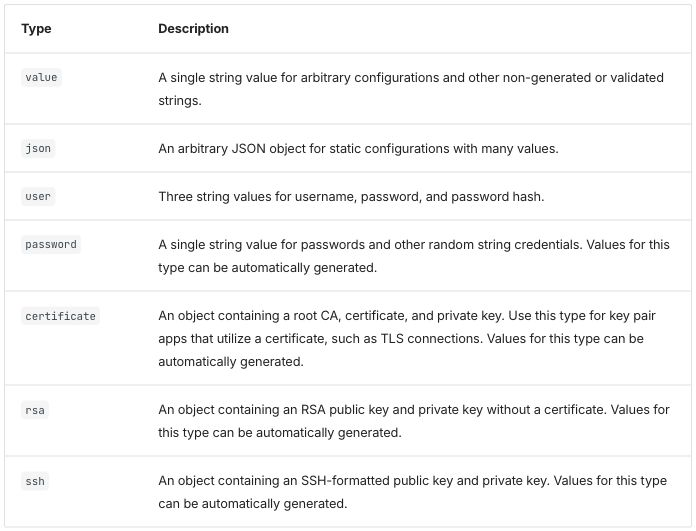

Differences seen:

- **The page builds with the HTML as written.** The only change is the
  straight quotes from the intent file.
- **Column 1 is 20% in both modes.** Native gets it from the attribute on the
  header cell. Without it (native-plain), column 1 is 15%.
- **No rule between the columns.** Rows are separated by horizontal rules
  inside a thin outer frame.
- **Body cells are aligned to the top**; the published page centers them.
- No row headers. The default theme styles only tables without a class, so
  the site's stylesheet gives `table.table` the theme's table look
  ([Zensical finding 1](../concepts/tables/results.md#zensical-0069)); that is
  why the two modes look the same.

**Extension mode.** A `/// list-table` block, read by a Python-Markdown
extension added to the site,
[list_table.py](../concepts/tables/sites/zensical/list_table.py), with
[hints.css](../concepts/tables/sites/zensical/docs/stylesheets/hints.css).

<details><summary>Extension input: a list-table block</summary>

```markdown
/// list-table
    widths: 20 auto
    header-rows: 1
    stub-columns: 1
    roles: key prose

-   - Type
    - Description

-   - `value`
    - A single string value for arbitrary configurations and other non-generated or validated strings.

-   - `json`
    - An arbitrary JSON object for static configurations with many values.

-   - `user`
    - Three string values for username, password, and password hash.

-   - `password`
    - A single string value for passwords and other random string credentials. Values for this type can be automatically generated.

-   - `certificate`
    - An object containing a root CA, certificate, and private key. Use this type for key pair apps that utilize a certificate, such as TLS connections. Values for this type can be automatically generated.

-   - `rsa`
    - An object containing an RSA public key and private key without a certificate. Values for this type can be automatically generated.

-   - `ssh`
    - An object containing an SSH-formatted public key and private key. Values for this type can be automatically generated.
///
```

The options mean the same as in the Docusaurus directive: column 1 at 20%,
a header row, column 1 as row headers, and the column roles.

</details>

**Extension output:**

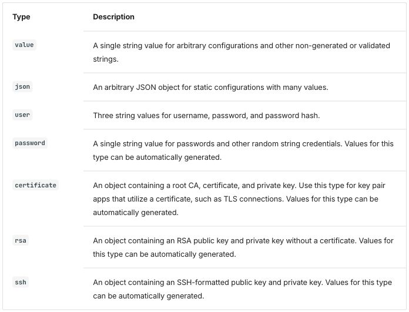

Differences seen, against native and passthrough:

- **The type names are bold**: they are row headers. Compared pixel by
  pixel with the native screenshot, only the type column differs.
- Column 1 at 20%, cells aligned to the top and no rule between the
  columns, as in the other two modes.

### Starlight 0.42.6

Starlight is a documentation theme for the Astro site builder
([depends on `astro`](https://github.com/withastro/starlight/blob/67de74077524001c79ec233e1b113e86b2b800b0/packages/starlight/package.json#L51)).
These pages are Markdoc, Markdown with `` tags, with HTML allowed (see the
[glossary](../glossary.md#markdoc)). Markdoc's `` tag writes each
cell as a list item and each row break as `---`
([table transform](https://github.com/markdoc/markdoc/blob/df5ac9aae57505eae5e7572aab3dda50d61f434c/src/transforms/table.ts#L41-L86)).

<details><summary>Native input: Markdoc's table tag with a width on the header cell</summary>

```markdown

* Type {% width="20%" %}
* Description
---
* `value`
* A single string value for arbitrary configurations and other non-generated or validated strings.
---
* `json`
* An arbitrary JSON object for static configurations with many values.
---
* `user`
* Three string values for username, password, and password hash.
---
* `password`
* A single string value for passwords and other random string credentials. Values for this type can be automatically generated.
---
* `certificate`
* An object containing a root CA, certificate, and private key. Use this type for key pair apps that utilize a certificate, such as TLS connections. Values for this type can be automatically generated.
---
* `rsa`
* An object containing an RSA public key and private key without a certificate. Values for this type can be automatically generated.
---
* `ssh`
* An object containing an SSH-formatted public key and private key. Values for this type can be automatically generated.

```

</details>

<details><summary>Passthrough input: the HTML as written, quotes made straight</summary>

```html
<table class="table">
<thead>
  <tr>
    <th style="width:20%">Type</th>
    <th>Description</th>
  </tr>
  </thead>
  <tr>
    <td><code>value</code></td>
    <td>A single string value for arbitrary configurations and other non-generated or validated strings.</td>
  </tr><tr>
    <td><code>json</code></td>
    <td>An arbitrary JSON object for static configurations with many values.</td>
  </tr><tr>
    <td><code>user</code></td>
    <td>Three string values for username, password, and password hash.</td>
  </tr><tr>
    <td><code>password</code></td>
    <td>A single string value for passwords and other random string credentials. Values for this type can be automatically generated.</td>
  </tr><tr>
    <td><code>certificate</code></td>
    <td>An object containing a root CA, certificate, and private key. Use this type for key pair apps that utilize a certificate, such as TLS connections. Values for this type can be automatically generated.</td>
  </tr><tr>
    <td><code>rsa</code></td>
    <td>An object containing an RSA public key and private key without a certificate. Values for this type can be automatically generated.</td>
  </tr><tr>
    <td><code>ssh</code></td>
    <td>An object containing an SSH-formatted public key and private key. Values for this type can be automatically generated.</td>
  </tr>
</table>
```

</details>

Files: [native](../concepts/tables/sites/starlight/src/content/docs/native/credential-types.mdoc),
[native-plain](../concepts/tables/sites/starlight/src/content/docs/native-plain/credential-types.mdoc),
[passthrough](../concepts/tables/sites/starlight/src/content/docs/passthrough/credential-types.mdoc),
[passthrough as written](../concepts/tables/sites/starlight/src/content/docs/passthrough-raw/credential-types.mdoc),
[extension](../concepts/tables/sites/starlight/src/content/docs/extension/credential-types.mdoc).

**Native and passthrough output** (the two screenshots are the same image,
byte for byte):

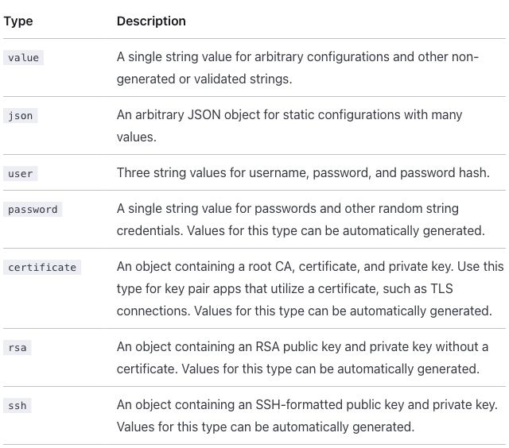

Differences seen:

- **The page builds with the HTML as written.** On other pages Markdoc reads
  the text inside HTML as Markdown and changes it; this table has nothing it
  changes, so the only edit is the straight quotes.
- **Column 1 is 20% in both modes.** Native gets it from `width` on the
  header cell. Without it (native-plain, a pipe table), column 1 is 18%.
- **Only horizontal rules:** no rule between the columns and no outer border.
- **Body cells are aligned to the top**; the published page centers them.
- **"non-generated" breaks after its hyphen**, at the end of the first line
  ("other non-" / "generated or validated strings."). The content column is
  narrower here (632 pixels), so the line ends at a different place than on
  the published page, which keeps "non-generated" whole. The text itself is
  unchanged.
- No row headers.

**Extension mode.** Markdoc's own `` tag with extra attributes,
declared for the site in
[list-table.mjs](../concepts/tables/sites/starlight/list-table.mjs), with
[hints.css](../concepts/tables/sites/starlight/src/styles/hints.css).

<details><summary>Extension input: the table tag with hint attributes</summary>

```markdown

* Type
* Description
---
* `value`
* A single string value for arbitrary configurations and other non-generated or validated strings.
---
* `json`
* An arbitrary JSON object for static configurations with many values.
---
* `user`
* Three string values for username, password, and password hash.
---
* `password`
* A single string value for passwords and other random string credentials. Values for this type can be automatically generated.
---
* `certificate`
* An object containing a root CA, certificate, and private key. Use this type for key pair apps that utilize a certificate, such as TLS connections. Values for this type can be automatically generated.
---
* `rsa`
* An object containing an RSA public key and private key without a certificate. Values for this type can be automatically generated.
---
* `ssh`
* An object containing an SSH-formatted public key and private key. Values for this type can be automatically generated.

```

The attributes mean the same as in the Docusaurus directive: column 1 at
20%, a header row, column 1 as row headers, and the column roles.

</details>

**Extension output:**


Differences seen, against native and passthrough:

- **The type names are bold**: they are row headers. Compared pixel by
  pixel with the native screenshot, only the type column differs.
- Everything else is as in the other two modes, including "non-generated"
  breaking after its hyphen.

### Antora 3.2.1

Antora builds sites from AsciiDoc, a plain-text markup with its own table
syntax (see the [glossary](../glossary.md#asciidoc)). The whole page is
rewritten from Markdown to AsciiDoc in every mode, including passthrough. In
passthrough the HTML sits unchanged inside a passthrough block (`++++`),
which AsciiDoc hands to the browser without reading it (Asciidoctor:
[raw block](https://github.com/asciidoctor/asciidoctor/blob/30fb8cd5f7145c57274b04524ceaa99812f830e0/lib/asciidoctor/block.rb#L21),
[no substitutions](https://github.com/asciidoctor/asciidoctor/blob/30fb8cd5f7145c57274b04524ceaa99812f830e0/lib/asciidoctor/substitutors.rb#L1294-L1296)).

<details><summary>Native input: an AsciiDoc table with column specs</summary>

```asciidoc
[%header,cols=".<20%h,.<~"]
|===
|Type |Description

|`value`
|A single string value for arbitrary configurations and other non-generated or validated strings.

|`json`
|An arbitrary JSON object for static configurations with many values.

|`user`
|Three string values for username, password, and password hash.

|`password`
|A single string value for passwords and other random string credentials. Values for this type can be automatically generated.

|`certificate`
|An object containing a root CA, certificate, and private key. Use this type for key pair apps that utilize a certificate, such as TLS connections. Values for this type can be automatically generated.

|`rsa`
|An object containing an RSA public key and private key without a certificate. Values for this type can be automatically generated.

|`ssh`
|An object containing an SSH-formatted public key and private key. Values for this type can be automatically generated.
|===
```

`%header` makes the first row the header row. In `cols`, each column gets a
spec: `.<` aligns it to the top, `20%` is the width, `h` styles its cells as
headers (row headers), and `~` sizes the second column by its content
(Asciidoctor:
[`cols` parsing](https://github.com/asciidoctor/asciidoctor/blob/30fb8cd5f7145c57274b04524ceaa99812f830e0/lib/asciidoctor/parser.rb#L2469-L2513),
[`<` and `h`](https://github.com/asciidoctor/asciidoctor/blob/30fb8cd5f7145c57274b04524ceaa99812f830e0/lib/asciidoctor/parser.rb#L63-L79)).

</details>

<details><summary>Passthrough input: the HTML inside a passthrough block</summary>

```asciidoc
++++
<table class="table">
<thead>
  <tr>
    <th style="width:20%">Type</th>
    <th>Description</th>
  </tr>
  </thead>
  <tr>
    <td><code>value</code></td>
    <td>A single string value for arbitrary configurations and other non-generated or validated strings.</td>
  </tr><tr>
    <td><code>json</code></td>
    <td>An arbitrary JSON object for static configurations with many values.</td>
  </tr><tr>
    <td><code>user</code></td>
    <td>Three string values for username, password, and password hash.</td>
  </tr><tr>
    <td><code>password</code></td>
    <td>A single string value for passwords and other random string credentials. Values for this type can be automatically generated.</td>
  </tr><tr>
    <td><code>certificate</code></td>
    <td>An object containing a root CA, certificate, and private key. Use this type for key pair apps that utilize a certificate, such as TLS connections. Values for this type can be automatically generated.</td>
  </tr><tr>
    <td><code>rsa</code></td>
    <td>An object containing an RSA public key and private key without a certificate. Values for this type can be automatically generated.</td>
  </tr><tr>
    <td><code>ssh</code></td>
    <td>An object containing an SSH-formatted public key and private key. Values for this type can be automatically generated.</td>
  </tr>
</table>
++++
```

</details>

Files: [native](../concepts/tables/sites/antora/native/modules/ROOT/pages/credential-types.adoc),
[native-plain](../concepts/tables/sites/antora/native-plain/modules/ROOT/pages/credential-types.adoc),
[passthrough](../concepts/tables/sites/antora/passthrough/modules/ROOT/pages/credential-types.adoc),
[passthrough as written](../concepts/tables/sites/antora/passthrough-raw/modules/ROOT/pages/credential-types.adoc),
[extension](../concepts/tables/sites/antora/extension/modules/ROOT/pages/credential-types.adoc).

**Native output:**


**Passthrough output:**

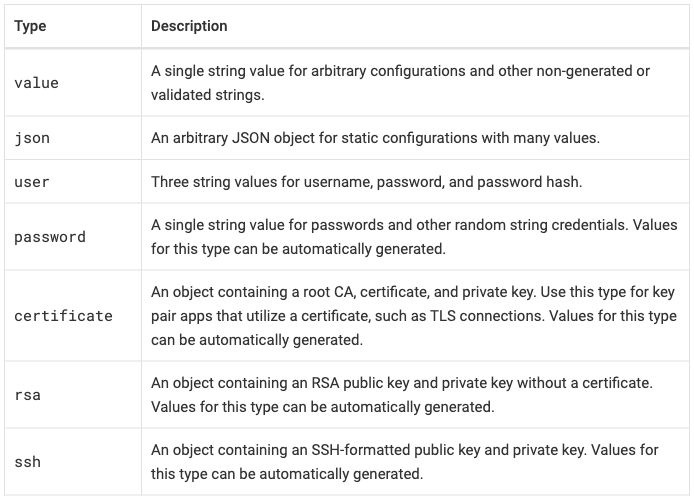

Differences seen:

- **Column 1 is 20% in both modes.** Native gets it from `cols`. An AsciiDoc
  table with no `cols` (native-plain) splits the columns equally, 50/50
  ([`assign_column_widths`](https://github.com/asciidoctor/asciidoctor/blob/30fb8cd5f7145c57274b04524ceaa99812f830e0/lib/asciidoctor/table.rb#L142-L145);
  [screenshot](../concepts/tables/results/antora-credential-types-t1-native-plain-equal-widths.png)).
- **Native makes the type cells row headers**, drawn in bold, from the `h`
  in `cols`. It is the only native syntax here that does so without an
  extension. Passthrough keeps them ordinary cells.
- **Native aligns body cells to the top** (the `.<` specs); passthrough
  centers them vertically, as on the published page.
- Header cells on the left and a rule around every cell, in both modes. The
  default UI (Antora's theme) styles only AsciiDoc tables, so an HTML table
  would have no borders and centered headers
  ([screenshot](../concepts/tables/results/antora-credential-types-t1-passthrough-unstyled.png));
  the site's stylesheet gives `table.table` the same look as the native
  table ([R-09](../requirements/README.md#r-09) table styles by class).
- **The source around the table changes.** The page's prose and code
  blocks are AsciiDoc in every mode, not only the table
  ([Antora finding 1](../concepts/tables/results.md#antora-321)).

**Extension mode.** The native AsciiDoc table with *roles* (AsciiDoc's
names for classes, written `[.name]`;
[shorthand parsing](https://github.com/asciidoctor/asciidoctor/blob/30fb8cd5f7145c57274b04524ceaa99812f830e0/lib/asciidoctor/parser.rb#L2605-L2616))
added before it. No code: the roles
get their meaning from the site's stylesheet,
[hints.css](../concepts/tables/sites/antora/supplemental-ui/css/hints.css).

<details><summary>Extension input: the AsciiDoc table with roles</summary>

```asciidoc
[.hinted.col1-key.col2-prose.col1-nowrap%header,cols=".<20%h,.<~"]
|===
|Type |Description

|`value`
|A single string value for arbitrary configurations and other non-generated or validated strings.

|`json`
|An arbitrary JSON object for static configurations with many values.

|`user`
|Three string values for username, password, and password hash.

|`password`
|A single string value for passwords and other random string credentials. Values for this type can be automatically generated.

|`certificate`
|An object containing a root CA, certificate, and private key. Use this type for key pair apps that utilize a certificate, such as TLS connections. Values for this type can be automatically generated.

|`rsa`
|An object containing an RSA public key and private key without a certificate. Values for this type can be automatically generated.

|`ssh`
|An object containing an SSH-formatted public key and private key. Values for this type can be automatically generated.
|===
```

`.hinted` marks the table as carrying hints; `.col1-key` and `.col2-prose`
name the column roles; `.col1-nowrap` keeps column 1 on one line, up to a
cap. The rest is the native table.

</details>

**Extension output:**

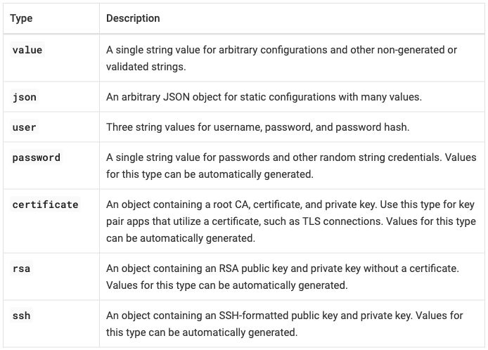

Differences seen:

- **None against native.** The two screenshots differ only by
  image-compression noise. Native already has the width, the row headers
  and the top alignment; the no-wrap role changes nothing here because no
  type name wraps in native either.

### Across the tools

- Every converted table is taller than the published one (410 pixels in the
  screenshot): 498 pixels in Antora, 531 in Zensical, 564 in Starlight, 580
  in Docusaurus. Each theme's cell padding, line height and font size set
  that; they belong to the template, not to the table. Table text is
  smaller than body text in Zensical (12.8 against 15 pixels) and Antora
  (15 against 17), and the same size in Docusaurus and Starlight. A
  smaller font narrows a column sized by its content, not one given a
  fixed width
  ([font size](../concepts/tables/results.md#widths-alignment-and-font-size)).
- These are default themes. A site's or a page's theme can set table font
  size, padding and alignment, so the widths and heights here are not
  limits of the tools.
- Pipe tables can align each column left, center or right with colons in
  the delimiter row, the GitHub Flavored Markdown form, in Docusaurus,
  Zensical and Starlight. Antora's AsciiDoc does the same in `cols`.
- The width hint survives in passthrough everywhere, and in native wherever
  the tool's own table syntax takes a width: Zensical, Starlight and Antora.
  Docusaurus native, a pipe table, has none.
- Only Antora native shows row headers. Extension mode adds them in every
  tool, along with top alignment and a key column that does not wrap. In
  Zensical and Starlight the bold row headers are the only visible change
  from native; in Antora nothing visible changes. Each extension is code
  for the whole site, not for one page.
- Source readability ([R-11](../requirements/README.md#r-11) readable source): results.md rates every native
  form of this table readable. Passthrough is HTML in every tool.

## `metadata`

- Published: <https://docs.cloudfoundry.org/adminguide/metadata.html>
  Tables on the page: [Requirements for labels](https://docs.cloudfoundry.org/adminguide/metadata.html#reqs-labels), [Requirements for annotations](https://docs.cloudfoundry.org/adminguide/metadata.html#reqs-annotations), [Selector requirement reference](https://docs.cloudfoundry.org/adminguide/metadata.html#requirements-reference)
- Upstream source: [`metadata.html.md.erb` in cloudfoundry/docs-cf-admin, commit `19b0c9c`](https://github.com/cloudfoundry/docs-cf-admin/blob/19b0c9c5fabd93b33ba184c6eb541f3cafd3a1b9/metadata.html.md.erb)
- Snapshot: [source/metadata.html.md.erb](../concepts/tables/source/metadata.html.md.erb) in this repo
  is a copy of that file at that commit. The per-tool versions are
  modified from it. Details: [SOURCES.md](../concepts/tables/source/SOURCES.md).

From docs-cf-admin, three tables: label requirements and annotation
requirements (HTML, with a title row spanning all four columns and lists
inside cells), and a selector reference that is already a Markdown table.
The published page shows stray backslashes in `\[a-z0-9A-Z\]`; every
conversion removes them (a decided fix). Every converted mode except
passthrough shows the title as a bold line above the table.

What the tables ask for ([R-02](../requirements/README.md#r-02) rich tables):

- **Tables 1 and 2** (label and annotation requirements) have the same shape.
  - A title row comes first: one header cell spanning all four columns,
    centered ("Label requirements", "Annotation Requirements"). The column
    headers follow in a plain `<tr>` after `</thead>`.
  - Column 1 names the part of the label or annotation, so it is a *key*
    column and could be row headers. Column 2 is a *value* column of
    lengths such as `0-253`, which should not break at the hyphen. Columns
    3 and 4 are *prose*, and hold lists.
  - No widths in the source; the column roles decide them
    ([R-03](../requirements/README.md#r-03) column widths as hints).
  - Cleanup from the intent file ([R-24](../requirements/README.md#r-24)
    markup cleanup before conversion): in row 1, the column 3 `<td>` is
    never closed. Browsers close it when the next `<td>` opens, so the
    published page is correct; strict parsers fail or nest the cell. The
    column headers move into `<thead>`. The backslashes in
    `\[a-z0-9A-Z\]` are Markdown escapes, but Markdown is not processed
    inside this HTML, so the published page shows them; every conversion
    removes them (a decided fix).
  - The title was first decided as a spanning row, not a caption. After the
    Starlight round it became a bold line above the table in every
    converted mode of every tool, because Markdown tables have one header
    row (decided; [Starlight finding 4](../concepts/tables/results.md#starlight-0426)).
    Passthrough keeps the source's spanning row.
- **Table 3** (selector requirement reference) is already a pipe table in
  the source (a Markdown table written with `|` between cells): column 1 a
  key, column 2 a value in code, column 3 prose. Code in column 2 should not
  break inside `KEY in (VALUE1,VALUE2...)` if avoidable. No cleanup.

At a glance, from the screenshots below, for tables 1 and 2. Key column
widths are the measured values in
[results.md](../concepts/tables/results.md), percent of table 1, first body
row; a dash means not measured:

| Output | Title | Key column width | Header cells | Body cells, vertically | Key cells as row headers | "(Optional) Key Prefix" on one line | Rule between the columns |
|---|---|---|---|---|---|---|---|
| Published | spanning row, centered | — | left | centered | no | no | yes |
| Docusaurus native | bold line above | — | centered | centered | no | no | yes |
| Docusaurus passthrough | spanning row, centered | — | centered | centered | no | no | yes |
| Zensical native | bold line above | 18% | left | top | no | no | no |
| Zensical passthrough | spanning row, centered | 16% | left | top | no | no | no |
| Starlight native | bold line above | 16% | left | top | no | no | no |
| Starlight passthrough | spanning row, centered | 16% | left | top | no | no | no |
| Antora native | bold line above | 17% | left | top | yes (bold) | no | yes |
| Antora passthrough | spanning row, centered | 16% | left | centered | no | no | yes |
| Docusaurus extension | bold line above | 26% | "Part of …" left, the rest centered | top | yes (bold) | yes | yes |
| Zensical extension | bold line above | 23% | left | top | yes (bold) | yes | no |
| Starlight extension | bold line above | 27% | left | top | yes (bold) | yes | no |
| Antora extension | bold line above | 23% | left | top | yes (bold) | yes | yes |

Table 3 follows the same pattern, with two exceptions in Antora: native
makes the requirement names row headers too, and passthrough draws the
table as AsciiDoc, with its cells aligned to the top.

Every row, cell and list item is present in every output, the
one-character code spans (`-`, `.`, `_`, `/`) render as code, and the
backslashes are gone in every converted mode: the table spot checks (listed
in the intent file and run on every build) pass in every mode of every tool.
In Docusaurus the page's description check fails, in every mode: the
description is taken from the first paragraph, which holds a variable
([Docusaurus finding 7](../concepts/tables/results.md#docusaurus-3102)).

- Intent and spot checks: [intent/metadata.md](../concepts/tables/intent/metadata.md)
- Results per tool: [Docusaurus](../concepts/tables/results.md#docusaurus-3102),
  [Zensical](../concepts/tables/results.md#zensical-0069),
  [Starlight](../concepts/tables/results.md#starlight-0426),
  [Antora](../concepts/tables/results.md#antora-321)
- Screenshots already in the results: title as a
  [spanning row](../concepts/tables/results/docusaurus-metadata-t1-passthrough-spanning-row.png)
  and as a [bold line](../concepts/tables/results/docusaurus-metadata-t1-native-bold-title-line.png)
  (Docusaurus), the
  [lost dash](../concepts/tables/results/starlight-metadata-t1-passthrough-raw-dash-list.png)
  (Starlight, HTML as written)

### Published

**Table 1, label requirements:**

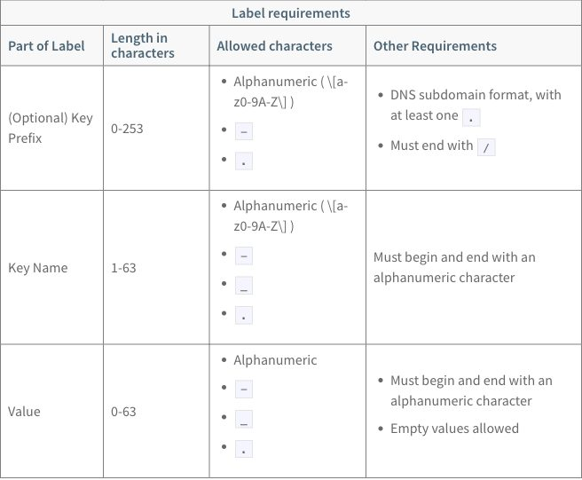

The title row spans the four columns, centered, above the column headers;
both rows share the shaded header band. Column headers are on the left.
Body cells sit in the vertical middle of their rows. Every cell has a
border. The bracket text shows its backslashes, `( \[a-z0-9A-Z\] )`, and
breaks after `[a-`.

<details><summary>Source as written (HTML in an ERB page; note the unclosed cell after the first list, the column headers outside <code>&lt;thead&gt;</code>, and the backslashes)</summary>

```html
<table class="table">
<thead>
<tr>
	<th colspan="4" style="text-align: center">Label requirements</th>
</tr>
</thead>
<tr>
	<th>Part of Label</th>
	<th>Length in characters</th>
	<th>Allowed characters</th>
	<th>Other Requirements</th>
</tr>
<tr>
	<td>(Optional) Key Prefix</td>
	<td>0-253</td>
	<td>
		<ul>
			<li>Alphanumeric  ( \[a-z0-9A-Z\] )</li>
			<li><code>-</code></li>
			<li><code>.</code></li>
		</ul>
	<td>
		<ul>
			<li>DNS subdomain format, with at least one <code>.</code></li>
			<li>Must end with <code>/</code></li>
		</ul>
  </td>
</tr>
<tr>
	<td>Key Name</td>
	<td>1-63</td>
	<td>
    <ul>
			<li>Alphanumeric  ( \[a-z0-9A-Z\] )</li>
			<li><code>-</code></li>
			<li><code>_</code></li>
			<li><code>.</code></li>
		</ul>
  </td>
	<td>Must begin and end with an alphanumeric character</td>
</tr>
<tr>
	<td>Value</td>
	<td>0-63</td>
	<td>
    <ul>
      <li>Alphanumeric</li>
			<li><code>-</code></li>
			<li><code>_</code></li>
			<li><code>.</code></li>
    </ul>
  </td>
	<td>
		<ul>
			<li>Must begin and end with an alphanumeric character</li>
			<li>Empty values allowed</li>
    </ul>
  </td>
</tr>
</table>
```

</details>

**Table 2, annotation requirements:**

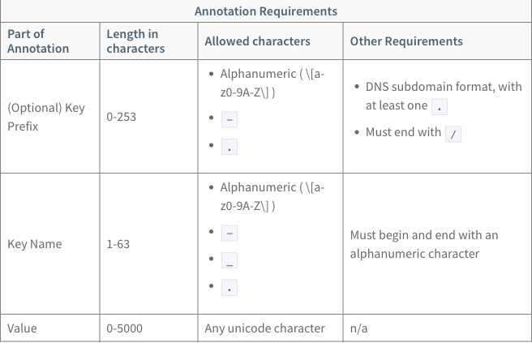

The same layout as table 1. Row 3 is plain text in every cell.

<details><summary>Source as written (HTML; the same unclosed cell in row 1)</summary>

```html
<table class="table">
<thead>
<tr>
	<th colspan="4" style="text-align: center">Annotation Requirements</th>
</tr>
</thead>
<tr>
	<th>Part of Annotation</th>
	<th>Length in characters</th>
	<th>Allowed characters</th>
	<th>Other Requirements</th>
</tr>
<tr>
	<td>(Optional) Key Prefix</td>
	<td>0-253</td>
	<td>
		<ul>
			<li>Alphanumeric ( \[a-z0-9A-Z\] )</li>
			<li><code>-</code></li>
			<li><code>.</code></li>
		</ul>
	<td>
		<ul>
			<li>DNS subdomain format, with at least one <code>.</code></li>
			<li>Must end with <code>/</code></li>
		</ul>
  </td>
</tr>
<tr>
	<td>Key Name</td>
	<td>1-63</td>
	<td>
    <ul>
			<li>Alphanumeric ( \[a-z0-9A-Z\] )</li>
			<li><code>-</code></li>
			<li><code>_</code></li>
			<li><code>.</code></li>
		</ul>
  </td>
	<td>Must begin and end with an alphanumeric character</td>
</tr>
<tr>
	<td>Value</td>
	<td>0-5000</td>
	<td>Any unicode character</td>
	<td>n/a</td>
</tr>
</table>
```

</details>

**Table 3, selector requirement reference:**

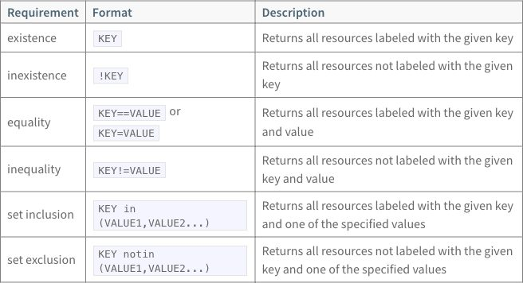

Header cells are on the left and body cells are vertically centered. Code
in the Format column wraps: `KEY in (VALUE1,VALUE2...)` breaks after `in`,
and `KEY==VALUE or KEY=VALUE` takes two lines.

<details><summary>Source as written (a pipe table)</summary>

```markdown
| Requirement | Format | Description |
| ----------- | ------ | ----------- |
| existence | `KEY` | Returns all resources labeled with the given key |
| inexistence | `!KEY` | Returns all resources not labeled with the given key |
| equality | `KEY==VALUE` or `KEY=VALUE` | Returns all resources labeled with the given key and value |
| inequality | `KEY!=VALUE` | Returns all resources not labeled with the given key and value |
| set inclusion | `KEY in (VALUE1,VALUE2...)` | Returns all resources labeled with the given key and one of the specified values |
| set exclusion | `KEY notin (VALUE1,VALUE2...)` | Returns all resources not labeled with the given key and one of the specified values |
```

</details>

ERB (Embedded Ruby, `<%= … %>` tags in a page; see the
[glossary](../glossary.md#erb)) is how today's pages insert variables and
partials. These tables use neither. The page's prose uses variables,
including `vars.metadata_ref`, which the book does not define, so the
published page renders it as empty text
([SOURCES.md](../concepts/tables/source/SOURCES.md)).

### Docusaurus 3.10.2

Pages are MDX, as for [`credential-types`](#credential-types). A pipe table
cell can hold an inline HTML list, `<ul><li>…</li></ul>` on one line
([conventions](../concepts/tables/sites/docusaurus/CONVENTIONS.md)).

<details><summary>Native input: pipe tables, the lists as inline HTML, the title as a bold line above</summary>

Table 1:

```markdown
**Label requirements**

| Part of Label | Length in characters | Allowed characters | Other Requirements |
| --- | --- | --- | --- |
| (Optional) Key Prefix | 0-253 | <ul><li>Alphanumeric ( [a-z0-9A-Z] )</li><li>`-`</li><li>`.`</li></ul> | <ul><li>DNS subdomain format, with at least one `.`</li><li>Must end with `/`</li></ul> |
| Key Name | 1-63 | <ul><li>Alphanumeric ( [a-z0-9A-Z] )</li><li>`-`</li><li>`_`</li><li>`.`</li></ul> | Must begin and end with an alphanumeric character |
| Value | 0-63 | <ul><li>Alphanumeric</li><li>`-`</li><li>`_`</li><li>`.`</li></ul> | <ul><li>Must begin and end with an alphanumeric character</li><li>Empty values allowed</li></ul> |
```

Table 2:

```markdown
**Annotation Requirements**

| Part of Annotation | Length in characters | Allowed characters | Other Requirements |
| --- | --- | --- | --- |
| (Optional) Key Prefix | 0-253 | <ul><li>Alphanumeric ( [a-z0-9A-Z] )</li><li>`-`</li><li>`.`</li></ul> | <ul><li>DNS subdomain format, with at least one `.`</li><li>Must end with `/`</li></ul> |
| Key Name | 1-63 | <ul><li>Alphanumeric ( [a-z0-9A-Z] )</li><li>`-`</li><li>`_`</li><li>`.`</li></ul> | Must begin and end with an alphanumeric character |
| Value | 0-5000 | Any unicode character | n/a |
```

Table 3, the source's pipe table unchanged:

```markdown
| Requirement | Format | Description |
| ----------- | ------ | ----------- |
| existence | `KEY` | Returns all resources labeled with the given key |
| inexistence | `!KEY` | Returns all resources not labeled with the given key |
| equality | `KEY==VALUE` or `KEY=VALUE` | Returns all resources labeled with the given key and value |
| inequality | `KEY!=VALUE` | Returns all resources not labeled with the given key and value |
| set inclusion | `KEY in (VALUE1,VALUE2...)` | Returns all resources labeled with the given key and one of the specified values |
| set exclusion | `KEY notin (VALUE1,VALUE2...)` | Returns all resources not labeled with the given key and one of the specified values |
```

</details>

<details><summary>Passthrough input: the HTML written as JSX (style objects, added tbody), after the intent file's cleanup</summary>

Table 1:

```jsx
<table class="table">
<thead>
<tr>
	<th colspan="4" style={{textAlign: 'center'}}>Label requirements</th>
</tr>
<tr>
	<th>Part of Label</th>
	<th>Length in characters</th>
	<th>Allowed characters</th>
	<th>Other Requirements</th>
</tr>
</thead>
<tbody>
<tr>
	<td>(Optional) Key Prefix</td>
	<td>0-253</td>
	<td>
		<ul>
			<li>Alphanumeric  ( [a-z0-9A-Z] )</li>
			<li><code>-</code></li>
			<li><code>.</code></li>
		</ul>
	</td>
	<td>
		<ul>
			<li>DNS subdomain format, with at least one <code>.</code></li>
			<li>Must end with <code>/</code></li>
		</ul>
  </td>
</tr>
<tr>
	<td>Key Name</td>
	<td>1-63</td>
	<td>
    <ul>
			<li>Alphanumeric  ( [a-z0-9A-Z] )</li>
			<li><code>-</code></li>
			<li><code>_</code></li>
			<li><code>.</code></li>
		</ul>
  </td>
	<td>Must begin and end with an alphanumeric character</td>
</tr>
<tr>
	<td>Value</td>
	<td>0-63</td>
	<td>
    <ul>
      <li>Alphanumeric</li>
			<li><code>-</code></li>
			<li><code>_</code></li>
			<li><code>.</code></li>
    </ul>
  </td>
	<td>
		<ul>
			<li>Must begin and end with an alphanumeric character</li>
			<li>Empty values allowed</li>
    </ul>
  </td>
</tr>
</tbody>
</table>
```

Table 2:

```jsx
<table class="table">
<thead>
<tr>
	<th colspan="4" style={{textAlign: 'center'}}>Annotation Requirements</th>
</tr>
<tr>
	<th>Part of Annotation</th>
	<th>Length in characters</th>
	<th>Allowed characters</th>
	<th>Other Requirements</th>
</tr>
</thead>
<tbody>
<tr>
	<td>(Optional) Key Prefix</td>
	<td>0-253</td>
	<td>
		<ul>
			<li>Alphanumeric ( [a-z0-9A-Z] )</li>
			<li><code>-</code></li>
			<li><code>.</code></li>
		</ul>
	</td>
	<td>
		<ul>
			<li>DNS subdomain format, with at least one <code>.</code></li>
			<li>Must end with <code>/</code></li>
		</ul>
  </td>
</tr>
<tr>
	<td>Key Name</td>
	<td>1-63</td>
	<td>
    <ul>
			<li>Alphanumeric ( [a-z0-9A-Z] )</li>
			<li><code>-</code></li>
			<li><code>_</code></li>
			<li><code>.</code></li>
		</ul>
  </td>
	<td>Must begin and end with an alphanumeric character</td>
</tr>
<tr>
	<td>Value</td>
	<td>0-5000</td>
	<td>Any unicode character</td>
	<td>n/a</td>
</tr>
</tbody>
</table>
```

Table 3, the source's pipe table unchanged, as in native:

```markdown
| Requirement | Format | Description |
| ----------- | ------ | ----------- |
| existence | `KEY` | Returns all resources labeled with the given key |
| inexistence | `!KEY` | Returns all resources not labeled with the given key |
| equality | `KEY==VALUE` or `KEY=VALUE` | Returns all resources labeled with the given key and value |
| inequality | `KEY!=VALUE` | Returns all resources not labeled with the given key and value |
| set inclusion | `KEY in (VALUE1,VALUE2...)` | Returns all resources labeled with the given key and one of the specified values |
| set exclusion | `KEY notin (VALUE1,VALUE2...)` | Returns all resources not labeled with the given key and one of the specified values |
```

</details>

Files: [native](../concepts/tables/sites/docusaurus/docs/native/metadata.mdx),
[passthrough](../concepts/tables/sites/docusaurus/docs/passthrough/metadata.mdx),
[passthrough as written](../concepts/tables/sites/docusaurus/docs/passthrough-raw/metadata.mdx),
[extension](../concepts/tables/sites/docusaurus/docs/extension/metadata.mdx).
Docusaurus has no native-plain page: its native page already has no width
settings.

**Table 1, native output:**

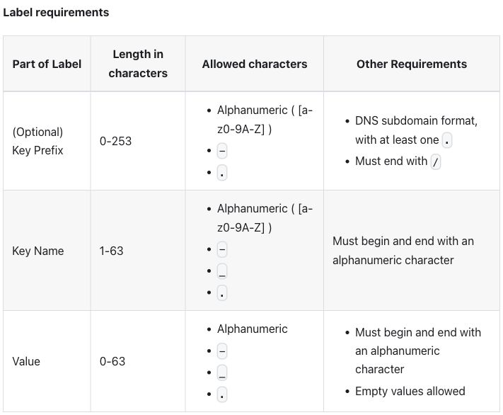

**Table 1, passthrough output:**

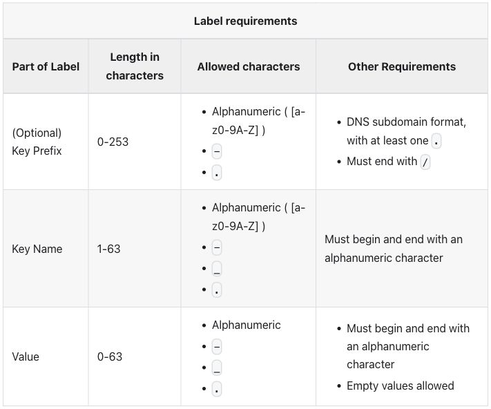

**Table 2, native output:**

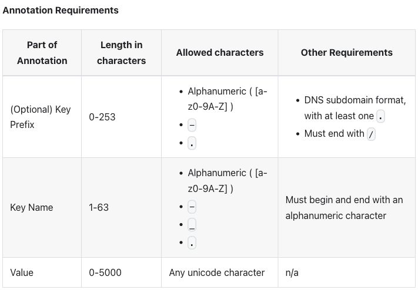

**Table 2, passthrough output:**

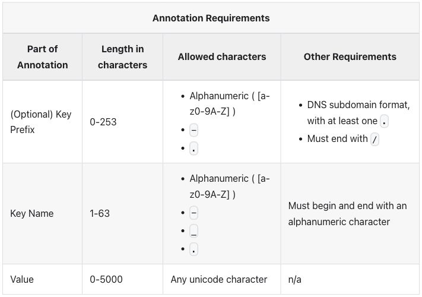

**Table 3, native and passthrough output** (the two screenshots differ only
by image-compression noise):

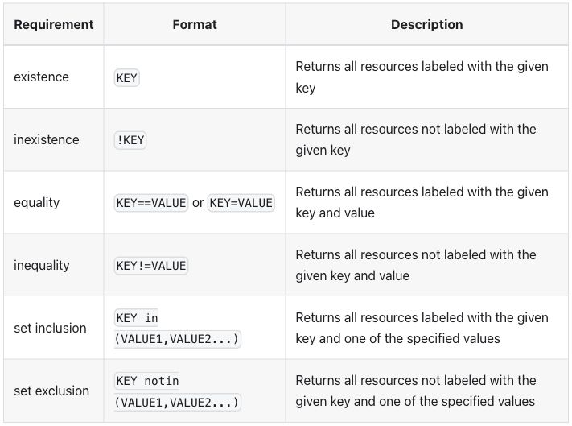

Differences seen:

- **The page does not build with the HTML as written,** and MDX's first
  error is outside the tables: it reads the `{` of JSON inside a `<pre>`
  block as an expression
  ([raw passthrough errors](../concepts/tables/results.md#raw-passthrough-errors)).
  For the tables, passthrough needed the intent file's cleanup (the two
  unclosed `<td>` closed, the column headers moved into `<thead>`), `style`
  written as a JSX object (`style={{textAlign: 'center'}}`) and the rows
  wrapped in `<tbody>` ([R-24](../requirements/README.md#r-24) markup
  cleanup before conversion).
- **The title** is a bold line above the table in native and the source's
  spanning row in passthrough.
- **Native holds the lists as inline HTML,** one list per line in a pipe
  table cell. results.md rates that source "hard to edit"
  ([R-11](../requirements/README.md#r-11) readable source).
- **Header cells are centered** in both modes, as in `credential-types`:
  the theme sets no alignment, so the browser's default shows
  ([checked after review](../concepts/tables/results.md#widths-alignment-and-font-size)).
- **Alternate body rows are shaded,** in all three tables. The published
  tables shade only the header band.
- Body cells are vertically centered and the key column wraps, as on the
  published page. No row headers. `[a-z0-9A-Z]` still breaks after `[a-`.
- **Table 3** is the same pipe table in both modes. `KEY==VALUE or
  KEY=VALUE` fits on one line; `KEY in (VALUE1,VALUE2...)` still breaks
  after `in`.

**Extension mode.** A `:::list-table` block, as in `credential-types`, read
by [plugins/list-table.js](../concepts/tables/sites/docusaurus/plugins/list-table.js),
with [hints.css](../concepts/tables/sites/docusaurus/src/css/hints.css).

<details><summary>Extension input: list-table directives, with nested lists in cells</summary>

Table 1:

```markdown
**Label requirements**

:::list-table{header-rows="1" stub-columns="1" roles="key value prose prose"}
- - Part of Label
  - Length in characters
  - Allowed characters
  - Other Requirements
- - (Optional) Key Prefix
  - 0-253
  - - Alphanumeric ( [a-z0-9A-Z] )
    - `-`
    - `.`
  - - DNS subdomain format, with at least one `.`
    - Must end with `/`
- - Key Name
  - 1-63
  - - Alphanumeric ( [a-z0-9A-Z] )
    - `-`
    - `_`
    - `.`
  - Must begin and end with an alphanumeric character
- - Value
  - 0-63
  - - Alphanumeric
    - `-`
    - `_`
    - `.`
  - - Must begin and end with an alphanumeric character
    - Empty values allowed
:::
```

Table 2:

```markdown
**Annotation Requirements**

:::list-table{header-rows="1" stub-columns="1" roles="key value prose prose"}
- - Part of Annotation
  - Length in characters
  - Allowed characters
  - Other Requirements
- - (Optional) Key Prefix
  - 0-253
  - - Alphanumeric ( [a-z0-9A-Z] )
    - `-`
    - `.`
  - - DNS subdomain format, with at least one `.`
    - Must end with `/`
- - Key Name
  - 1-63
  - - Alphanumeric ( [a-z0-9A-Z] )
    - `-`
    - `_`
    - `.`
  - Must begin and end with an alphanumeric character
- - Value
  - 0-5000
  - Any unicode character
  - n/a
:::
```

Table 3:

```markdown
:::list-table{header-rows="1" stub-columns="1" roles="key value prose"}
- - Requirement
  - Format
  - Description
- - existence
  - `KEY`
  - Returns all resources labeled with the given key
- - inexistence
  - `!KEY`
  - Returns all resources not labeled with the given key
- - equality
  - `KEY==VALUE` or `KEY=VALUE`
  - Returns all resources labeled with the given key and value
- - inequality
  - `KEY!=VALUE`
  - Returns all resources not labeled with the given key and value
- - set inclusion
  - `KEY in (VALUE1,VALUE2...)`
  - Returns all resources labeled with the given key and one of the specified values
- - set exclusion
  - `KEY notin (VALUE1,VALUE2...)`
  - Returns all resources not labeled with the given key and one of the specified values
:::
```

`header-rows="1"` makes the first row the header, `stub-columns="1"` makes
column 1 row headers, and `roles` names the columns key, value and prose.
There is no `widths`: the source sets none. A `key` column stays on one
line up to a cap; the `wrap` option would do the same for another column
([conventions](../concepts/tables/sites/docusaurus/CONVENTIONS.md)), and
these tables do not use it.

</details>

**Table 1, extension output:**

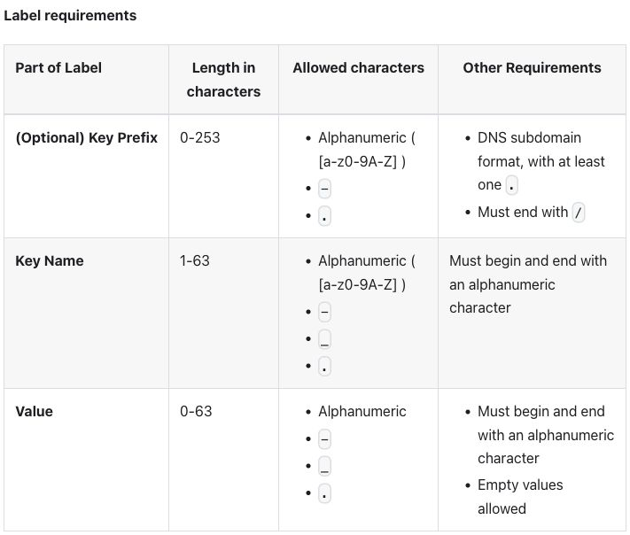

**Table 2, extension output:**

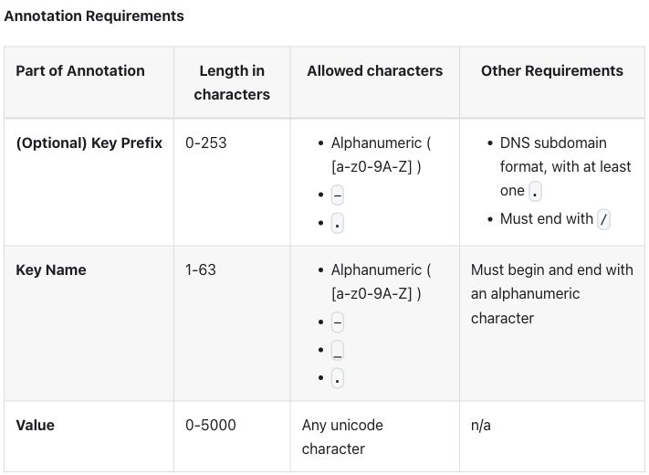

**Table 3, extension output:**

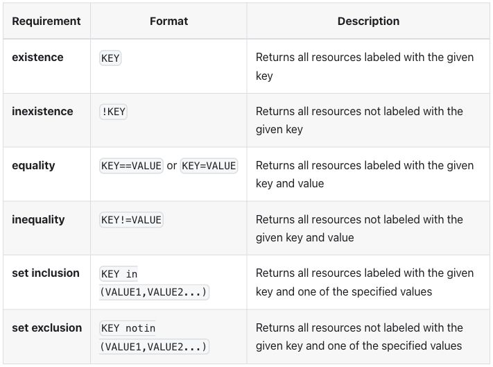

Differences seen, against the published page and the other two modes:

- **Column 1 is row headers,** drawn in bold, in all three tables.
- **The key column stays on one line:** "(Optional) Key Prefix" fits, and
  the column takes 26% of table 1. The other columns get narrower, so
  "Any unicode character" wraps in table 2.
- **Body cells are aligned to the top;** native, passthrough and the
  published page center them.
- **The first header cell is on the left and the others are centered,** as
  in `credential-types`.
- The title is a bold line above the table, and alternate rows are shaded,
  as in native. results.md rates the source, a list-table with nested
  lists, readable.

### Zensical 0.0.69

Pages are Markdown read by Python-Markdown, which passes HTML blocks through
unchanged, as for [`credential-types`](#credential-types). The source sets
no widths, so native needs no attribute lists: its pipe tables are the same
as Docusaurus native, byte for byte, and native-plain is the same file as
native.

<details><summary>Native input: pipe tables, the lists as inline HTML, the title as a bold line above</summary>

Table 1:

```markdown
**Label requirements**

| Part of Label | Length in characters | Allowed characters | Other Requirements |
| --- | --- | --- | --- |
| (Optional) Key Prefix | 0-253 | <ul><li>Alphanumeric ( [a-z0-9A-Z] )</li><li>`-`</li><li>`.`</li></ul> | <ul><li>DNS subdomain format, with at least one `.`</li><li>Must end with `/`</li></ul> |
| Key Name | 1-63 | <ul><li>Alphanumeric ( [a-z0-9A-Z] )</li><li>`-`</li><li>`_`</li><li>`.`</li></ul> | Must begin and end with an alphanumeric character |
| Value | 0-63 | <ul><li>Alphanumeric</li><li>`-`</li><li>`_`</li><li>`.`</li></ul> | <ul><li>Must begin and end with an alphanumeric character</li><li>Empty values allowed</li></ul> |
```

Table 2:

```markdown
**Annotation Requirements**

| Part of Annotation | Length in characters | Allowed characters | Other Requirements |
| --- | --- | --- | --- |
| (Optional) Key Prefix | 0-253 | <ul><li>Alphanumeric ( [a-z0-9A-Z] )</li><li>`-`</li><li>`.`</li></ul> | <ul><li>DNS subdomain format, with at least one `.`</li><li>Must end with `/`</li></ul> |
| Key Name | 1-63 | <ul><li>Alphanumeric ( [a-z0-9A-Z] )</li><li>`-`</li><li>`_`</li><li>`.`</li></ul> | Must begin and end with an alphanumeric character |
| Value | 0-5000 | Any unicode character | n/a |
```

Table 3, the source's pipe table unchanged:

```markdown
| Requirement | Format | Description |
| ----------- | ------ | ----------- |
| existence | `KEY` | Returns all resources labeled with the given key |
| inexistence | `!KEY` | Returns all resources not labeled with the given key |
| equality | `KEY==VALUE` or `KEY=VALUE` | Returns all resources labeled with the given key and value |
| inequality | `KEY!=VALUE` | Returns all resources not labeled with the given key and value |
| set inclusion | `KEY in (VALUE1,VALUE2...)` | Returns all resources labeled with the given key and one of the specified values |
| set exclusion | `KEY notin (VALUE1,VALUE2...)` | Returns all resources not labeled with the given key and one of the specified values |
```

</details>

<details><summary>Passthrough input: the HTML with only the intent file's cleanup</summary>

Table 1:

```html
<table class="table">
<thead>
<tr>
	<th colspan="4" style="text-align: center">Label requirements</th>
</tr>
<tr>
	<th>Part of Label</th>
	<th>Length in characters</th>
	<th>Allowed characters</th>
	<th>Other Requirements</th>
</tr>
</thead>
<tr>
	<td>(Optional) Key Prefix</td>
	<td>0-253</td>
	<td>
		<ul>
			<li>Alphanumeric  ( [a-z0-9A-Z] )</li>
			<li><code>-</code></li>
			<li><code>.</code></li>
		</ul>
	</td>
	<td>
		<ul>
			<li>DNS subdomain format, with at least one <code>.</code></li>
			<li>Must end with <code>/</code></li>
		</ul>
  </td>
</tr>
<tr>
	<td>Key Name</td>
	<td>1-63</td>
	<td>
    <ul>
			<li>Alphanumeric  ( [a-z0-9A-Z] )</li>
			<li><code>-</code></li>
			<li><code>_</code></li>
			<li><code>.</code></li>
		</ul>
  </td>
	<td>Must begin and end with an alphanumeric character</td>
</tr>
<tr>
	<td>Value</td>
	<td>0-63</td>
	<td>
    <ul>
      <li>Alphanumeric</li>
			<li><code>-</code></li>
			<li><code>_</code></li>
			<li><code>.</code></li>
    </ul>
  </td>
	<td>
		<ul>
			<li>Must begin and end with an alphanumeric character</li>
			<li>Empty values allowed</li>
    </ul>
  </td>
</tr>
</table>
```

Table 2:

```html
<table class="table">
<thead>
<tr>
	<th colspan="4" style="text-align: center">Annotation Requirements</th>
</tr>
<tr>
	<th>Part of Annotation</th>
	<th>Length in characters</th>
	<th>Allowed characters</th>
	<th>Other Requirements</th>
</tr>
</thead>
<tr>
	<td>(Optional) Key Prefix</td>
	<td>0-253</td>
	<td>
		<ul>
			<li>Alphanumeric ( [a-z0-9A-Z] )</li>
			<li><code>-</code></li>
			<li><code>.</code></li>
		</ul>
	</td>
	<td>
		<ul>
			<li>DNS subdomain format, with at least one <code>.</code></li>
			<li>Must end with <code>/</code></li>
		</ul>
  </td>
</tr>
<tr>
	<td>Key Name</td>
	<td>1-63</td>
	<td>
    <ul>
			<li>Alphanumeric ( [a-z0-9A-Z] )</li>
			<li><code>-</code></li>
			<li><code>_</code></li>
			<li><code>.</code></li>
		</ul>
  </td>
	<td>Must begin and end with an alphanumeric character</td>
</tr>
<tr>
	<td>Value</td>
	<td>0-5000</td>
	<td>Any unicode character</td>
	<td>n/a</td>
</tr>
</table>
```

Table 3, the source's pipe table unchanged, as in native:

```markdown
| Requirement | Format | Description |
| ----------- | ------ | ----------- |
| existence | `KEY` | Returns all resources labeled with the given key |
| inexistence | `!KEY` | Returns all resources not labeled with the given key |
| equality | `KEY==VALUE` or `KEY=VALUE` | Returns all resources labeled with the given key and value |
| inequality | `KEY!=VALUE` | Returns all resources not labeled with the given key and value |
| set inclusion | `KEY in (VALUE1,VALUE2...)` | Returns all resources labeled with the given key and one of the specified values |
| set exclusion | `KEY notin (VALUE1,VALUE2...)` | Returns all resources not labeled with the given key and one of the specified values |
```

</details>

Files: [native](../concepts/tables/sites/zensical/docs/native/metadata.md),
[native-plain](../concepts/tables/sites/zensical/docs/native-plain/metadata.md),
[passthrough](../concepts/tables/sites/zensical/docs/passthrough/metadata.md),
[passthrough as written](../concepts/tables/sites/zensical/docs/passthrough-raw/metadata.md),
[extension](../concepts/tables/sites/zensical/docs/extension/metadata.md).

**Table 1, native output:**

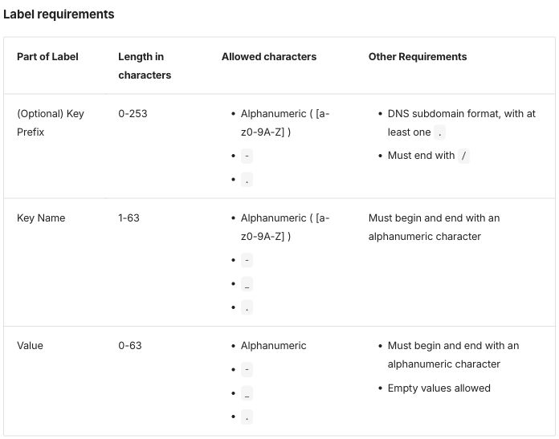

**Table 1, passthrough output:**

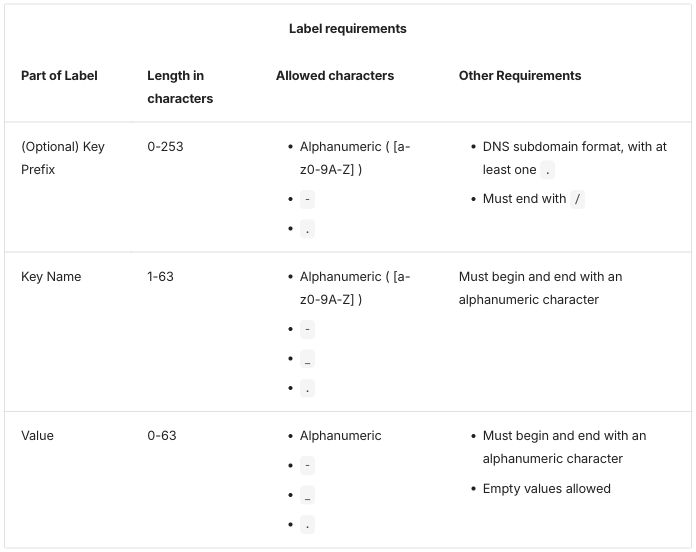

**Table 2, native output:**

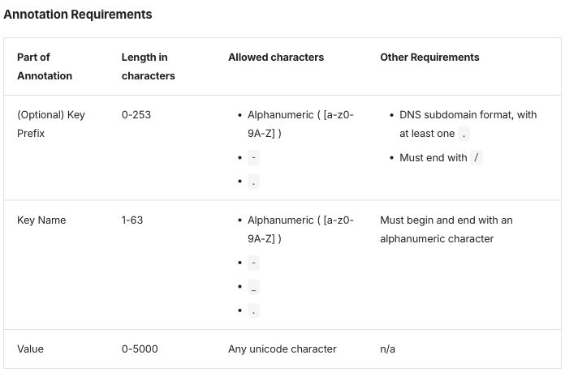

**Table 2, passthrough output:**

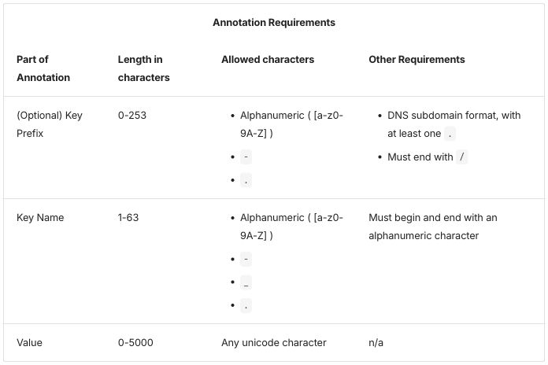

**Table 3, native output** (passthrough is the same pipe table and looks
the same):

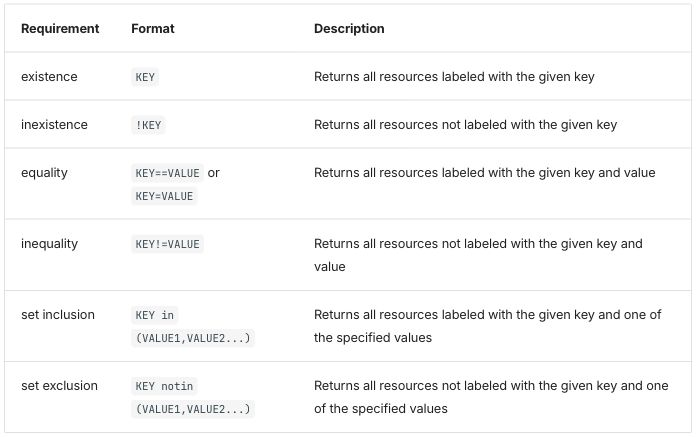

Differences seen:

- **The page builds with the HTML as written.** The browser repairs the
  unclosed cells, as on the published page; raw, only the backslash checks
  fail ([Zensical raw passthrough](../concepts/tables/results.md#zensical-0069)).
  Passthrough adds the intent file's cleanup and nothing else.
- **The title** is a bold line above the table in native and the source's
  spanning row in passthrough.
- **No rule between the columns.** Rows are separated by horizontal rules
  inside a thin outer frame.
- **Body cells are aligned to the top,** in all three tables; the published
  page centers them.
- **Passthrough looks like native** because the site's stylesheet gives
  `table.table` the theme's table look. The default theme styles only
  tables without a class, so these two tables first rendered with no
  borders and headers in normal weight
  ([Zensical finding 1](../concepts/tables/results.md#zensical-0069);
  [screenshot](../concepts/tables/results/zensical-metadata-t1-passthrough-class-unstyled.png)).
  **Decided:** keep the class and style it
  ([R-09](../requirements/README.md#r-09) table styles by class).
- **Native holds the lists as inline HTML,** as in Docusaurus; results.md
  rates that source "hard to edit".
- No row headers, and the key column wraps: 18% of table 1 in native, 16%
  in passthrough.

**Extension mode.** A `/// list-table` block, as in `credential-types`,
read by [list_table.py](../concepts/tables/sites/zensical/list_table.py),
with [hints.css](../concepts/tables/sites/zensical/docs/stylesheets/hints.css).

<details><summary>Extension input: list-table blocks, with nested lists in cells</summary>

Table 1:

```markdown
**Label requirements**

/// list-table
    header-rows: 1
    stub-columns: 1
    roles: key value prose prose

-   - Part of Label
    - Length in characters
    - Allowed characters
    - Other Requirements

-   - (Optional) Key Prefix
    - 0-253
    -   - Alphanumeric ( [a-z0-9A-Z] )
        - `-`
        - `.`
    -   - DNS subdomain format, with at least one `.`
        - Must end with `/`

-   - Key Name
    - 1-63
    -   - Alphanumeric ( [a-z0-9A-Z] )
        - `-`
        - `_`
        - `.`
    - Must begin and end with an alphanumeric character

-   - Value
    - 0-63
    -   - Alphanumeric
        - `-`
        - `_`
        - `.`
    -   - Must begin and end with an alphanumeric character
        - Empty values allowed
///
```

Table 2:

```markdown
**Annotation Requirements**

/// list-table
    header-rows: 1
    stub-columns: 1
    roles: key value prose prose

-   - Part of Annotation
    - Length in characters
    - Allowed characters
    - Other Requirements

-   - (Optional) Key Prefix
    - 0-253
    -   - Alphanumeric ( [a-z0-9A-Z] )
        - `-`
        - `.`
    -   - DNS subdomain format, with at least one `.`
        - Must end with `/`

-   - Key Name
    - 1-63
    -   - Alphanumeric ( [a-z0-9A-Z] )
        - `-`
        - `_`
        - `.`
    - Must begin and end with an alphanumeric character

-   - Value
    - 0-5000
    - Any unicode character
    - n/a
///
```

Table 3:

```markdown
/// list-table
    header-rows: 1
    stub-columns: 1
    roles: key value prose

-   - Requirement
    - Format
    - Description

-   - existence
    - `KEY`
    - Returns all resources labeled with the given key

-   - inexistence
    - `!KEY`
    - Returns all resources not labeled with the given key

-   - equality
    - `KEY==VALUE` or `KEY=VALUE`
    - Returns all resources labeled with the given key and value

-   - inequality
    - `KEY!=VALUE`
    - Returns all resources not labeled with the given key and value

-   - set inclusion
    - `KEY in (VALUE1,VALUE2...)`
    - Returns all resources labeled with the given key and one of the specified values

-   - set exclusion
    - `KEY notin (VALUE1,VALUE2...)`
    - Returns all resources not labeled with the given key and one of the specified values
///
```

The options mean the same as in the Docusaurus directive. Rows need a
blank line between them, and nesting needs four-space indents
([Zensical finding 5](../concepts/tables/results.md#zensical-0069)).

</details>

**Table 1, extension output:**

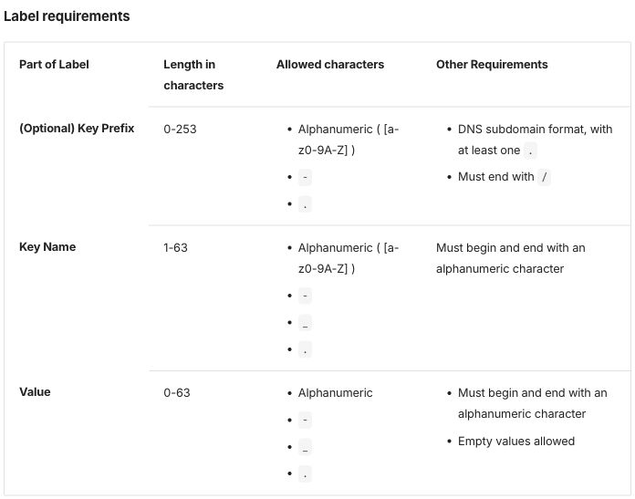

**Table 2, extension output:**

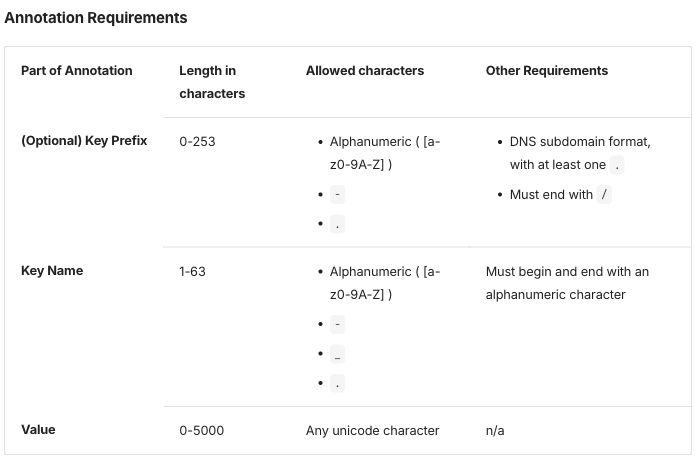

**Table 3, extension output:**

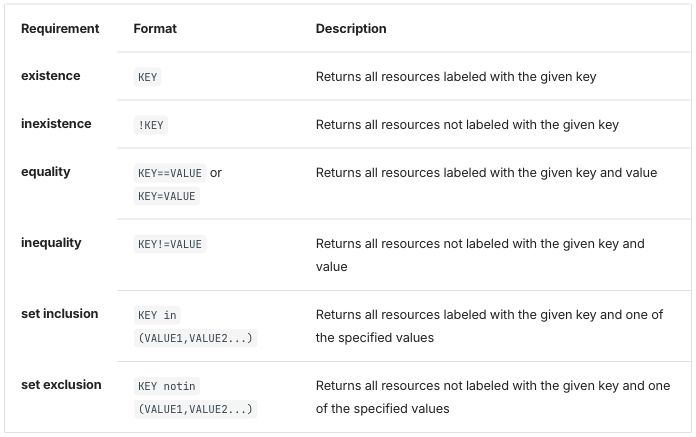

Differences seen, against native and passthrough:

- **Column 1 is row headers,** drawn in bold, in all three tables.
- **The key column stays on one line,** at 23% of table 1 (native: 18%).
- **The rules between body rows stop at the key column;** in native they
  cross the whole table. The reason has not been looked into.
- Cells aligned to the top and no rule between the columns, as in the
  other two modes.

### Starlight 0.42.6

Pages are Markdoc, as for [`credential-types`](#credential-types).
Markdoc's own `` tag holds lists in cells without any HTML, so
native writes the lists as Markdown lists
([Starlight summary](../concepts/tables/results.md#starlight-0426)).

<details><summary>Native input: Markdoc's table tag, the lists as Markdown lists, the title as a bold line above</summary>

Table 1:

```markdown
**Label requirements**


* Part of Label
* Length in characters
* Allowed characters
* Other Requirements
---
* (Optional) Key Prefix
* 0-253
* - Alphanumeric ( [a-z0-9A-Z] )
  - `-`
  - `.`
* - DNS subdomain format, with at least one `.`
  - Must end with `/`
---
* Key Name
* 1-63
* - Alphanumeric ( [a-z0-9A-Z] )
  - `-`
  - `_`
  - `.`
* Must begin and end with an alphanumeric character
---
* Value
* 0-63
* - Alphanumeric
  - `-`
  - `_`
  - `.`
* - Must begin and end with an alphanumeric character
  - Empty values allowed

```

Table 2:

```markdown
**Annotation Requirements**


* Part of Annotation
* Length in characters
* Allowed characters
* Other Requirements
---
* (Optional) Key Prefix
* 0-253
* - Alphanumeric ( [a-z0-9A-Z] )
  - `-`
  - `.`
* - DNS subdomain format, with at least one `.`
  - Must end with `/`
---
* Key Name
* 1-63
* - Alphanumeric ( [a-z0-9A-Z] )
  - `-`
  - `_`
  - `.`
* Must begin and end with an alphanumeric character
---
* Value
* 0-5000
* Any unicode character
* n/a

```

Table 3:

```markdown

* Requirement
* Format
* Description
---
* existence
* `KEY`
* Returns all resources labeled with the given key
---
* inexistence
* `!KEY`
* Returns all resources not labeled with the given key
---
* equality
* `KEY==VALUE` or `KEY=VALUE`
* Returns all resources labeled with the given key and value
---
* inequality
* `KEY!=VALUE`
* Returns all resources not labeled with the given key and value
---
* set inclusion
* `KEY in (VALUE1,VALUE2...)`
* Returns all resources labeled with the given key and one of the specified values
---
* set exclusion
* `KEY notin (VALUE1,VALUE2...)`
* Returns all resources not labeled with the given key and one of the specified values

```

</details>

<details><summary>Passthrough input: the HTML with <code>&amp;#45;</code> for the lone dashes and each list cell on one line</summary>

Table 1:

```html
<table class="table">
<thead>
<tr>
	<th colspan="4" style="text-align: center">Label requirements</th>
</tr>
<tr>
	<th>Part of Label</th>
	<th>Length in characters</th>
	<th>Allowed characters</th>
	<th>Other Requirements</th>
</tr>
</thead>
<tr>
	<td>(Optional) Key Prefix</td>
	<td>0-253</td>
	<td> <ul> <li>Alphanumeric  ( [a-z0-9A-Z] )</li> <li><code>&#45;</code></li> <li><code>.</code></li> </ul> </td>
	<td> <ul> <li>DNS subdomain format, with at least one <code>.</code></li> <li>Must end with <code>/</code></li> </ul> </td>
</tr>
<tr>
	<td>Key Name</td>
	<td>1-63</td>
	<td> <ul> <li>Alphanumeric  ( [a-z0-9A-Z] )</li> <li><code>&#45;</code></li> <li><code>_</code></li> <li><code>.</code></li> </ul> </td>
	<td>Must begin and end with an alphanumeric character</td>
</tr>
<tr>
	<td>Value</td>
	<td>0-63</td>
	<td> <ul> <li>Alphanumeric</li> <li><code>&#45;</code></li> <li><code>_</code></li> <li><code>.</code></li> </ul> </td>
	<td> <ul> <li>Must begin and end with an alphanumeric character</li> <li>Empty values allowed</li> </ul> </td>
</tr>
</table>
```

Table 2:

```html
<table class="table">
<thead>
<tr>
	<th colspan="4" style="text-align: center">Annotation Requirements</th>
</tr>
<tr>
	<th>Part of Annotation</th>
	<th>Length in characters</th>
	<th>Allowed characters</th>
	<th>Other Requirements</th>
</tr>
</thead>
<tr>
	<td>(Optional) Key Prefix</td>
	<td>0-253</td>
	<td> <ul> <li>Alphanumeric ( [a-z0-9A-Z] )</li> <li><code>&#45;</code></li> <li><code>.</code></li> </ul> </td>
	<td> <ul> <li>DNS subdomain format, with at least one <code>.</code></li> <li>Must end with <code>/</code></li> </ul> </td>
</tr>
<tr>
	<td>Key Name</td>
	<td>1-63</td>
	<td> <ul> <li>Alphanumeric ( [a-z0-9A-Z] )</li> <li><code>&#45;</code></li> <li><code>_</code></li> <li><code>.</code></li> </ul> </td>
	<td>Must begin and end with an alphanumeric character</td>
</tr>
<tr>
	<td>Value</td>
	<td>0-5000</td>
	<td>Any unicode character</td>
	<td>n/a</td>
</tr>
</table>
```

Table 3, the source's pipe table unchanged:

```markdown
| Requirement | Format | Description |
| ----------- | ------ | ----------- |
| existence | `KEY` | Returns all resources labeled with the given key |
| inexistence | `!KEY` | Returns all resources not labeled with the given key |
| equality | `KEY==VALUE` or `KEY=VALUE` | Returns all resources labeled with the given key and value |
| inequality | `KEY!=VALUE` | Returns all resources not labeled with the given key and value |
| set inclusion | `KEY in (VALUE1,VALUE2...)` | Returns all resources labeled with the given key and one of the specified values |
| set exclusion | `KEY notin (VALUE1,VALUE2...)` | Returns all resources not labeled with the given key and one of the specified values |
```

</details>

Files: [native](../concepts/tables/sites/starlight/src/content/docs/native/metadata.mdoc),
[native-plain](../concepts/tables/sites/starlight/src/content/docs/native-plain/metadata.mdoc),
[passthrough](../concepts/tables/sites/starlight/src/content/docs/passthrough/metadata.mdoc),
[passthrough as written](../concepts/tables/sites/starlight/src/content/docs/passthrough-raw/metadata.mdoc),
[extension](../concepts/tables/sites/starlight/src/content/docs/extension/metadata.mdoc).

**Table 1, native output:**

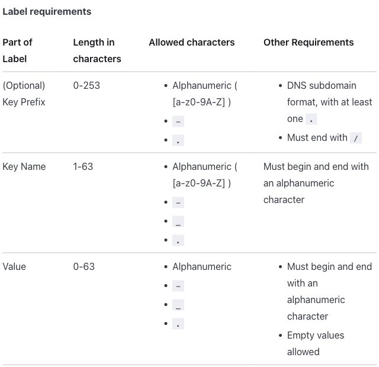

**Table 1, passthrough output:**

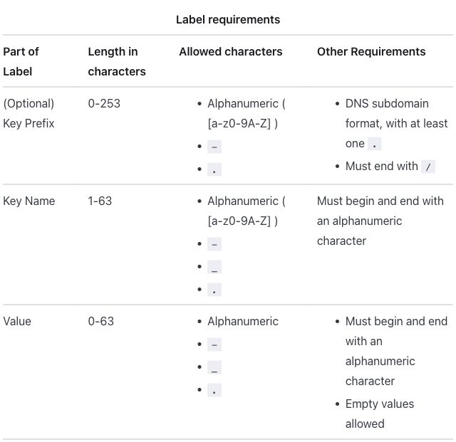

**Table 2, native output:**

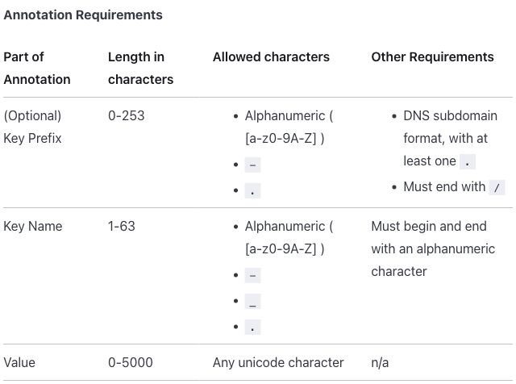

**Table 2, passthrough output:**

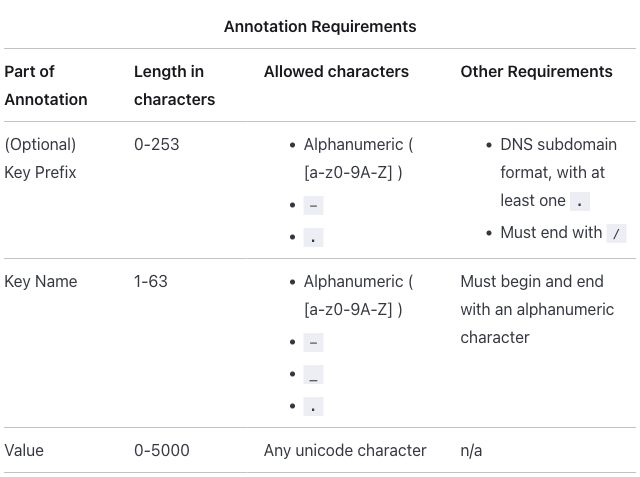

**Table 3, native and passthrough output** (the two screenshots differ only
by image-compression noise):

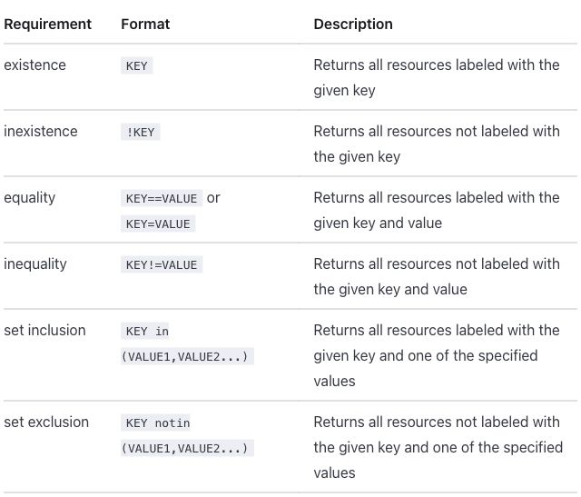

Differences seen:

- **The HTML as written loses content.** Markdoc reads the text inside HTML
  as Markdown, so `<li><code>-</code></li>` becomes a code span holding an
  empty bulleted list, and the dash is gone. No error is reported
  ([Starlight finding 1](../concepts/tables/results.md#starlight-0426);
  [screenshot](../concepts/tables/results/starlight-metadata-t1-passthrough-raw-dash-list.png)).
  Passthrough writes the five lone dashes as `&#45;` and joins each list
  cell onto one line: Markdoc cannot take the HTML as is.
- **The title** is a bold line above the table in native and the source's
  spanning row in passthrough. Markdoc's table has one header row: written
  as a spanning first row, the title took the table head and the column
  headers became an ordinary row
  ([screenshot](../concepts/tables/results/starlight-metadata-t1-native-title-row.png)).
- **Native and native-plain are the same image,** byte for byte, in all
  three tables. Native-plain writes pipe tables with inline `<ul>` lists;
  results.md rates that source "hard to edit" and native's Markdoc table
  with nested lists readable
  ([R-11](../requirements/README.md#r-11) readable source).
- **Only horizontal rules:** no rule between the columns and no outer
  border. **Body cells are aligned to the top;** the published page centers
  them.
- **Words in list items no longer break inside.** The theme let them break
  anywhere, so "Alphanumeric" broke as "Alphanumeri" / "c"; the site's
  stylesheet now limits that to words that cannot fit at all
  ([Starlight finding 5](../concepts/tables/results.md#starlight-0426);
  [screenshot](../concepts/tables/results/starlight-metadata-t1-extension-word-break.png)).
- No row headers, and the key column wraps, at 16% of table 1.

**Extension mode.** Markdoc's own `` tag with extra attributes,
as in `credential-types`, declared in
[list-table.mjs](../concepts/tables/sites/starlight/list-table.mjs), with
[hints.css](../concepts/tables/sites/starlight/src/styles/hints.css).

<details><summary>Extension input: the table tag with hint attributes</summary>

Table 1:

```markdown
**Label requirements**


* Part of Label
* Length in characters
* Allowed characters
* Other Requirements
---
* (Optional) Key Prefix
* 0-253
* - Alphanumeric ( [a-z0-9A-Z] )
  - `-`
  - `.`
* - DNS subdomain format, with at least one `.`
  - Must end with `/`
---
* Key Name
* 1-63
* - Alphanumeric ( [a-z0-9A-Z] )
  - `-`
  - `_`
  - `.`
* Must begin and end with an alphanumeric character
---
* Value
* 0-63
* - Alphanumeric
  - `-`
  - `_`
  - `.`
* - Must begin and end with an alphanumeric character
  - Empty values allowed

```

Table 2:

```markdown
**Annotation Requirements**


* Part of Annotation
* Length in characters
* Allowed characters
* Other Requirements
---
* (Optional) Key Prefix
* 0-253
* - Alphanumeric ( [a-z0-9A-Z] )
  - `-`
  - `.`
* - DNS subdomain format, with at least one `.`
  - Must end with `/`
---
* Key Name
* 1-63
* - Alphanumeric ( [a-z0-9A-Z] )
  - `-`
  - `_`
  - `.`
* Must begin and end with an alphanumeric character
---
* Value
* 0-5000
* Any unicode character
* n/a

```

Table 3:

```markdown

* Requirement
* Format
* Description
---
* existence
* `KEY`
* Returns all resources labeled with the given key
---
* inexistence
* `!KEY`
* Returns all resources not labeled with the given key
---
* equality
* `KEY==VALUE` or `KEY=VALUE`
* Returns all resources labeled with the given key and value
---
* inequality
* `KEY!=VALUE`
* Returns all resources not labeled with the given key and value
---
* set inclusion
* `KEY in (VALUE1,VALUE2...)`
* Returns all resources labeled with the given key and one of the specified values
---
* set exclusion
* `KEY notin (VALUE1,VALUE2...)`
* Returns all resources not labeled with the given key and one of the specified values

```

The attributes mean the same as in the Docusaurus directive.

</details>

**Table 1, extension output:**

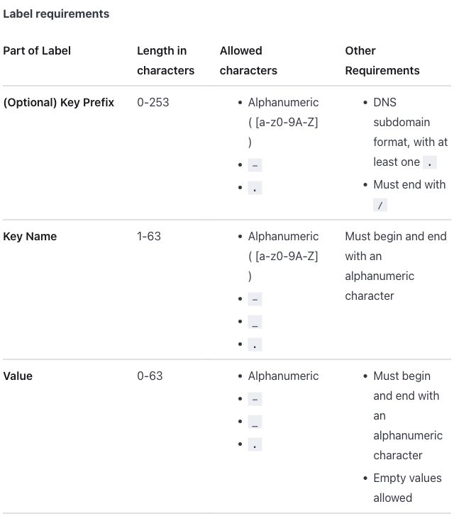

**Table 2, extension output:**

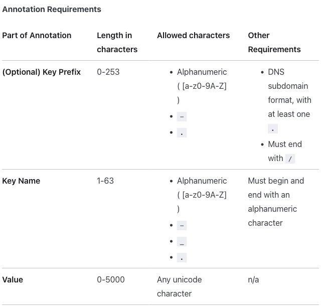

**Table 3, extension output:**

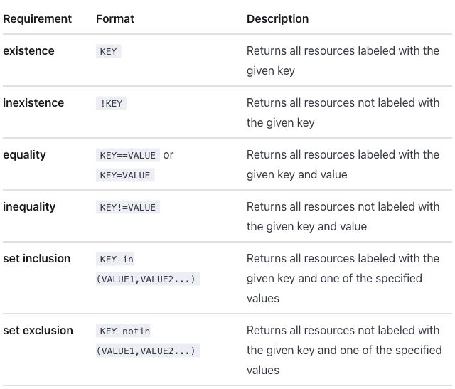

Differences seen, against native and passthrough:

- **Column 1 is row headers,** drawn in bold, in all three tables.
- **The key column stays on one line,** at 27% of table 1 (native: 16%).
  The other columns get narrower, so more lines wrap: the "Allowed
  characters" and "Other Requirements" headers take two lines, the closing
  parenthesis of `( [a-z0-9A-Z] )` lands on its own line, and table 1 is
  728 pixels tall in the screenshot against 620 in native.
- Table 3 is as in native, apart from the bold row headers.

### Antora 3.2.1

The whole page is AsciiDoc in every mode, as for
[`credential-types`](#credential-types). An `a|` cell is an AsciiDoc cell,
which holds lists and paragraphs
([conventions](../concepts/tables/sites/antora/CONVENTIONS.md)). Table 3 is
a Markdown table in the source, so it is an AsciiDoc table in every mode,
passthrough included.

<details><summary>Native input: AsciiDoc tables with column specs, lists in <code>a|</code> cells</summary>

Table 1:

```asciidoc
*Label requirements*

[%header,cols=".<~h,.<~,.<~,.<~"]
|===
|Part of Label |Length in characters |Allowed characters |Other Requirements

|(Optional) Key Prefix
|0-253
a|* Alphanumeric ( [a-z0-9A-Z] )
* `-`
* `.`
a|* DNS subdomain format, with at least one `.`
* Must end with `/`

|Key Name
|1-63
a|* Alphanumeric ( [a-z0-9A-Z] )
* `-`
* `+_+`
* `.`
|Must begin and end with an alphanumeric character

|Value
|0-63
a|* Alphanumeric
* `-`
* `+_+`
* `.`
a|* Must begin and end with an alphanumeric character
* Empty values allowed
|===
```

Table 2:

```asciidoc
*Annotation Requirements*

[%header,cols=".<~h,.<~,.<~,.<~"]
|===
|Part of Annotation |Length in characters |Allowed characters |Other Requirements

|(Optional) Key Prefix
|0-253
a|* Alphanumeric ( [a-z0-9A-Z] )
* `-`
* `.`
a|* DNS subdomain format, with at least one `.`
* Must end with `/`

|Key Name
|1-63
a|* Alphanumeric ( [a-z0-9A-Z] )
* `-`
* `+_+`
* `.`
|Must begin and end with an alphanumeric character

|Value
|0-5000
|Any unicode character
|n/a
|===
```

Table 3:

```asciidoc
[%header,cols=".<~h,.<~,.<~"]
|===
|Requirement |Format |Description

|existence
|`KEY`
|Returns all resources labeled with the given key

|inexistence
|`!KEY`
|Returns all resources not labeled with the given key

|equality
|`KEY==VALUE` or `KEY=VALUE`
|Returns all resources labeled with the given key and value

|inequality
|`KEY!=VALUE`
|Returns all resources not labeled with the given key and value

|set inclusion
|`+KEY in (VALUE1,VALUE2...)+`
|Returns all resources labeled with the given key and one of the specified values

|set exclusion
|`+KEY notin (VALUE1,VALUE2...)+`
|Returns all resources not labeled with the given key and one of the specified values
|===
```

In `cols`, `h` styles column 1's cells as row headers, `.<` aligns every
column to the top, and `~` sizes each column by its content. Code spans
that hold `_` or `...` are written as literal monospace, `` `+…+` ``:
plain backticks turned `...` into `…`
([Antora finding 7](../concepts/tables/results.md#antora-321)).

</details>

<details><summary>Passthrough input: the HTML inside passthrough blocks; table 3 an AsciiDoc table without row headers</summary>

Table 1:

```asciidoc
++++
<table class="table">
<thead>
<tr>
	<th colspan="4" style="text-align: center">Label requirements</th>
</tr>
<tr>
	<th>Part of Label</th>
	<th>Length in characters</th>
	<th>Allowed characters</th>
	<th>Other Requirements</th>
</tr>
</thead>
<tr>
	<td>(Optional) Key Prefix</td>
	<td>0-253</td>
	<td>
		<ul>
			<li>Alphanumeric  ( [a-z0-9A-Z] )</li>
			<li><code>-</code></li>
			<li><code>.</code></li>
		</ul>
	</td>
	<td>
		<ul>
			<li>DNS subdomain format, with at least one <code>.</code></li>
			<li>Must end with <code>/</code></li>
		</ul>
  </td>
</tr>
<tr>
	<td>Key Name</td>
	<td>1-63</td>
	<td>
    <ul>
			<li>Alphanumeric  ( [a-z0-9A-Z] )</li>
			<li><code>-</code></li>
			<li><code>_</code></li>
			<li><code>.</code></li>
		</ul>
  </td>
	<td>Must begin and end with an alphanumeric character</td>
</tr>
<tr>
	<td>Value</td>
	<td>0-63</td>
	<td>
    <ul>
      <li>Alphanumeric</li>
			<li><code>-</code></li>
			<li><code>_</code></li>
			<li><code>.</code></li>
    </ul>
  </td>
	<td>
		<ul>
			<li>Must begin and end with an alphanumeric character</li>
			<li>Empty values allowed</li>
    </ul>
  </td>
</tr>
</table>
++++
```

Table 2:

```asciidoc
++++
<table class="table">
<thead>
<tr>
	<th colspan="4" style="text-align: center">Annotation Requirements</th>
</tr>
<tr>
	<th>Part of Annotation</th>
	<th>Length in characters</th>
	<th>Allowed characters</th>
	<th>Other Requirements</th>
</tr>
</thead>
<tr>
	<td>(Optional) Key Prefix</td>
	<td>0-253</td>
	<td>
		<ul>
			<li>Alphanumeric ( [a-z0-9A-Z] )</li>
			<li><code>-</code></li>
			<li><code>.</code></li>
		</ul>
	</td>
	<td>
		<ul>
			<li>DNS subdomain format, with at least one <code>.</code></li>
			<li>Must end with <code>/</code></li>
		</ul>
  </td>
</tr>
<tr>
	<td>Key Name</td>
	<td>1-63</td>
	<td>
    <ul>
			<li>Alphanumeric ( [a-z0-9A-Z] )</li>
			<li><code>-</code></li>
			<li><code>_</code></li>
			<li><code>.</code></li>
		</ul>
  </td>
	<td>Must begin and end with an alphanumeric character</td>
</tr>
<tr>
	<td>Value</td>
	<td>0-5000</td>
	<td>Any unicode character</td>
	<td>n/a</td>
</tr>
</table>
++++
```

Table 3:

```asciidoc
[%header,cols=".<~,.<~,.<~"]
|===
|Requirement |Format |Description

|existence
|`KEY`
|Returns all resources labeled with the given key

|inexistence
|`!KEY`
|Returns all resources not labeled with the given key

|equality
|`KEY==VALUE` or `KEY=VALUE`
|Returns all resources labeled with the given key and value

|inequality
|`KEY!=VALUE`
|Returns all resources not labeled with the given key and value

|set inclusion
|`+KEY in (VALUE1,VALUE2...)+`
|Returns all resources labeled with the given key and one of the specified values

|set exclusion
|`+KEY notin (VALUE1,VALUE2...)+`
|Returns all resources not labeled with the given key and one of the specified values
|===
```

</details>

Files: [native](../concepts/tables/sites/antora/native/modules/ROOT/pages/metadata.adoc),
[native-plain](../concepts/tables/sites/antora/native-plain/modules/ROOT/pages/metadata.adoc),
[passthrough](../concepts/tables/sites/antora/passthrough/modules/ROOT/pages/metadata.adoc),
[passthrough as written](../concepts/tables/sites/antora/passthrough-raw/modules/ROOT/pages/metadata.adoc),
[extension](../concepts/tables/sites/antora/extension/modules/ROOT/pages/metadata.adoc).

**Table 1, native output:**

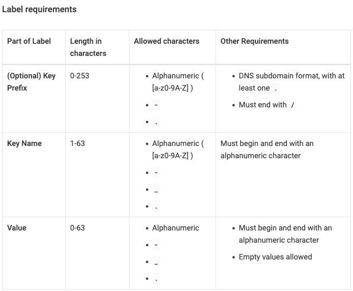

**Table 1, passthrough output:**

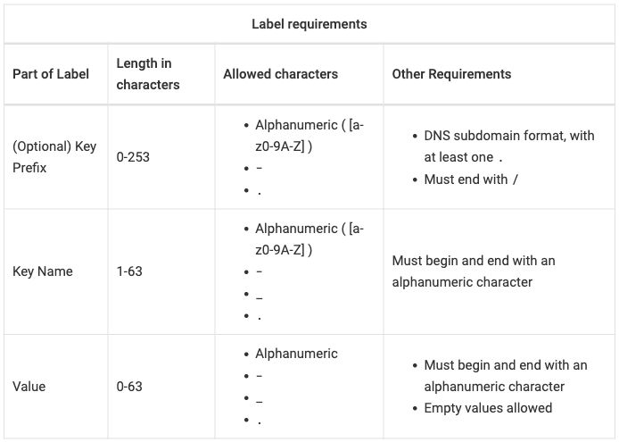

**Table 2, native output:**


**Table 2, passthrough output:**


**Table 3, native output:**


**Table 3, passthrough output:**


Differences seen:

- **The page builds with the HTML as written,** inside passthrough blocks;
  raw, only the two backslash checks fail
  ([Antora raw passthrough](../concepts/tables/results.md#antora-321)).
- **The title** is a bold line above the table in native (`*Label
  requirements*`) and the source's spanning row in passthrough.
- **Native makes column 1 row headers** in all three tables, drawn in bold,
  from the `h` in `cols`. Passthrough keeps ordinary cells, in table 3 too,
  whose specs have no `h`.
- **Native aligns body cells to the top** (the `.<` specs). Passthrough
  centers tables 1 and 2 vertically, as on the published page; its table 3
  is top-aligned.
- **A rule around every cell and header cells on the left,** in both modes.
  The default UI styles only AsciiDoc tables; the site's stylesheet gives
  `table.table` the same look (every HTML table names its style with a
  class, decided; [Antora finding 3](../concepts/tables/results.md#antora-321)).
- **No hyphenation.** The default UI hyphenates words in cells
  ("al-phanumeric"), which the published page does not. Decided: no
  hyphenation in tables; the site's stylesheet turns it off in every mode
  ([Antora finding 5](../concepts/tables/results.md#antora-321)).
- **Native-plain has equal columns,** 25/25/25/25 in tables 1 and 2 and
  33/33/33 in table 3: an AsciiDoc table with no `cols` splits the width
  evenly ([Antora finding 6](../concepts/tables/results.md#antora-321)).
- The key column wraps: 17% of table 1 in native, 16% in passthrough.
- **The source around the tables changes.** The page's prose and code
  blocks are AsciiDoc in every mode, not only the tables
  ([Antora finding 1](../concepts/tables/results.md#antora-321)).

**Extension mode.** The native AsciiDoc tables with roles added before
them, as in `credential-types`. No code: the roles get their meaning from
the site's stylesheet,
[hints.css](../concepts/tables/sites/antora/supplemental-ui/css/hints.css).

<details><summary>Extension input: the AsciiDoc tables with roles</summary>

Table 1:

```asciidoc
*Label requirements*

[.hinted.col1-key.col2-value.col3-prose.col4-prose.col1-nowrap%header,cols=".<~h,.<~,.<~,.<~"]
|===
|Part of Label |Length in characters |Allowed characters |Other Requirements

|(Optional) Key Prefix
|0-253
a|* Alphanumeric ( [a-z0-9A-Z] )
* `-`
* `.`
a|* DNS subdomain format, with at least one `.`
* Must end with `/`

|Key Name
|1-63
a|* Alphanumeric ( [a-z0-9A-Z] )
* `-`
* `+_+`
* `.`
|Must begin and end with an alphanumeric character

|Value
|0-63
a|* Alphanumeric
* `-`
* `+_+`
* `.`
a|* Must begin and end with an alphanumeric character
* Empty values allowed
|===
```

Table 2:

```asciidoc
*Annotation Requirements*

[.hinted.col1-key.col2-value.col3-prose.col4-prose.col1-nowrap%header,cols=".<~h,.<~,.<~,.<~"]
|===
|Part of Annotation |Length in characters |Allowed characters |Other Requirements

|(Optional) Key Prefix
|0-253
a|* Alphanumeric ( [a-z0-9A-Z] )
* `-`
* `.`
a|* DNS subdomain format, with at least one `.`
* Must end with `/`

|Key Name
|1-63
a|* Alphanumeric ( [a-z0-9A-Z] )
* `-`
* `+_+`
* `.`
|Must begin and end with an alphanumeric character

|Value
|0-5000
|Any unicode character
|n/a
|===
```

Table 3:

```asciidoc
[.hinted.col1-key.col2-value.col3-prose.col1-nowrap%header,cols=".<~h,.<~,.<~"]
|===
|Requirement |Format |Description

|existence
|`KEY`
|Returns all resources labeled with the given key

|inexistence
|`!KEY`
|Returns all resources not labeled with the given key

|equality
|`KEY==VALUE` or `KEY=VALUE`
|Returns all resources labeled with the given key and value

|inequality
|`KEY!=VALUE`
|Returns all resources not labeled with the given key and value

|set inclusion
|`+KEY in (VALUE1,VALUE2...)+`
|Returns all resources labeled with the given key and one of the specified values

|set exclusion
|`+KEY notin (VALUE1,VALUE2...)+`
|Returns all resources not labeled with the given key and one of the specified values
|===
```

`.hinted` marks the table as carrying hints; `.col1-key`, `.col2-value`,
`.col3-prose` and `.col4-prose` name the column roles; `.col1-nowrap`
keeps column 1 on one line, up to a cap. The rest is the native table.

</details>

**Table 1, extension output:**


**Table 2, extension output:**


**Table 3, extension output:**


Differences seen, against native:

- **The key column stays on one line:** "(Optional) Key Prefix" in tables
  1 and 2, at 23% of table 1 (native: 17%), and "set exclusion" in table 3.
  The other columns get narrower, so "Any unicode character" wraps in
  table 2.
- Everything else is as in native: row headers, top alignment and a rule
  around every cell.

### Across the tools

- **Heights.** In passthrough, where every screenshot holds table 1 with
  its spanning title row, the table is 541 pixels tall on the published
  page, 495 in Antora, 552 in Zensical, 592 in Docusaurus and 621 in
  Starlight. Table 3, which has no title, is 356 pixels
  published and taller in every native output: 431 in Antora, 437 in
  Zensical, 529 in Docusaurus, 547 in Starlight. As for
  `credential-types`, these are default themes; a site's or a page's theme
  can set table font size, padding and alignment
  ([font size](../concepts/tables/results.md#widths-alignment-and-font-size)).
- **The title row.** No tool's own table syntax puts a title row above the
  column headers: a pipe table cannot span cells, and Markdoc's and
  AsciiDoc's tables have one header row. Every converted mode shows the
  title as a bold line above the table, as decided; passthrough keeps the
  spanning row everywhere.
- **Lists in cells.** Starlight's Markdoc table tag and Antora's `a|` cells
  hold lists in the tool's own syntax, and results.md rates both readable.
  Docusaurus and Zensical native, pipe tables, hold them only as inline
  HTML, which results.md rates hard to edit. Every extension writes them as
  lists in the tool's own syntax ([R-11](../requirements/README.md#r-11) readable source).
- **Row headers.** Only Antora native has them. Extension mode adds them in
  every tool, with top alignment and a key column on one line: 26% of table
  1 in Docusaurus, 23% in Zensical, 27% in Starlight, 23% in Antora.
- **No-wrap for the value column.** The intent asks column 2 to avoid
  wrapping. Lengths such as `0-253` never break in any output. No extension
  page asks it for column 2, though each extension could (the `wrap`
  option; a `col2-nowrap` role in Antora), and `KEY in (VALUE1,VALUE2...)`
  breaks after `in` in every output, as on the published page
  ([R-03](../requirements/README.md#r-03) column widths as hints).
- **The unclosed cells.** Zensical and Antora build the HTML as written and
  the browser repairs it, as on the published page. Docusaurus needs the
  cleanup to build, and Starlight also needs `&#45;` for the lone dashes
  ([R-24](../requirements/README.md#r-24) markup cleanup before
  conversion).

## `troubleshooting_slow_requests`

- Published: <https://docs.cloudfoundry.org/adminguide/troubleshooting_slow_requests.html>
  Tables on the page: [Experiment 1](https://docs.cloudfoundry.org/adminguide/troubleshooting_slow_requests.html#total-latency), [Experiment 2](https://docs.cloudfoundry.org/adminguide/troubleshooting_slow_requests.html#within-cf), [Experiment 3](https://docs.cloudfoundry.org/adminguide/troubleshooting_slow_requests.html#duplicate-latency), [Experiment 4](https://docs.cloudfoundry.org/adminguide/troubleshooting_slow_requests.html#remove-the-load-balancer), [Experiment 5](https://docs.cloudfoundry.org/adminguide/troubleshooting_slow_requests.html#remove-the-gorouter), [Experiment 6](https://docs.cloudfoundry.org/adminguide/troubleshooting_slow_requests.html#test-internal-network)
- Upstream source: [`troubleshooting_slow_requests.html.md.erb` in cloudfoundry/docs-cf-admin, commit `19b0c9c`](https://github.com/cloudfoundry/docs-cf-admin/blob/19b0c9c5fabd93b33ba184c6eb541f3cafd3a1b9/troubleshooting_slow_requests.html.md.erb)
- Snapshot: [source/troubleshooting_slow_requests.html.md.erb](../concepts/tables/source/troubleshooting_slow_requests.html.md.erb) in this repo
  is a copy of that file at that commit. The per-tool versions are
  modified from it. Details: [SOURCES.md](../concepts/tables/source/SOURCES.md).

From docs-cf-admin, six tables with the same shape: Result / Explanation /
Action, one per experiment. Table 2 sits inside a numbered list step, so it
is narrower. Passthrough keeps the widths as written; every other mode sets
no widths and lets the column roles decide (variant C, decided).

- Intent and spot checks: [intent/troubleshooting_slow_requests.md](../concepts/tables/intent/troubleshooting_slow_requests.md)
- Width variants A, B, C: [results.md](../concepts/tables/results.md#width-variants-for-troubleshooting_slow_requests)
- Results per tool: [Docusaurus](../concepts/tables/results.md#docusaurus-3102),
  [Zensical](../concepts/tables/results.md#zensical-0069),
  [Starlight](../concepts/tables/results.md#starlight-0426),
  [Antora](../concepts/tables/results.md#antora-321)

What the tables ask for ([R-02](../requirements/README.md#r-02) rich tables):

- Three columns in every table. Column 1, Result, is a *key* column (the
  outcome each row is about; see [column role](../glossary.md#column-role)),
  but its entries are sentences, so it may wrap. Columns 2 and 3,
  Explanation and Action, are *prose*.
- The source sets widths unevenly. Table 1 sets none, tables 2 to 4 set
  `width="25%"` on a column 1 cell, and tables 5 and 6 set it on columns 1
  and 2. Each width sits on one body cell and applies to the whole column
  only because browsers size a column from its widest request
  ([R-03](../requirements/README.md#r-03) column widths as hints).
- Three width variants were compared: A, the widths as written; B, 25/25/50
  in every table; C, no widths, so the column roles decide. **Decided:**
  variant C. Passthrough keeps variant A.
- Table 2 belongs to step 4 of a numbered list. The source writes it at the
  start of the line, after the step's indented text; the published page
  keeps it in the step because Bookbinder's parser continues the list item
  ([Docusaurus finding 3](../concepts/tables/results.md#docusaurus-3102)).
  In every tool the converted table is indented under the step
  ([R-01](../requirements/README.md#r-01) content and outline survive).
- No row headers. The intent file gives column 1 the key role but no
  row-header hint: its cells are sentences. No input in any tool asks for
  row headers (no `stub-columns`, no `h` in Antora's `cols`).
- No cleanup for well-formedness. Body rows sit directly in `<table>` with
  no `<tbody>`; browsers insert one.
- Table 1, row 4 holds a variable, `<%= vars.app_runtime_abbr %>`, which
  the published page renders as "Cloud Foundry".

At a glance, from the screenshots below. Widths are the measured values in
[results.md](../concepts/tables/results.md), percent of the table, first
body row:

| Output | Table 1 widths | Table 2 widths | Header cells | Body cells, vertically | Rule between the columns |
|---|---|---|---|---|---|
| Published | not measured | not measured | left | centered | yes |
| Docusaurus native | 33/25/42 | 28/35/37 | centered | centered | yes |
| Docusaurus passthrough | 33/25/42 | 25/36/39 | centered | centered | yes |
| Docusaurus extension | 33/25/42 | 28/35/37 | centered | top | yes |
| Zensical native, native-plain and extension | 28/25/46 | 23/37/40 | left | top | no |
| Zensical passthrough | same image as native | 25/36/39 | left | top | no |
| Starlight native, native-plain and extension | 32/27/41 | 31/35/34 | left | top | no |
| Starlight passthrough | 32/27/41 | 25/38/37 | left | top | no |
| Antora native and extension | 34/23/43 | 28/34/37 | left | top | yes |
| Antora passthrough | 34/23/43 | 25/36/39 | left | centered | yes |

No output has row headers. All six tables keep every row and column in
every output, and every spot check of the tables passes in every mode of
every tool (the two Docusaurus misses in results.md are page descriptions,
not tables).

### Published

**Table 1**, Experiment 1:


**Table 2**, Experiment 2, inside step 4 of the list:


**Table 3**, Experiment 3:


**Table 4**, Experiment 4:


**Table 5**, Experiment 5:


**Table 6**, Experiment 6:


Header cells are on the left. Body cells sit in the vertical middle of
their rows, and every cell has a border. Code has a shaded background.
Table 2 is narrower than the others (634 pixels in the screenshot, against
656) because it sits in a list step. Tables 5 and 6 link to headings on the
same page.

<details><summary>Source as written (HTML in an ERB page; table 2 starts at the line's start after the step's indented text)</summary>

Table 1 (lines 69–100):

```html
<table class="table">
<thead>
  <tr>
    <th>Result</th>
    <th>Explanation</th>
    <th>Action</th>
  </tr>
</thead>
  <tr>
    <td>The output shows latency.</td>
    <td>A component of your app request flow is causing a delay.</td>
    <td>Continue with the rest of the experiments to try to narrow down which component is causing
        latency.</td>
  </tr>
  <tr>
    <td>The output does not show latency.</td>
    <td>Your app experiences inconsistent delays.</td>
    <td>Try to find an endpoint that is consistently experiencing latency. If that is not possible,
        then continue with the following experiments, running each of them multiple times.</td>
  </tr>
  <tr>
    <td>The output shows the error: <code>Could not resolve host: NONEXISTENT.com</code></td>
    <td>DNS failed to resolve.</td>
    <td>Troubleshoot your DNS configuration.</td>
  </tr>
  <tr>
    <td>The output of <code>curl</code> returns normally, but there is no value for
        <code>X-Vcap-Request-Id</code>.</td>
    <td>The request from the load balancer did not reach <%= vars.app_runtime_abbr %>.</td>
    <td>Troubleshoot your load balancer configuration.</td>
  </tr>
</table>
```

Table 2, with the last lines of step 4 before it (lines 147–183):

```html
    To narrow down the cause of latency, see the following table for information about the output
    that you see after running `cf logs APP-NAME`:
<table class="table">
      <thead>
      <tr>
        <th>Result</th>
        <th>Explanation</th>
        <th>Action</th>
      </tr>
      </thead>
      <tr>
        <td width="25%">The output shows latency within <code>gorouter_time</code>.</td>
        <td>Gorouter</td>
        <td>Investigate gorouter logs as to why the latency is high. Investigate gorouter capacity metrics + possibly scale up</td>
      </tr>
      <tr>
        <td width="25%">The output shows latency within <code>response_time</code> but not in
            <code>gorouter_time</code>.</td>
        <td>The network between Gorouter and the app, or the app itself, is causing latency. If the requests are uploading data
          to the app, latency between the client and gorouter may appear here as well
        </td>
        <td>If the issue is not related to uploads, jump to experiment 5, and continue with the rest of the experiments to try to narrow
            down which component is causing latency. Otherwise continue with experiment 3.</td>
      </tr>
      <tr>
        <td>The output does not show latency within <code>response_time</code>.</td>
        <td>A component before Gorouter is causing latency to the request before it reaches Gorouter.</td>
        <td>Continue with the rest of the experiments to try to narrow down which component is
            causing latency.</td>
      </tr>
      <tr>
        <td>The output does not show a log line.</td>
        <td>Every incoming request should generate an access log message. If a request does not
            generate an access log message, it means Gorouter did not receive the request.</td>
        <td>Troubleshoot your Gorouter configuration.</td>
      </tr>
    </table>
```

Table 3 (lines 210–229):

```html
<table class="table">
<thead>
  <tr>
    <th>Result</th>
    <th>Explanation</th>
    <th>Action</th>
  </tr>
  </thead>
  <tr>
    <td width="25%">The output shows latency.</td>
    <td>One of the components in the app request path is causing latency.</td>
    <td>Continue with the rest of the experiments, using the test app, to try to narrow down which
        component is causing latency.</td>
  </tr>
  <tr>
    <td>The output does not show latency.</td>
    <td>Something in your app configuration is causing latency.</td>
    <td>Evaluate your app for recent changes.</td>
  </tr>
</table>
```

Table 4 (lines 275–296):

```html
<table class="table">
<thead>
  <tr>
    <th>Result</th>
    <th>Explanation</th>
    <th>Action</th>
  </tr>
  </thead>
  <tr>
    <td width="25%">The output shows latency.</td>
    <td>The load balancer is not causing latency.</td>
    <td>Continue with the rest of the experiments, using the test app, to try to narrow down which
        component is causing latency.</td>
  </tr>
  <tr>
    <td>The output does not show latency.</td>
    <td>A component before Gorouter is causing latency.</td>
    <td>Look at your load balancer logs and logs for any other components that exist between the
        end client and Gorouter. Additionally, run these experiments with clients in different networks
        to help isolate where issues occur.</td>
  </tr>
</table>
```

Table 5 (lines 330–350):

```html
<table class="table">
<thead>
  <tr>
    <th>Result</th>
    <th>Explanation</th>
    <th>Action</th>
  </tr>
  </thead>
  <tr>
    <td width="25%">The output shows latency.</td>
    <td width="25%">Gorouter is not causing latency.</td>
    <td>Continue with the rest of the experiments, using the test app, to try to narrow down which
        component is causing latency.</td>
  </tr>
  <tr>
    <td>The output does not show latency.</td>
    <td>Gorouter is causing latency.</td>
    <td>See <a href="#gorouter-latency">Causes for Gorouter Latency</a> and
        <a href="#ops-recommendations">Operations Recommendations</a>.</td>
  </tr>
</table>
```

Table 6 (lines 395–415; the last cell's third line starts with a tab):

```html
<table class="table">
  <thead>
  <tr>
    <th>Result</th>
    <th>Explanation</th>
    <th>Action</th>
  </tr>
  </thead>
  <tr>
    <td width="25%">The output shows latency.</td>
    <td width="25%">Your network is causing latency.</td>
    <td>Troubleshoot your network configuration.</td>
  </tr>
  <tr>
    <td>The output does not show latency.</td>
    <td>A component in your app request path is causing latency.</td>
    <td>Repeat the diagnostic experiments to narrow down which component is causing latency. Follow
    the steps in <a href="#total-latency">Experiment 1: Measure Total Round-Trip App Requests</a>
	 and ensure that you are consistently experiencing latency.</td>
  </tr>
</table>
```

</details>

ERB (see the [glossary](../glossary.md#erb)) inserts the one variable in
the tables, `vars.app_runtime_abbr` in table 1, row 4. Each tool writes it
its own way: `{vars.app_runtime_abbr}` in Docusaurus, unchanged in
Zensical, `` in Starlight and
`{app_runtime_abbr}` in Antora. Every output shows "Cloud Foundry".

The sections below show tables 1 and 2 for each tool and mode. All six
tables, in every mode, are side by side on the
[comparison page](compare/index.html#troubleshooting_slow_requests).

### Docusaurus 3.10.2

Pages are MDX, as in [`credential-types`](#credential-types): MDX parses
HTML as JSX, which is stricter than a browser. Variables need one import
per page.

<details><summary>Native input: pipe tables; table 2 indented under step 4</summary>

Table 1:

```markdown
| Result | Explanation | Action |
| --- | --- | --- |
| The output shows latency. | A component of your app request flow is causing a delay. | Continue with the rest of the experiments to try to narrow down which component is causing latency. |
| The output does not show latency. | Your app experiences inconsistent delays. | Try to find an endpoint that is consistently experiencing latency. If that is not possible, then continue with the following experiments, running each of them multiple times. |
| The output shows the error: `Could not resolve host: NONEXISTENT.com` | DNS failed to resolve. | Troubleshoot your DNS configuration. |
| The output of `curl` returns normally, but there is no value for `X-Vcap-Request-Id`. | The request from the load balancer did not reach {vars.app_runtime_abbr}. | Troubleshoot your load balancer configuration. |
```

Table 2, after the last lines of step 4:

```markdown
    To narrow down the cause of latency, see the following table for information about the output
    that you see after running `cf logs APP-NAME`:


    | Result | Explanation | Action |
    | --- | --- | --- |
    | The output shows latency within `gorouter_time`. | Gorouter | Investigate gorouter logs as to why the latency is high. Investigate gorouter capacity metrics + possibly scale up |
    | The output shows latency within `response_time` but not in `gorouter_time`. | The network between Gorouter and the app, or the app itself, is causing latency. If the requests are uploading data to the app, latency between the client and gorouter may appear here as well | If the issue is not related to uploads, jump to experiment 5, and continue with the rest of the experiments to try to narrow down which component is causing latency. Otherwise continue with experiment 3. |
    | The output does not show latency within `response_time`. | A component before Gorouter is causing latency to the request before it reaches Gorouter. | Continue with the rest of the experiments to try to narrow down which component is causing latency. |
    | The output does not show a log line. | Every incoming request should generate an access log message. If a request does not generate an access log message, it means Gorouter did not receive the request. | Troubleshoot your Gorouter configuration. |
```

</details>

<details><summary>Passthrough input: the HTML with <code>tbody</code> added; table 2 indented under step 4</summary>

Table 1:

```jsx
<table class="table">
<thead>
  <tr>
    <th>Result</th>
    <th>Explanation</th>
    <th>Action</th>
  </tr>
</thead>
  <tbody>
<tr>
    <td>The output shows latency.</td>
    <td>A component of your app request flow is causing a delay.</td>
    <td>Continue with the rest of the experiments to try to narrow down which component is causing
        latency.</td>
  </tr>
  <tr>
    <td>The output does not show latency.</td>
    <td>Your app experiences inconsistent delays.</td>
    <td>Try to find an endpoint that is consistently experiencing latency. If that is not possible,
        then continue with the following experiments, running each of them multiple times.</td>
  </tr>
  <tr>
    <td>The output shows the error: <code>Could not resolve host: NONEXISTENT.com</code></td>
    <td>DNS failed to resolve.</td>
    <td>Troubleshoot your DNS configuration.</td>
  </tr>
  <tr>
    <td>The output of <code>curl</code> returns normally, but there is no value for
        <code>X-Vcap-Request-Id</code>.</td>
    <td>The request from the load balancer did not reach {vars.app_runtime_abbr}.</td>
    <td>Troubleshoot your load balancer configuration.</td>
  </tr>
</tbody>

</table>
```

Table 2, after the last lines of step 4:

```jsx
    To narrow down the cause of latency, see the following table for information about the output
    that you see after running `cf logs APP-NAME`:

    <table class="table">
          <thead>
          <tr>
            <th>Result</th>
            <th>Explanation</th>
            <th>Action</th>
          </tr>
          </thead>
          <tbody>
    <tr>
            <td width="25%">The output shows latency within <code>gorouter_time</code>.</td>
            <td>Gorouter</td>
            <td>Investigate gorouter logs as to why the latency is high. Investigate gorouter capacity metrics + possibly scale up</td>
          </tr>
          <tr>
            <td width="25%">The output shows latency within <code>response_time</code> but not in
                <code>gorouter_time</code>.</td>
            <td>The network between Gorouter and the app, or the app itself, is causing latency. If the requests are uploading data
              to the app, latency between the client and gorouter may appear here as well</td>
            <td>If the issue is not related to uploads, jump to experiment 5, and continue with the rest of the experiments to try to narrow
                down which component is causing latency. Otherwise continue with experiment 3.</td>
          </tr>
          <tr>
            <td>The output does not show latency within <code>response_time</code>.</td>
            <td>A component before Gorouter is causing latency to the request before it reaches Gorouter.</td>
            <td>Continue with the rest of the experiments to try to narrow down which component is
                causing latency.</td>
          </tr>
          <tr>
            <td>The output does not show a log line.</td>
            <td>Every incoming request should generate an access log message. If a request does not
                generate an access log message, it means Gorouter did not receive the request.</td>
            <td>Troubleshoot your Gorouter configuration.</td>
          </tr>
    </tbody>

        </table>
```

</details>

Files: [native](../concepts/tables/sites/docusaurus/docs/native/troubleshooting_slow_requests.mdx),
[passthrough](../concepts/tables/sites/docusaurus/docs/passthrough/troubleshooting_slow_requests.mdx),
[passthrough as written](../concepts/tables/sites/docusaurus/docs/passthrough-raw/troubleshooting_slow_requests.mdx),
[extension](../concepts/tables/sites/docusaurus/docs/extension/troubleshooting_slow_requests.mdx).
Docusaurus has no native-plain page: its native page already has no width
settings.

**Table 1, native and passthrough output** (the two screenshots are the
same image, byte for byte):


**Table 2, native output:**


**Table 2, passthrough output:**


Differences seen:

- **The page does not build with the HTML as written.** MDX's first error
  is an unclosed `<br>` outside the tables
  ([raw passthrough errors](../concepts/tables/results.md#raw-passthrough-errors)).
  The tables needed `<tbody>` and one cell's closing `</td>` moved off the
  start of its line, the Explanation cell of row 2 in table 2. The `width="25%"`
  attributes stay as written
  ([R-24](../requirements/README.md#r-24) markup cleanup before conversion).
- **Table 1 is the same in both modes.** The source sets no widths there,
  so both size the columns by their content, 33/25/42.
- **Table 2 differs in its widths.** Passthrough keeps column 1 at 25%;
  native, with no widths, gives it 28% (variant A against variant C). The
  widths of all six tables in each variant are in
  [results.md](../concepts/tables/results.md#width-variants-for-troubleshooting_slow_requests),
  with table 2 rendered in each:
  [A](../concepts/tables/results/docusaurus-troubleshooting-t2-A-as-written.png),
  [B](../concepts/tables/results/docusaurus-troubleshooting-t2-B-uniform.png),
  [C](../concepts/tables/results/docusaurus-troubleshooting-t2-C-roles-only.png).
- **Header cells are centered**, in both modes, as in `credential-types`:
  the theme sets no alignment, so the browser's default shows
  ([checked after review](../concepts/tables/results.md#widths-alignment-and-font-size)).
- **Alternate body rows are shaded** (rows 2 and 4). The published tables
  have no shading.
- **`X-Vcap-Request-Id` breaks after its last hyphen** ("X-Vcap-Request-" /
  "Id") in table 1, row 4, in every mode; the published page keeps it
  whole. The text itself is unchanged.
- Body cells are vertically centered, as on the published page.

Both modes use no plugin: native is MDX's own pipe table, passthrough is
HTML written as JSX inside MDX.

**Extension mode.** A `:::list-table` block, read by the remark plugin
added to the site,
[plugins/list-table.js](../concepts/tables/sites/docusaurus/plugins/list-table.js),
with [hints.css](../concepts/tables/sites/docusaurus/src/css/hints.css).

<details><summary>Extension input: a list-table directive (table 1)</summary>

```markdown
:::list-table{header-rows="1" roles="key prose prose" wrap="normal"}
- - Result
  - Explanation
  - Action
- - The output shows latency.
  - A component of your app request flow is causing a delay.
  - Continue with the rest of the experiments to try to narrow down which component is causing latency.
- - The output does not show latency.
  - Your app experiences inconsistent delays.
  - Try to find an endpoint that is consistently experiencing latency. If that is not possible, then continue with the following experiments, running each of them multiple times.
- - The output shows the error: `Could not resolve host: NONEXISTENT.com`
  - DNS failed to resolve.
  - Troubleshoot your DNS configuration.
- - The output of `curl` returns normally, but there is no value for `X-Vcap-Request-Id`.
  - The request from the load balancer did not reach {vars.app_runtime_abbr}.
  - Troubleshoot your load balancer configuration.
:::
```

`header-rows="1"` makes the first row the header, `roles` names column 1 a
key column and columns 2 and 3 prose, and `wrap="normal"` lets column 1
wrap; a key column otherwise avoids wrapping. There is no `widths`
(variant C) and no `stub-columns`, so no row headers. Table 2 is written
the same way, indented under step 4.

</details>

**Table 1, extension output:**


**Table 2, extension output:**


Differences seen, against native:

- **Body cells are aligned to the top**; native, passthrough and the
  published page center them. The widths are the same as native
  (variant C).
- Header cells centered and alternate rows shaded, as in the other two
  modes.

### Zensical 0.0.69

Pages are Markdown read by Python-Markdown, which passes HTML blocks
through unchanged, as in [`credential-types`](#credential-types). Variables
keep their ERB form.

<details><summary>Native input: pipe tables with no width attributes; table 2 indented under step 4</summary>

Table 1:

```markdown
| Result | Explanation | Action |
| --- | --- | --- |
| The output shows latency. | A component of your app request flow is causing a delay. | Continue with the rest of the experiments to try to narrow down which component is causing latency. |
| The output does not show latency. | Your app experiences inconsistent delays. | Try to find an endpoint that is consistently experiencing latency. If that is not possible, then continue with the following experiments, running each of them multiple times. |
| The output shows the error: `Could not resolve host: NONEXISTENT.com` | DNS failed to resolve. | Troubleshoot your DNS configuration. |
| The output of `curl` returns normally, but there is no value for `X-Vcap-Request-Id`. | The request from the load balancer did not reach <%= vars.app_runtime_abbr %>. | Troubleshoot your load balancer configuration. |
```

Table 2, after the last lines of step 4:

```markdown
    To narrow down the cause of latency, see the following table for information about the output
    that you see after running `cf logs APP-NAME`:

    | Result | Explanation | Action |
    | --- | --- | --- |
    | The output shows latency within `gorouter_time`. | Gorouter | Investigate gorouter logs as to why the latency is high. Investigate gorouter capacity metrics + possibly scale up |
    | The output shows latency within `response_time` but not in `gorouter_time`. | The network between Gorouter and the app, or the app itself, is causing latency. If the requests are uploading data to the app, latency between the client and gorouter may appear here as well | If the issue is not related to uploads, jump to experiment 5, and continue with the rest of the experiments to try to narrow down which component is causing latency. Otherwise continue with experiment 3. |
    | The output does not show latency within `response_time`. | A component before Gorouter is causing latency to the request before it reaches Gorouter. | Continue with the rest of the experiments to try to narrow down which component is causing latency. |
    | The output does not show a log line. | Every incoming request should generate an access log message. If a request does not generate an access log message, it means Gorouter did not receive the request. | Troubleshoot your Gorouter configuration. |
```

</details>

<details><summary>Passthrough input: the HTML as written; table 2 indented under step 4</summary>

Table 1, the same as the source:

```html
<table class="table">
<thead>
  <tr>
    <th>Result</th>
    <th>Explanation</th>
    <th>Action</th>
  </tr>
</thead>
  <tr>
    <td>The output shows latency.</td>
    <td>A component of your app request flow is causing a delay.</td>
    <td>Continue with the rest of the experiments to try to narrow down which component is causing
        latency.</td>
  </tr>
  <tr>
    <td>The output does not show latency.</td>
    <td>Your app experiences inconsistent delays.</td>
    <td>Try to find an endpoint that is consistently experiencing latency. If that is not possible,
        then continue with the following experiments, running each of them multiple times.</td>
  </tr>
  <tr>
    <td>The output shows the error: <code>Could not resolve host: NONEXISTENT.com</code></td>
    <td>DNS failed to resolve.</td>
    <td>Troubleshoot your DNS configuration.</td>
  </tr>
  <tr>
    <td>The output of <code>curl</code> returns normally, but there is no value for
        <code>X-Vcap-Request-Id</code>.</td>
    <td>The request from the load balancer did not reach <%= vars.app_runtime_abbr %>.</td>
    <td>Troubleshoot your load balancer configuration.</td>
  </tr>
</table>
```

Table 2, after the last lines of step 4:

```html
    To narrow down the cause of latency, see the following table for information about the output
    that you see after running `cf logs APP-NAME`:
    <table class="table">
          <thead>
          <tr>
            <th>Result</th>
            <th>Explanation</th>
            <th>Action</th>
          </tr>
          </thead>
          <tr>
            <td width="25%">The output shows latency within <code>gorouter_time</code>.</td>
            <td>Gorouter</td>
            <td>Investigate gorouter logs as to why the latency is high. Investigate gorouter capacity metrics + possibly scale up</td>
          </tr>
          <tr>
            <td width="25%">The output shows latency within <code>response_time</code> but not in
                <code>gorouter_time</code>.</td>
            <td>The network between Gorouter and the app, or the app itself, is causing latency. If the requests are uploading data
              to the app, latency between the client and gorouter may appear here as well
            </td>
            <td>If the issue is not related to uploads, jump to experiment 5, and continue with the rest of the experiments to try to narrow
                down which component is causing latency. Otherwise continue with experiment 3.</td>
          </tr>
          <tr>
            <td>The output does not show latency within <code>response_time</code>.</td>
            <td>A component before Gorouter is causing latency to the request before it reaches Gorouter.</td>
            <td>Continue with the rest of the experiments to try to narrow down which component is
                causing latency.</td>
          </tr>
          <tr>
            <td>The output does not show a log line.</td>
            <td>Every incoming request should generate an access log message. If a request does not
                generate an access log message, it means Gorouter did not receive the request.</td>
            <td>Troubleshoot your Gorouter configuration.</td>
          </tr>
        </table>
```

</details>

Files: [native](../concepts/tables/sites/zensical/docs/native/troubleshooting_slow_requests.md),
[native-plain](../concepts/tables/sites/zensical/docs/native-plain/troubleshooting_slow_requests.md),
[passthrough](../concepts/tables/sites/zensical/docs/passthrough/troubleshooting_slow_requests.md),
[passthrough as written](../concepts/tables/sites/zensical/docs/passthrough-raw/troubleshooting_slow_requests.md),
[extension](../concepts/tables/sites/zensical/docs/extension/troubleshooting_slow_requests.md).
Native and native-plain are the same file: with no widths, native has no
attribute to leave out.

**Table 1, every mode** (the native, native-plain, passthrough and
extension screenshots are the same image, byte for byte):


**Table 2, native, native-plain and extension output** (the three
screenshots are the same image, byte for byte):


**Table 2, passthrough output:**


Differences seen:

- **The page builds with the HTML as written.** Built raw, the only failing
  spot check is table 2 outside its list step; indenting it under step 4
  fixes that
  ([Zensical raw passthrough](../concepts/tables/results.md#zensical-0069)).
  Indented, the HTML table becomes inline HTML inside the step's paragraph,
  and browsers close the paragraph at the table, so it stays in the step
  ([Zensical finding 4](../concepts/tables/results.md#zensical-0069)).
- **Table 2 differs in its widths**: 25/36/39 in passthrough, from the
  source's 25%, and 23/37/40 in the other modes.
- **No rule between the columns.** Rows are separated by horizontal rules
  inside a thin outer frame. Body cells are aligned to the top and header
  cells are on the left, as in `credential-types`. The site's stylesheet
  gives `table.table` the theme's table look
  ([Zensical finding 1](../concepts/tables/results.md#zensical-0069)), so
  passthrough looks like native.
- **`X-Vcap-Request-Id` breaks after its first hyphen** ("X-Vcap-" /
  "Request-Id") in table 1, row 4. The text itself is unchanged.
- Outside the tables, three asterisks show as text in every mode, where a
  bulleted list follows a paragraph line with no blank line between them.
  Lists are their own concept.

**Extension mode.** A `/// list-table` block, read by the Python-Markdown
extension added to the site,
[list_table.py](../concepts/tables/sites/zensical/list_table.py), with
[hints.css](../concepts/tables/sites/zensical/docs/stylesheets/hints.css).

<details><summary>Extension input: a list-table block (table 1)</summary>

```markdown
/// list-table
    header-rows: 1
    roles: key prose prose
    wrap: normal

-   - Result
    - Explanation
    - Action

-   - The output shows latency.
    - A component of your app request flow is causing a delay.
    - Continue with the rest of the experiments to try to narrow down which component is causing latency.

-   - The output does not show latency.
    - Your app experiences inconsistent delays.
    - Try to find an endpoint that is consistently experiencing latency. If that is not possible, then continue with the following experiments, running each of them multiple times.

-   - The output shows the error: `Could not resolve host: NONEXISTENT.com`
    - DNS failed to resolve.
    - Troubleshoot your DNS configuration.

-   - The output of `curl` returns normally, but there is no value for `X-Vcap-Request-Id`.
    - The request from the load balancer did not reach <%= vars.app_runtime_abbr %>.
    - Troubleshoot your load balancer configuration.
///
```

The options mean the same as in the Docusaurus directive: a header row,
the column roles, and column 1 allowed to wrap. Table 2 is written the same
way, indented under step 4.

</details>

**Extension output:** the same images as native, for all six tables.

Differences seen:

- **None against native.** The six extension screenshots are the native
  ones, byte for byte. The theme already aligns cells to the top, no option
  sets a width, and there are no row headers.

### Starlight 0.42.6

These pages are Markdoc, as in [`credential-types`](#credential-types):
Markdown with `` tags, with HTML allowed. Markdoc's `` tag
writes each cell as a list item and each row break as `---`.

<details><summary>Native input: Markdoc's table tag with no widths; table 2 indented under step 4</summary>

Table 1:

```markdown

* Result
* Explanation
* Action
---
* The output shows latency.
* A component of your app request flow is causing a delay.
* Continue with the rest of the experiments to try to narrow down which component is causing latency.
---
* The output does not show latency.
* Your app experiences inconsistent delays.
* Try to find an endpoint that is consistently experiencing latency. If that is not possible, then continue with the following experiments, running each of them multiple times.
---
* The output shows the error: `Could not resolve host: NONEXISTENT.com`
* DNS failed to resolve.
* Troubleshoot your DNS configuration.
---
* The output of `curl` returns normally, but there is no value for `X-Vcap-Request-Id`.
* The request from the load balancer did not reach .
* Troubleshoot your load balancer configuration.

```

Table 2, after the last lines of step 4:

```markdown
    To narrow down the cause of latency, see the following table for information about the output
    that you see after running `cf logs APP-NAME`:
    
    * Result
    * Explanation
    * Action
    ---
    * The output shows latency within `gorouter_time`.
    * Gorouter
    * Investigate gorouter logs as to why the latency is high. Investigate gorouter capacity metrics + possibly scale up
    ---
    * The output shows latency within `response_time` but not in `gorouter_time`.
    * The network between Gorouter and the app, or the app itself, is causing latency. If the requests are uploading data to the app, latency between the client and gorouter may appear here as well
    * If the issue is not related to uploads, jump to experiment 5, and continue with the rest of the experiments to try to narrow down which component is causing latency. Otherwise continue with experiment 3.
    ---
    * The output does not show latency within `response_time`.
    * A component before Gorouter is causing latency to the request before it reaches Gorouter.
    * Continue with the rest of the experiments to try to narrow down which component is causing latency.
    ---
    * The output does not show a log line.
    * Every incoming request should generate an access log message. If a request does not generate an access log message, it means Gorouter did not receive the request.
    * Troubleshoot your Gorouter configuration.
    
```

</details>

<details><summary>Passthrough input: the HTML with each cell on one line; table 2 indented under step 4</summary>

Table 1:

```html
<table class="table">
<thead>
  <tr>
    <th>Result</th>
    <th>Explanation</th>
    <th>Action</th>
  </tr>
</thead>
  <tr>
    <td>The output shows latency.</td>
    <td>A component of your app request flow is causing a delay.</td>
    <td>Continue with the rest of the experiments to try to narrow down which component is causing latency.</td>
  </tr>
  <tr>
    <td>The output does not show latency.</td>
    <td>Your app experiences inconsistent delays.</td>
    <td>Try to find an endpoint that is consistently experiencing latency. If that is not possible, then continue with the following experiments, running each of them multiple times.</td>
  </tr>
  <tr>
    <td>The output shows the error: <code>Could not resolve host: NONEXISTENT.com</code></td>
    <td>DNS failed to resolve.</td>
    <td>Troubleshoot your DNS configuration.</td>
  </tr>
  <tr>
    <td>The output of <code>curl</code> returns normally, but there is no value for <code>X-Vcap-Request-Id</code>.</td>
    <td>The request from the load balancer did not reach .</td>
    <td>Troubleshoot your load balancer configuration.</td>
  </tr>
</table>
```

Table 2, after the last lines of step 4:

```html
    To narrow down the cause of latency, see the following table for information about the output
    that you see after running `cf logs APP-NAME`:
    <table class="table">
          <thead>
          <tr>
            <th>Result</th>
            <th>Explanation</th>
            <th>Action</th>
          </tr>
          </thead>
          <tr>
            <td width="25%">The output shows latency within <code>gorouter_time</code>.</td>
            <td>Gorouter</td>
            <td>Investigate gorouter logs as to why the latency is high. Investigate gorouter capacity metrics + possibly scale up</td>
          </tr>
          <tr>
            <td width="25%">The output shows latency within <code>response_time</code> but not in <code>gorouter_time</code>.</td>
            <td>The network between Gorouter and the app, or the app itself, is causing latency. If the requests are uploading data to the app, latency between the client and gorouter may appear here as well </td>
            <td>If the issue is not related to uploads, jump to experiment 5, and continue with the rest of the experiments to try to narrow down which component is causing latency. Otherwise continue with experiment 3.</td>
          </tr>
          <tr>
            <td>The output does not show latency within <code>response_time</code>.</td>
            <td>A component before Gorouter is causing latency to the request before it reaches Gorouter.</td>
            <td>Continue with the rest of the experiments to try to narrow down which component is causing latency.</td>
          </tr>
          <tr>
            <td>The output does not show a log line.</td>
            <td>Every incoming request should generate an access log message. If a request does not generate an access log message, it means Gorouter did not receive the request.</td>
            <td>Troubleshoot your Gorouter configuration.</td>
          </tr>
        </table>
```

</details>

Files: [native](../concepts/tables/sites/starlight/src/content/docs/native/troubleshooting_slow_requests.mdoc),
[native-plain](../concepts/tables/sites/starlight/src/content/docs/native-plain/troubleshooting_slow_requests.mdoc),
[passthrough](../concepts/tables/sites/starlight/src/content/docs/passthrough/troubleshooting_slow_requests.mdoc),
[passthrough as written](../concepts/tables/sites/starlight/src/content/docs/passthrough-raw/troubleshooting_slow_requests.mdoc),
[extension](../concepts/tables/sites/starlight/src/content/docs/extension/troubleshooting_slow_requests.mdoc).
Native-plain writes the same tables as pipe tables.

**Table 1, every mode** (the native, native-plain, passthrough and
extension screenshots are the same image, byte for byte):


**Table 2, native, native-plain and extension output** (the three
screenshots are the same image, byte for byte):


**Table 2, passthrough output:**


Differences seen:

- **The page does not parse with the HTML as written**, and that stops the
  whole build. The cause is outside the tables: a blank line inside the
  terminal block in step 4 of Experiment 2, now written `&#10;`
  ([Starlight finding 3](../concepts/tables/results.md#starlight-0426)).
- **Each cell is joined onto one line.** When a cell's text spans lines,
  Markdoc drops the space next to an inline tag: in table 6 the HTML as
  written renders "the steps inExperiment 1"
  ([Starlight finding 2](../concepts/tables/results.md#starlight-0426)).
  Both changes are needed because Markdoc cannot take the HTML as is
  ([R-24](../requirements/README.md#r-24) markup cleanup before conversion).
- **Table 2 differs in its widths**: 25/38/37 in passthrough, from the
  source's 25%, and 31/35/34 in the other modes. Native's table 2 is the
  tallest output on the page, 933 pixels in the screenshot against 849 in
  passthrough.
- **Only horizontal rules**, body cells aligned to the top and header
  cells on the left, as in `credential-types`.
- **`X-Vcap-Request-Id` breaks after its first hyphen** ("X-" /
  "Vcap-Request-Id") in table 1, row 4. The text itself is unchanged.
- Outside the tables, `Accept: */*` in a terminal block shows as
  `Accept: /` in every mode, as in Docusaurus. Code blocks are their own
  concept.

**Extension mode.** Markdoc's own `` tag with extra attributes,
declared for the site in
[list-table.mjs](../concepts/tables/sites/starlight/list-table.mjs), with
[hints.css](../concepts/tables/sites/starlight/src/styles/hints.css).

<details><summary>Extension input: the table tag with hint attributes (table 1)</summary>

```markdown

* Result
* Explanation
* Action
---
* The output shows latency.
* A component of your app request flow is causing a delay.
* Continue with the rest of the experiments to try to narrow down which component is causing latency.
---
* The output does not show latency.
* Your app experiences inconsistent delays.
* Try to find an endpoint that is consistently experiencing latency. If that is not possible, then continue with the following experiments, running each of them multiple times.
---
* The output shows the error: `Could not resolve host: NONEXISTENT.com`
* DNS failed to resolve.
* Troubleshoot your DNS configuration.
---
* The output of `curl` returns normally, but there is no value for `X-Vcap-Request-Id`.
* The request from the load balancer did not reach .
* Troubleshoot your load balancer configuration.

```

The attributes mean the same as in the Docusaurus directive. Only the
opening tag differs from native; table 2 is written the same way, indented
under step 4.

</details>

**Extension output:** the same images as native, for all six tables.

Differences seen:

- **None against native.** The six extension screenshots are the native
  ones, byte for byte. The theme already aligns cells to the top, no
  attribute sets a width, and there are no row headers.

### Antora 3.2.1

Antora builds sites from AsciiDoc, as in
[`credential-types`](#credential-types). The whole page is rewritten from
Markdown to AsciiDoc in every mode; in passthrough the HTML sits unchanged
inside a passthrough block (`++++`).

<details><summary>Native input: AsciiDoc tables with column specs; table 2 inside step 4</summary>

Table 1:

```asciidoc
[%header,cols=".<~,.<~,.<~"]
|===
|Result |Explanation |Action

|The output shows latency.
|A component of your app request flow is causing a delay.
|Continue with the rest of the experiments to try to narrow down which component is causing latency.

|The output does not show latency.
|Your app experiences inconsistent delays.
|Try to find an endpoint that is consistently experiencing latency. If that is not possible, then continue with the following experiments, running each of them multiple times.

|The output shows the error: `Could not resolve host: NONEXISTENT.com`
|DNS failed to resolve.
|Troubleshoot your DNS configuration.

|The output of `curl` returns normally, but there is no value for `X-Vcap-Request-Id`.
|The request from the load balancer did not reach {app_runtime_abbr}.
|Troubleshoot your load balancer configuration.
|===
```

Table 2, after the last lines of step 4; the `--` below it closes the block
that holds the step's content:

```asciidoc
To narrow down the cause of latency, see the following table for information about the output
that you see after running `cf logs APP-NAME`:

[%header,cols=".<~,.<~,.<~"]
|===
|Result |Explanation |Action

|The output shows latency within `+gorouter_time+`.
|Gorouter
|Investigate gorouter logs as to why the latency is high. Investigate gorouter capacity metrics + possibly scale up

|The output shows latency within `+response_time+` but not in `+gorouter_time+`.
|The network between Gorouter and the app, or the app itself, is causing latency. If the requests are uploading data to the app, latency between the client and gorouter may appear here as well
|If the issue is not related to uploads, jump to experiment 5, and continue with the rest of the experiments to try to narrow down which component is causing latency. Otherwise continue with experiment 3.

|The output does not show latency within `+response_time+`.
|A component before Gorouter is causing latency to the request before it reaches Gorouter.
|Continue with the rest of the experiments to try to narrow down which component is causing latency.

|The output does not show a log line.
|Every incoming request should generate an access log message. If a request does not generate an access log message, it means Gorouter did not receive the request.
|Troubleshoot your Gorouter configuration.
|===
--
```

In `cols`, `.<` aligns each column to the top and `~` sizes it by its
content, so no column gets a width (variant C; Asciidoctor:
[`cols` parsing](https://github.com/asciidoctor/asciidoctor/blob/30fb8cd5f7145c57274b04524ceaa99812f830e0/lib/asciidoctor/parser.rb#L2469-L2513)).
Step 4's content sits in a block opened with `--` after the `+` that
attaches it to the step, so the table belongs to the step. Code that holds
`_` is written `` `+…+` `` ([Antora finding 7](../concepts/tables/results.md#antora-321)).

</details>

<details><summary>Passthrough input: the HTML inside passthrough blocks</summary>

Table 1:

```asciidoc
[subs=attributes+]
++++
<table class="table">
<thead>
  <tr>
    <th>Result</th>
    <th>Explanation</th>
    <th>Action</th>
  </tr>
</thead>
  <tr>
    <td>The output shows latency.</td>
    <td>A component of your app request flow is causing a delay.</td>
    <td>Continue with the rest of the experiments to try to narrow down which component is causing
        latency.</td>
  </tr>
  <tr>
    <td>The output does not show latency.</td>
    <td>Your app experiences inconsistent delays.</td>
    <td>Try to find an endpoint that is consistently experiencing latency. If that is not possible,
        then continue with the following experiments, running each of them multiple times.</td>
  </tr>
  <tr>
    <td>The output shows the error: <code>Could not resolve host: NONEXISTENT.com</code></td>
    <td>DNS failed to resolve.</td>
    <td>Troubleshoot your DNS configuration.</td>
  </tr>
  <tr>
    <td>The output of <code>curl</code> returns normally, but there is no value for
        <code>X-Vcap-Request-Id</code>.</td>
    <td>The request from the load balancer did not reach {app_runtime_abbr}.</td>
    <td>Troubleshoot your load balancer configuration.</td>
  </tr>
</table>
++++
```

Table 2, after the last lines of step 4:

```asciidoc
To narrow down the cause of latency, see the following table for information about the output
that you see after running `cf logs APP-NAME`:

++++
<table class="table">
  <thead>
  <tr>
    <th>Result</th>
    <th>Explanation</th>
    <th>Action</th>
  </tr>
  </thead>
  <tr>
    <td width="25%">The output shows latency within <code>gorouter_time</code>.</td>
    <td>Gorouter</td>
    <td>Investigate gorouter logs as to why the latency is high. Investigate gorouter capacity metrics + possibly scale up</td>
  </tr>
  <tr>
    <td width="25%">The output shows latency within <code>response_time</code> but not in
        <code>gorouter_time</code>.</td>
    <td>The network between Gorouter and the app, or the app itself, is causing latency. If the requests are uploading data
      to the app, latency between the client and gorouter may appear here as well
    </td>
    <td>If the issue is not related to uploads, jump to experiment 5, and continue with the rest of the experiments to try to narrow
        down which component is causing latency. Otherwise continue with experiment 3.</td>
  </tr>
  <tr>
    <td>The output does not show latency within <code>response_time</code>.</td>
    <td>A component before Gorouter is causing latency to the request before it reaches Gorouter.</td>
    <td>Continue with the rest of the experiments to try to narrow down which component is
        causing latency.</td>
  </tr>
  <tr>
    <td>The output does not show a log line.</td>
    <td>Every incoming request should generate an access log message. If a request does not
        generate an access log message, it means Gorouter did not receive the request.</td>
    <td>Troubleshoot your Gorouter configuration.</td>
  </tr>
</table>
++++
--
```

`[subs=attributes+]` lets the block replace `{app_runtime_abbr}`; it is
the only addition to table 1.

</details>

Files: [native](../concepts/tables/sites/antora/native/modules/ROOT/pages/troubleshooting_slow_requests.adoc),
[native-plain](../concepts/tables/sites/antora/native-plain/modules/ROOT/pages/troubleshooting_slow_requests.adoc),
[passthrough](../concepts/tables/sites/antora/passthrough/modules/ROOT/pages/troubleshooting_slow_requests.adoc),
[passthrough as written](../concepts/tables/sites/antora/passthrough-raw/modules/ROOT/pages/troubleshooting_slow_requests.adoc),
[extension](../concepts/tables/sites/antora/extension/modules/ROOT/pages/troubleshooting_slow_requests.adoc).

**Table 1, native output:**


**Table 1, passthrough output:**


**Table 2, native output:**


**Table 2, passthrough output:**


Differences seen:

- **The HTML builds as written.** Built raw, table 2 follows the list
  instead of sitting in step 4; it moves inside the step's block
  ([Antora raw passthrough](../concepts/tables/results.md#antora-321)).
- **Table 1 has the same widths in both modes**, 34/23/43. Table 2 is
  25/36/39 in passthrough, from the source's 25%, and 28/34/37 in native.
- **Native aligns body cells to the top** (the `.<` specs); passthrough
  centers them vertically, as on the published page.
- Header cells on the left and a rule around every cell, in both modes.
  The site's stylesheet gives `table.table` the look of AsciiDoc's tables
  ([Antora finding 3](../concepts/tables/results.md#antora-321);
  [R-09](../requirements/README.md#r-09) table styles by class).
- **`X-Vcap-Request-Id` stays whole**, as on the published page. The
  default UI hyphenates words in cells; the site turns that off in every
  mode ([Antora finding 5](../concepts/tables/results.md#antora-321);
  [screenshot of table 2](../concepts/tables/results/antora-troubleshooting-t2-native-hyphenation.png)).
- **Native-plain has equal columns**, 33/33/33 in all six tables, not
  variant C: an AsciiDoc table with no `cols` splits the width equally
  ([Antora finding 6](../concepts/tables/results.md#antora-321)).
- **The source around the tables changes.** The page's prose, lists and
  code blocks are AsciiDoc in every mode, not only the tables
  ([Antora finding 1](../concepts/tables/results.md#antora-321)).

**Extension mode.** The native AsciiDoc table with roles added before it.
No code: the roles get their meaning from the site's stylesheet,
[hints.css](../concepts/tables/sites/antora/supplemental-ui/css/hints.css).

<details><summary>Extension input: the AsciiDoc table with roles (table 1)</summary>

```asciidoc
[.hinted.col1-key.col2-prose.col3-prose%header,cols=".<~,.<~,.<~"]
|===
|Result |Explanation |Action

|The output shows latency.
|A component of your app request flow is causing a delay.
|Continue with the rest of the experiments to try to narrow down which component is causing latency.

|The output does not show latency.
|Your app experiences inconsistent delays.
|Try to find an endpoint that is consistently experiencing latency. If that is not possible, then continue with the following experiments, running each of them multiple times.

|The output shows the error: `Could not resolve host: NONEXISTENT.com`
|DNS failed to resolve.
|Troubleshoot your DNS configuration.

|The output of `curl` returns normally, but there is no value for `X-Vcap-Request-Id`.
|The request from the load balancer did not reach {app_runtime_abbr}.
|Troubleshoot your load balancer configuration.
|===
```

`.hinted` marks the table as carrying hints; `.col1-key`, `.col2-prose`
and `.col3-prose` name the column roles. There is no `.col1-nowrap`, so
column 1 wraps. The rest is the native table. Table 2 is written the same
way, inside step 4.

</details>

**Extension output:** the same images as native, for all six tables.

Differences seen:

- **None against native.** The six extension screenshots are the native
  ones, byte for byte. Native already has the top alignment and the
  content-sized columns, and no role changes how a column wraps.

### Across the tools

- **Widths follow the roles everywhere but passthrough.** Where the source
  writes 25% for column 1 (tables 2 to 6), passthrough keeps it. Native
  and extension size the columns by their content: in tables 3 to 6,
  column 1 takes 15 to 22% and the Action column takes the room. Table 1
  sets no widths, so passthrough and native give the same screenshot in
  Docusaurus, Zensical and Starlight, and the same widths in Antora.
- **The extension adds nothing visible** in Zensical, Starlight and
  Antora, and only top alignment in Docusaurus. The tables have no row
  headers, no widths and no column that must stay on one line, so on this
  page native carries what the extension carries in those three tools.
- **Table 2 has to be moved into its step** in every tool. Built raw,
  Zensical and Antora show it after the list; Docusaurus and Starlight do
  not build the page raw, for reasons outside the tables.
- **Table height.** Table 2 is 559 pixels tall in the published
  screenshot: 594 in Zensical, 633 in Antora passthrough and 657 in Antora
  native, 768 in Docusaurus, 849 in Starlight passthrough and 933 in
  Starlight native. Each theme's cell padding, line height and font size
  set that. Zensical and Antora draw table text smaller than body text
  ([font size](../concepts/tables/results.md#widths-alignment-and-font-size),
  measured on `credential-types`).
- **`X-Vcap-Request-Id` breaks at a hyphen** in Docusaurus, Zensical and
  Starlight, at a different hyphen in each. Antora and the published page
  keep it whole.
- These are default themes. A site's or a page's theme can set table font
  size, padding and alignment, so the widths and heights here are not
  limits of the tools.
- Source readability ([R-11](../requirements/README.md#r-11) readable
  source): results.md names the source form of each mode for this page
  (pipe table, list-table, Markdoc table, AsciiDoc table; HTML in
  passthrough) without rating it. In the pipe tables each row is one line,
  up to 483 characters in Docusaurus native.

## `uaa-concepts`

- Published: <https://docs.cloudfoundry.org/uaa/uaa-concepts.html>
  Tables on the page: [Selecting the client grant type](https://docs.cloudfoundry.org/uaa/uaa-concepts.html#select-type), [client.additional_information](https://docs.cloudfoundry.org/uaa/uaa-concepts.html#additional-info)
- Upstream source: [`uaa-concepts.html.md.erb` in cloudfoundry/docs-uaa, commit `0f43fb9`](https://github.com/cloudfoundry/docs-uaa/blob/0f43fb93af5aa378f940dd19fec7ee54c2c01ccd/uaa-concepts.html.md.erb)
- Snapshot: [source/uaa-concepts.html.md.erb](../concepts/tables/source/uaa-concepts.html.md.erb) in this repo
  is a copy of that file at that commit. The per-tool versions are
  modified from it. Details: [SOURCES.md](../concepts/tables/source/SOURCES.md).

From docs-uaa, two tables: Grant type / User / Details, and Key / Value. The
`implicit` row ends with `</td>` instead of `</tr>` (fixed in every mode).
In the Key / Value table, `<br/><br/>` in a cell is a paragraph break
(decided): two paragraphs in extension and in Starlight and Antora native.

- Intent and spot checks: [intent/uaa-concepts.md](../concepts/tables/intent/uaa-concepts.md)
- Results per tool: [Docusaurus](../concepts/tables/results.md#docusaurus-3102),
  [Zensical](../concepts/tables/results.md#zensical-0069),
  [Starlight](../concepts/tables/results.md#starlight-0426),
  [Antora](../concepts/tables/results.md#antora-321)
- Screenshots already in the results: the paragraph break as
  [`<br/><br/>`](../concepts/tables/results/docusaurus-uaa-t2-passthrough-br.png)
  and as [two paragraphs](../concepts/tables/results/docusaurus-uaa-t2-extension-paragraphs.png)
  (Docusaurus), the
  [lost spaces](../concepts/tables/results/starlight-uaa-t1-passthrough-raw-spaces-lost.png)
  (Starlight, HTML as written)

What the tables ask for ([R-02](../requirements/README.md#r-02) rich tables):

- **Table 1, Grant type / User / Details** (source lines 174–220, five
  rows). Column 1 about 30% wide; the source writes it as
  `<th width="30%">`. Column 1 names the grant type, so it is a key column
  and could be row headers. Its identifiers, such as `client_credentials`,
  should not break at the `_`. Columns 2 and 3 are prose.
- **Table 2, Key / Value** (source lines 285–328, five rows). Column 1
  about 25% wide (`<th width="25%">`), a key column that could be row
  headers. Column 2 is prose.
- **The stray `</td>`.** The `implicit` row ends with `</td>` where `</tr>`
  belongs. Browsers ignore the stray end tag and close the row at the next
  `<tr>`; strict parsers fail. Every conversion fixes it
  ([R-24](../requirements/README.md#r-24) markup cleanup before conversion).
- **The paragraph break.** In the `allowed providers` row, `<br/><br/>`
  separates two paragraphs; the line breaks stand in for a paragraph break.
  The cell holds two paragraphs (decided) wherever the tool's table syntax
  can hold them. Passthrough keeps `<br/><br/>`, and pipe tables, which
  cannot hold paragraphs, keep `<br /><br />`. The intent file records the
  change as a deviation ([R-01](../requirements/README.md#r-01) content and
  outline survive).
- **A variable in two cells.** `<%= vars.platform_name %>` renders as
  "Cloud Foundry" ([R-04](../requirements/README.md#r-04) variables
  everywhere).
- Neither table has a class. Each gets `class="table"`, the standard style
  ([R-09](../requirements/README.md#r-09) table styles by class).

At a glance, from the screenshots below. Widths are the measured values in
[results.md](../concepts/tables/results.md), percent of the table, table 1
then table 2; a cell is empty where results.md has no measurement (the
published page, and Docusaurus extension, where results.md records only
that the widths are honored):

| Output | Column widths | Header cells | Body cells, vertically | Key cells as row headers | Rule between the columns | `allowed providers` cell |
|---|---|---|---|---|---|---|
| Published |  | left | centered | no | yes | `<br/><br/>` |
| Docusaurus native | 27/30/43 and 25/74, sized by content | centered | centered | no | yes | `<br /><br />` |
| Docusaurus passthrough | 30% and 25% | centered | centered | no | yes | `<br/><br/>` |
| Zensical native | 30/26/43 and 25/75 | left | top | no | no | `<br /><br />` |
| Zensical passthrough | 30/26/43 and 25/75 | left | top | no | no | `<br/><br/>` |
| Starlight native | 30/31/39 and 25/75 | left | top | no | no | two paragraphs |
| Starlight passthrough | 30/31/39 and 25/75 | left | top | no | no | `<br/><br/>` |
| Antora native | 30/29/41 and 25/75 | left | top | yes (bold) | yes | two paragraphs |
| Antora passthrough | 30/29/41 and 26/74 | left | centered | no | yes | `<br/><br/>` |
| Docusaurus extension |  | column 1 left, the others centered | top | yes (bold) | yes | two paragraphs |
| Zensical extension | 30/26/43 and 25/75 | left | top | yes (bold) | no | two paragraphs |
| Starlight extension | 30/31/39 and 25/75 | left | top | yes (bold) | no | two paragraphs |
| Antora extension | 30/29/41 and 25/75 | left | top | yes (bold) | yes | two paragraphs |

All five rows of both tables are present in every output: the spot checks
(per-table checks listed in the intent file and run on every build) pass in
every mode of every tool. Among them: every code span in table 1 renders as
code, the second paragraph of the `allowed providers` cell is set off by a
visible gap, and the `name` row's link goes to `#clientid`.

### Published

**Table 1:**


**Table 2:**


Header cells are on the left on a gray background, and every cell has a
border. A grant type or key sits in the vertical middle of its row. In
table 2 the double break leaves a blank line between the two paragraphs of
the `allowed providers` cell. The published build makes apostrophes
typographic (`organization’s`).

<details><summary>Source as written (HTML in an ERB page; note the <code>&lt;/td&gt;</code> that ends the <code>implicit</code> row)</summary>

Table 1:

```html
<table>
<thead>
  <tr>
    <th width="30%">Grant type</th>
    <th>User</th>
    <th>Details</th>
  </tr>
</thead>
<tbody>
  <tr>
    <td><code>authorization_code</code></td>
    <td>Developers building web apps</td>
    <td>In the authorization code grant flow, the user is directed to a UAA page where they grant approvals to the
      client. After the user approves the requested scopes, they are redirected back to the client app with an
      authorization code in the URL parameters. The client app may then exchange the authorization code with UAA to
      obtain an access token.</td>
  </tr>
  <tr>
    <td><code>password</code></td>
    <td>Developers building native desktop or mobile apps</td>
    <td>The name <code>password</code> refers to the resource owner password grant type. The user provides their
      username and password to the client app, which may then use them to obtain an <code>access_token</code>.</td>
  </tr>
  <tr>
    <td><code>implicit</code></td>
    <td>Developers building a single page web app with no server back end</td>
    <td>The user is taken to a page on UAA where they are asked to grant approvals to the client. After doing so, they
      are redirected to the <code>redirect_uri</code> with the access token in the URI fragment.</td>
  </td>
  <tr>
    <td><code>client_credentials</code></td>
    <td>Developers when the client app needs to perform actions in UAA on its own behalf</td>
    <td>Actions where a <code>client_credentials</code> grant type might be appropriate include creating or destroying
      user groups, managing user group membership, or creating or destroying other clients. The
      <code>client_credentials</code> grant can be likened to service accounts in legacy app ecosystems.</td>
  </tr>
  <tr>
    <td><code>refresh_token</code></td>
    <td>Developers must use the <code>refresh_token</code> grant type with either the <code>authorization_code</code>
      or <code>password</code> grant type. <code>refresh_token</code> cannot be used by itself.</td>
    <td>Clients typically use the <code>refresh_token</code> to obtain a new access token without the need for the user
      to authenticate again. They do this by calling <code>/oauth/token</code> with
      <code>grant_type=refresh_token</code>. A refresh token is only issued to clients that have
		<code>refresh_token</code> in their list of <code>authorized_grant_types</code>.</td>
  </tr>
</tbody>
</table>
```

Table 2:

```html
<table>
<thead>
  <tr>
    <th width="25%">Key</th>
    <th>Value</th>
  </tr>
</thead>
<tbody>
  <tr>
    <td><code>allowed providers</code></td>
    <td>You can limit which users can use which apps. For example, in a <%= vars.platform_name %> deployment, you may
      have set up multiple IDPs. Or, you could be using Facebook and your organization's LDAP system.<br/><br/>
      You can limit UAA to only issue an app tokens if the users are from a certain provider. To do this, configure the
      app's client with <code>allowed providers="ldap"</code>. The value is a comma-separated string of
      <code>Identity Provider.origin</code> values.</td>
  </tr>
  <tr>
    <td><code>created with</code></td>
    <td>UAA stores the scope <code>zones.write</code> in this field if the client was created using the
      <code>/identity-zones</code> endpoint. UAA uses this field to allow clients to be deleted by the same endpoint.
      This is not a configurable field.</td>
  </tr>
  <tr>
    <td><code>name</code></td>
    <td>Various tooling in the <%= vars.platform_name %> ecosystem creates clients with generated
      <code>Client.client_id</code> values. These tools often store a human-readable name in this field. For more
      information, see <a href="#clientid">client.client_id</a>.</td>
  </tr>
  <tr>
    <td><code>approvals_deleted</code></td>
    <td>Contains a boolean value if performing an operation on the client resulted in all the client's user approvals
      were deleted. For example, changing the <code>client.client_secret</code> value causes UAA to delete all the
      approvals. UAA then stores a value of <code>true</code> in this field.</td>
  </tr>
  <tr>
    <td><code>token_salt</code></td>
    <td>Tokens, even stateless JWT, can be revoked. Revoked tokens do not pass a UAA token validation when the token is
      passed to the <code>/introspect</code> endpoint. UAA revokes a token if the client's secret has changed. There
      may be occasions to revoke all tokens for a certain client without having to change the client secret. You can do
      this by changing the <code>token_salt</code>. <code>token_salt</code> is an arbitrary string value that is used
      to generate a hash.</td>
  </tr>
</tbody>
</table>
```

</details>

ERB (Embedded Ruby, `<%= … %>` tags in a page; see the
[glossary](../glossary.md#erb)) is how today's pages insert variables and
partials. Table 2 uses one variable, `vars.platform_name`, in two cells
(see the [glossary](../glossary.md#variable)).

### Docusaurus 3.10.2

Pages are MDX, which parses HTML as JSX (see
[`credential-types`](#docusaurus-3102) and the
[glossary](../glossary.md#mdx)). A variable is an MDX expression,
`{vars.platform_name}`, after one import at the top of the page.

<details><summary>Native input: pipe tables in MDX</summary>

Table 1:

```markdown
| Grant type | User | Details |
| --- | --- | --- |
| `authorization_code` | Developers building web apps | In the authorization code grant flow, the user is directed to a UAA page where they grant approvals to the client. After the user approves the requested scopes, they are redirected back to the client app with an authorization code in the URL parameters. The client app may then exchange the authorization code with UAA to obtain an access token. |
| `password` | Developers building native desktop or mobile apps | The name `password` refers to the resource owner password grant type. The user provides their username and password to the client app, which may then use them to obtain an `access_token`. |
| `implicit` | Developers building a single page web app with no server back end | The user is taken to a page on UAA where they are asked to grant approvals to the client. After doing so, they are redirected to the `redirect_uri` with the access token in the URI fragment. |
| `client_credentials` | Developers when the client app needs to perform actions in UAA on its own behalf | Actions where a `client_credentials` grant type might be appropriate include creating or destroying user groups, managing user group membership, or creating or destroying other clients. The `client_credentials` grant can be likened to service accounts in legacy app ecosystems. |
| `refresh_token` | Developers must use the `refresh_token` grant type with either the `authorization_code` or `password` grant type. `refresh_token` cannot be used by itself. | Clients typically use the `refresh_token` to obtain a new access token without the need for the user to authenticate again. They do this by calling `/oauth/token` with `grant_type=refresh_token`. A refresh token is only issued to clients that have `refresh_token` in their list of `authorized_grant_types`. |
```

Table 2:

```markdown
| Key | Value |
| --- | --- |
| `allowed providers` | You can limit which users can use which apps. For example, in a {vars.platform_name} deployment, you may have set up multiple IDPs. Or, you could be using Facebook and your organization's LDAP system. <br /><br /> You can limit UAA to only issue an app tokens if the users are from a certain provider. To do this, configure the app's client with `allowed providers="ldap"`. The value is a comma-separated string of `Identity Provider.origin` values. |
| `created with` | UAA stores the scope `zones.write` in this field if the client was created using the `/identity-zones` endpoint. UAA uses this field to allow clients to be deleted by the same endpoint. This is not a configurable field. |
| `name` | Various tooling in the {vars.platform_name} ecosystem creates clients with generated `Client.client_id` values. These tools often store a human-readable name in this field. For more information, see [client.client_id](#clientid). |
| `approvals_deleted` | Contains a boolean value if performing an operation on the client resulted in all the client's user approvals were deleted. For example, changing the `client.client_secret` value causes UAA to delete all the approvals. UAA then stores a value of `true` in this field. |
| `token_salt` | Tokens, even stateless JWT, can be revoked. Revoked tokens do not pass a UAA token validation when the token is passed to the `/introspect` endpoint. UAA revokes a token if the client's secret has changed. There may be occasions to revoke all tokens for a certain client without having to change the client secret. You can do this by changing the `token_salt`. `token_salt` is an arbitrary string value that is used to generate a hash. |
```

</details>

<details><summary>Passthrough input: the HTML as written, with <code>&lt;/tr&gt;</code> fixed and the variable as an MDX expression</summary>

Table 1:

```jsx
<table class="table">
<thead>
  <tr>
    <th width="30%">Grant type</th>
    <th>User</th>
    <th>Details</th>
  </tr>
</thead>
<tbody>
  <tr>
    <td><code>authorization_code</code></td>
    <td>Developers building web apps</td>
    <td>In the authorization code grant flow, the user is directed to a UAA page where they grant approvals to the
      client. After the user approves the requested scopes, they are redirected back to the client app with an
      authorization code in the URL parameters. The client app may then exchange the authorization code with UAA to
      obtain an access token.</td>
  </tr>
  <tr>
    <td><code>password</code></td>
    <td>Developers building native desktop or mobile apps</td>
    <td>The name <code>password</code> refers to the resource owner password grant type. The user provides their
      username and password to the client app, which may then use them to obtain an <code>access_token</code>.</td>
  </tr>
  <tr>
    <td><code>implicit</code></td>
    <td>Developers building a single page web app with no server back end</td>
    <td>The user is taken to a page on UAA where they are asked to grant approvals to the client. After doing so, they
      are redirected to the <code>redirect_uri</code> with the access token in the URI fragment.</td>
  </tr>
  <tr>
    <td><code>client_credentials</code></td>
    <td>Developers when the client app needs to perform actions in UAA on its own behalf</td>
    <td>Actions where a <code>client_credentials</code> grant type might be appropriate include creating or destroying
      user groups, managing user group membership, or creating or destroying other clients. The
      <code>client_credentials</code> grant can be likened to service accounts in legacy app ecosystems.</td>
  </tr>
  <tr>
    <td><code>refresh_token</code></td>
    <td>Developers must use the <code>refresh_token</code> grant type with either the <code>authorization_code</code>
      or <code>password</code> grant type. <code>refresh_token</code> cannot be used by itself.</td>
    <td>Clients typically use the <code>refresh_token</code> to obtain a new access token without the need for the user
      to authenticate again. They do this by calling <code>/oauth/token</code> with
      <code>grant_type=refresh_token</code>. A refresh token is only issued to clients that have
		<code>refresh_token</code> in their list of <code>authorized_grant_types</code>.</td>
  </tr>
</tbody>
</table>
```

Table 2:

```jsx
<table class="table">
<thead>
  <tr>
    <th width="25%">Key</th>
    <th>Value</th>
  </tr>
</thead>
<tbody>
  <tr>
    <td><code>allowed providers</code></td>
    <td>You can limit which users can use which apps. For example, in a {vars.platform_name} deployment, you may
      have set up multiple IDPs. Or, you could be using Facebook and your organization's LDAP system.<br/><br/>
      You can limit UAA to only issue an app tokens if the users are from a certain provider. To do this, configure the
      app's client with <code>allowed providers="ldap"</code>. The value is a comma-separated string of
      <code>Identity Provider.origin</code> values.</td>
  </tr>
  <tr>
    <td><code>created with</code></td>
    <td>UAA stores the scope <code>zones.write</code> in this field if the client was created using the
      <code>/identity-zones</code> endpoint. UAA uses this field to allow clients to be deleted by the same endpoint.
      This is not a configurable field.</td>
  </tr>
  <tr>
    <td><code>name</code></td>
    <td>Various tooling in the {vars.platform_name} ecosystem creates clients with generated
      <code>Client.client_id</code> values. These tools often store a human-readable name in this field. For more
      information, see <a href="#clientid">client.client_id</a>.</td>
  </tr>
  <tr>
    <td><code>approvals_deleted</code></td>
    <td>Contains a boolean value if performing an operation on the client resulted in all the client's user approvals
      were deleted. For example, changing the <code>client.client_secret</code> value causes UAA to delete all the
      approvals. UAA then stores a value of <code>true</code> in this field.</td>
  </tr>
  <tr>
    <td><code>token_salt</code></td>
    <td>Tokens, even stateless JWT, can be revoked. Revoked tokens do not pass a UAA token validation when the token is
      passed to the <code>/introspect</code> endpoint. UAA revokes a token if the client's secret has changed. There
      may be occasions to revoke all tokens for a certain client without having to change the client secret. You can do
      this by changing the <code>token_salt</code>. <code>token_salt</code> is an arbitrary string value that is used
      to generate a hash.</td>
  </tr>
</tbody>
</table>
```

</details>

Files: [native](../concepts/tables/sites/docusaurus/docs/native/uaa-concepts.mdx),
[passthrough](../concepts/tables/sites/docusaurus/docs/passthrough/uaa-concepts.mdx),
[passthrough as written](../concepts/tables/sites/docusaurus/docs/passthrough-raw/uaa-concepts.mdx),
[extension](../concepts/tables/sites/docusaurus/docs/extension/uaa-concepts.mdx).
Docusaurus has no native-plain page: its native page already has no width
settings.

**Native output:**


**Passthrough output:**


Differences seen:

- **The page does not build with the HTML as written**, but not because of
  the tables. MDX stops first at `{OIDC provider alias}` in a list, which it
  reads as an expression; passthrough writes it `\{OIDC provider alias\}`
  ([raw passthrough errors](../concepts/tables/results.md#raw-passthrough-errors)).
  The tables need only the `</tr>` fix and the variable: the source already
  has `<tbody>` and sets widths with `width`, not `style`.
- **Native has no column widths.** A pipe table carries none (see the
  [glossary](../glossary.md#pipe-table)), so the columns are sized by their
  content: 27/30/43 and 25/74. Passthrough keeps the 30% and 25%.
- **Header cells are centered**, in both modes; the published page has them
  on the left. The theme sets no alignment, so the browser's default shows
  ([widths, alignment and font size](../concepts/tables/results.md#widths-alignment-and-font-size)).
- **Alternate body rows are shaded**, in both modes. The published table has
  no shading.
- **The pipe table keeps `<br /><br />`**, and both modes show a blank line
  between the two paragraphs, as the published page does.
- **`allowed providers="ldap"` breaks at its space**, in both modes
  ("allowed" / `providers="ldap"`). The published page keeps it on one
  line. The text itself is unchanged.
- **Cells are roomier than on the published page**, measured on this page:
  cell padding 12 pixels on every side (published: 4.8 by 8), line height
  26.4 pixels (published: 23.2), code 14.4 pixels (published: 13)
  ([Docusaurus finding 9](../concepts/tables/results.md#docusaurus-3102)).
- Body cells are vertically centered, as on the published page. No row
  headers in either mode.

**Extension mode.** A `:::list-table` block, read by a remark plugin added
to the site, as in [`credential-types`](#docusaurus-3102):
[plugins/list-table.js](../concepts/tables/sites/docusaurus/plugins/list-table.js),
with [hints.css](../concepts/tables/sites/docusaurus/src/css/hints.css).

<details><summary>Extension input: list-table directives</summary>

Table 1:

```markdown
:::list-table{widths="30 auto auto" header-rows="1" stub-columns="1" roles="key prose prose"}
- - Grant type
  - User
  - Details
- - `authorization_code`
  - Developers building web apps
  - In the authorization code grant flow, the user is directed to a UAA page where they grant approvals to the client. After the user approves the requested scopes, they are redirected back to the client app with an authorization code in the URL parameters. The client app may then exchange the authorization code with UAA to obtain an access token.
- - `password`
  - Developers building native desktop or mobile apps
  - The name `password` refers to the resource owner password grant type. The user provides their username and password to the client app, which may then use them to obtain an `access_token`.
- - `implicit`
  - Developers building a single page web app with no server back end
  - The user is taken to a page on UAA where they are asked to grant approvals to the client. After doing so, they are redirected to the `redirect_uri` with the access token in the URI fragment.
- - `client_credentials`
  - Developers when the client app needs to perform actions in UAA on its own behalf
  - Actions where a `client_credentials` grant type might be appropriate include creating or destroying user groups, managing user group membership, or creating or destroying other clients. The `client_credentials` grant can be likened to service accounts in legacy app ecosystems.
- - `refresh_token`
  - Developers must use the `refresh_token` grant type with either the `authorization_code` or `password` grant type. `refresh_token` cannot be used by itself.
  - Clients typically use the `refresh_token` to obtain a new access token without the need for the user to authenticate again. They do this by calling `/oauth/token` with `grant_type=refresh_token`. A refresh token is only issued to clients that have `refresh_token` in their list of `authorized_grant_types`.
:::
```

Table 2:

```markdown
:::list-table{widths="25 auto" header-rows="1" stub-columns="1" roles="key prose"}
- - Key
  - Value
- - `allowed providers`
  - You can limit which users can use which apps. For example, in a {vars.platform_name} deployment, you may have set up multiple IDPs. Or, you could be using Facebook and your organization's LDAP system.

    You can limit UAA to only issue an app tokens if the users are from a certain provider. To do this, configure the app's client with `allowed providers="ldap"`. The value is a comma-separated string of `Identity Provider.origin` values.
- - `created with`
  - UAA stores the scope `zones.write` in this field if the client was created using the `/identity-zones` endpoint. UAA uses this field to allow clients to be deleted by the same endpoint. This is not a configurable field.
- - `name`
  - Various tooling in the {vars.platform_name} ecosystem creates clients with generated `Client.client_id` values. These tools often store a human-readable name in this field. For more information, see [client.client_id](#clientid).
- - `approvals_deleted`
  - Contains a boolean value if performing an operation on the client resulted in all the client's user approvals were deleted. For example, changing the `client.client_secret` value causes UAA to delete all the approvals. UAA then stores a value of `true` in this field.
- - `token_salt`
  - Tokens, even stateless JWT, can be revoked. Revoked tokens do not pass a UAA token validation when the token is passed to the `/introspect` endpoint. UAA revokes a token if the client's secret has changed. There may be occasions to revoke all tokens for a certain client without having to change the client secret. You can do this by changing the `token_salt`. `token_salt` is an arbitrary string value that is used to generate a hash.
:::
```

`widths` sets column 1 to 30% (25% in table 2) and sizes the other columns
by their content, `header-rows="1"` makes the first row the header,
`stub-columns="1"` makes column 1 row headers, and `roles` names column 1 a
key column and the others prose. In table 2 the `allowed providers` cell
holds two paragraphs, written as in Markdown: a blank line, then the second
paragraph indented under its list item.

</details>

**Extension output:**


Differences seen, against the published page and the other two modes:

- **Column 1 is 30% and 25%**, as in passthrough.
- **The grant types and keys are row headers**, drawn in bold.
- **Body cells are aligned to the top**; native, passthrough and the
  published page center them.
- **The `allowed providers` cell holds two paragraphs.** The gap between
  them is a paragraph margin, a little smaller than the blank line the
  double break leaves. The site removes the margin after a cell's last
  paragraph (Docusaurus finding 9).
- **The column 1 header is on the left and the others are centered**, as
  in [`credential-types`](#credential-types).
- Alternate body rows are still shaded, and `allowed providers="ldap"` still
  breaks at its space, as in the other two modes.

### Zensical 0.0.69

Pages are Markdown read by Python-Markdown, which passes HTML blocks through
unchanged, and an attribute list, `{: … }` after a cell's text, sets HTML
attributes on that cell (see [`credential-types`](#zensical-0069) and the
[glossary](../glossary.md#python-markdown)). Variables keep their ERB form.

<details><summary>Native input: pipe tables with a width on the first header cell</summary>

Table 1:

```markdown
| Grant type {: style="width:30%" } | User | Details |
| --- | --- | --- |
| `authorization_code` | Developers building web apps | In the authorization code grant flow, the user is directed to a UAA page where they grant approvals to the client. After the user approves the requested scopes, they are redirected back to the client app with an authorization code in the URL parameters. The client app may then exchange the authorization code with UAA to obtain an access token. |
| `password` | Developers building native desktop or mobile apps | The name `password` refers to the resource owner password grant type. The user provides their username and password to the client app, which may then use them to obtain an `access_token`. |
| `implicit` | Developers building a single page web app with no server back end | The user is taken to a page on UAA where they are asked to grant approvals to the client. After doing so, they are redirected to the `redirect_uri` with the access token in the URI fragment. |
| `client_credentials` | Developers when the client app needs to perform actions in UAA on its own behalf | Actions where a `client_credentials` grant type might be appropriate include creating or destroying user groups, managing user group membership, or creating or destroying other clients. The `client_credentials` grant can be likened to service accounts in legacy app ecosystems. |
| `refresh_token` | Developers must use the `refresh_token` grant type with either the `authorization_code` or `password` grant type. `refresh_token` cannot be used by itself. | Clients typically use the `refresh_token` to obtain a new access token without the need for the user to authenticate again. They do this by calling `/oauth/token` with `grant_type=refresh_token`. A refresh token is only issued to clients that have `refresh_token` in their list of `authorized_grant_types`. |
```

Table 2:

```markdown
| Key {: style="width:25%" } | Value |
| --- | --- |
| `allowed providers` | You can limit which users can use which apps. For example, in a <%= vars.platform_name %> deployment, you may have set up multiple IDPs. Or, you could be using Facebook and your organization's LDAP system. <br /><br /> You can limit UAA to only issue an app tokens if the users are from a certain provider. To do this, configure the app's client with `allowed providers="ldap"`. The value is a comma-separated string of `Identity Provider.origin` values. |
| `created with` | UAA stores the scope `zones.write` in this field if the client was created using the `/identity-zones` endpoint. UAA uses this field to allow clients to be deleted by the same endpoint. This is not a configurable field. |
| `name` | Various tooling in the <%= vars.platform_name %> ecosystem creates clients with generated `Client.client_id` values. These tools often store a human-readable name in this field. For more information, see [client.client_id](#clientid). |
| `approvals_deleted` | Contains a boolean value if performing an operation on the client resulted in all the client's user approvals were deleted. For example, changing the `client.client_secret` value causes UAA to delete all the approvals. UAA then stores a value of `true` in this field. |
| `token_salt` | Tokens, even stateless JWT, can be revoked. Revoked tokens do not pass a UAA token validation when the token is passed to the `/introspect` endpoint. UAA revokes a token if the client's secret has changed. There may be occasions to revoke all tokens for a certain client without having to change the client secret. You can do this by changing the `token_salt`. `token_salt` is an arbitrary string value that is used to generate a hash. |
```

</details>

<details><summary>Passthrough input: the HTML as written, with <code>&lt;/tr&gt;</code> fixed</summary>

Table 1:

```html
<table class="table">
<thead>
  <tr>
    <th width="30%">Grant type</th>
    <th>User</th>
    <th>Details</th>
  </tr>
</thead>
<tbody>
  <tr>
    <td><code>authorization_code</code></td>
    <td>Developers building web apps</td>
    <td>In the authorization code grant flow, the user is directed to a UAA page where they grant approvals to the
      client. After the user approves the requested scopes, they are redirected back to the client app with an
      authorization code in the URL parameters. The client app may then exchange the authorization code with UAA to
      obtain an access token.</td>
  </tr>
  <tr>
    <td><code>password</code></td>
    <td>Developers building native desktop or mobile apps</td>
    <td>The name <code>password</code> refers to the resource owner password grant type. The user provides their
      username and password to the client app, which may then use them to obtain an <code>access_token</code>.</td>
  </tr>
  <tr>
    <td><code>implicit</code></td>
    <td>Developers building a single page web app with no server back end</td>
    <td>The user is taken to a page on UAA where they are asked to grant approvals to the client. After doing so, they
      are redirected to the <code>redirect_uri</code> with the access token in the URI fragment.</td>
  </tr>
  <tr>
    <td><code>client_credentials</code></td>
    <td>Developers when the client app needs to perform actions in UAA on its own behalf</td>
    <td>Actions where a <code>client_credentials</code> grant type might be appropriate include creating or destroying
      user groups, managing user group membership, or creating or destroying other clients. The
      <code>client_credentials</code> grant can be likened to service accounts in legacy app ecosystems.</td>
  </tr>
  <tr>
    <td><code>refresh_token</code></td>
    <td>Developers must use the <code>refresh_token</code> grant type with either the <code>authorization_code</code>
      or <code>password</code> grant type. <code>refresh_token</code> cannot be used by itself.</td>
    <td>Clients typically use the <code>refresh_token</code> to obtain a new access token without the need for the user
      to authenticate again. They do this by calling <code>/oauth/token</code> with
      <code>grant_type=refresh_token</code>. A refresh token is only issued to clients that have
		<code>refresh_token</code> in their list of <code>authorized_grant_types</code>.</td>
  </tr>
</tbody>
</table>
```

Table 2:

```html
<table class="table">
<thead>
  <tr>
    <th width="25%">Key</th>
    <th>Value</th>
  </tr>
</thead>
<tbody>
  <tr>
    <td><code>allowed providers</code></td>
    <td>You can limit which users can use which apps. For example, in a <%= vars.platform_name %> deployment, you may
      have set up multiple IDPs. Or, you could be using Facebook and your organization's LDAP system.<br/><br/>
      You can limit UAA to only issue an app tokens if the users are from a certain provider. To do this, configure the
      app's client with <code>allowed providers="ldap"</code>. The value is a comma-separated string of
      <code>Identity Provider.origin</code> values.</td>
  </tr>
  <tr>
    <td><code>created with</code></td>
    <td>UAA stores the scope <code>zones.write</code> in this field if the client was created using the
      <code>/identity-zones</code> endpoint. UAA uses this field to allow clients to be deleted by the same endpoint.
      This is not a configurable field.</td>
  </tr>
  <tr>
    <td><code>name</code></td>
    <td>Various tooling in the <%= vars.platform_name %> ecosystem creates clients with generated
      <code>Client.client_id</code> values. These tools often store a human-readable name in this field. For more
      information, see <a href="#clientid">client.client_id</a>.</td>
  </tr>
  <tr>
    <td><code>approvals_deleted</code></td>
    <td>Contains a boolean value if performing an operation on the client resulted in all the client's user approvals
      were deleted. For example, changing the <code>client.client_secret</code> value causes UAA to delete all the
      approvals. UAA then stores a value of <code>true</code> in this field.</td>
  </tr>
  <tr>
    <td><code>token_salt</code></td>
    <td>Tokens, even stateless JWT, can be revoked. Revoked tokens do not pass a UAA token validation when the token is
      passed to the <code>/introspect</code> endpoint. UAA revokes a token if the client's secret has changed. There
      may be occasions to revoke all tokens for a certain client without having to change the client secret. You can do
      this by changing the <code>token_salt</code>. <code>token_salt</code> is an arbitrary string value that is used
      to generate a hash.</td>
  </tr>
</tbody>
</table>
```

</details>

Files: [native](../concepts/tables/sites/zensical/docs/native/uaa-concepts.md),
[native-plain](../concepts/tables/sites/zensical/docs/native-plain/uaa-concepts.md),
[passthrough](../concepts/tables/sites/zensical/docs/passthrough/uaa-concepts.md),
[passthrough as written](../concepts/tables/sites/zensical/docs/passthrough-raw/uaa-concepts.md),
[extension](../concepts/tables/sites/zensical/docs/extension/uaa-concepts.md).

**Native and passthrough output, table 1** (the two screenshots differ only
by image-compression noise):


**Native output, table 2:**


**Passthrough output, table 2** (it looks the same as native, but the two
screenshots are not the same image):


Differences seen:

- **The page builds with the HTML as written.** The stray `</td>` builds
  and renders as on the published page, because the browser repairs it; the
  only table change is the `</tr>` fix from the intent file
  ([Zensical](../concepts/tables/results.md#zensical-0069), raw passthrough).
- **The widths survive in both modes.** Native gets them from the attribute
  on the first header cell. Without it (native-plain), the columns are
  16/31/53 and 16/84
  ([native with and without widths](../concepts/tables/results.md#native-with-and-without-widths)).
- **No rule between the columns.** Rows are separated by horizontal rules
  inside a thin outer frame.
- **Body cells are aligned to the top**; the published page centers them.
- **Table 1 is shorter than the published one** (965 pixels in the
  screenshot against 1058). The theme sets table text smaller than body
  text, 12.8 against 15 pixels, measured on `credential-types`
  ([font size](../concepts/tables/results.md#widths-alignment-and-font-size)).
- No row headers. The site's stylesheet gives `table.table` the theme's
  table look ([Zensical finding 1](../concepts/tables/results.md#zensical-0069)),
  which is why the two modes look the same.

**Extension mode.** A `/// list-table` block, read by a Python-Markdown
extension added to the site, as in [`credential-types`](#zensical-0069):
[list_table.py](../concepts/tables/sites/zensical/list_table.py), with
[hints.css](../concepts/tables/sites/zensical/docs/stylesheets/hints.css).

<details><summary>Extension input: list-table blocks</summary>

Table 1:

```markdown
/// list-table
    widths: 30 auto auto
    header-rows: 1
    stub-columns: 1
    roles: key prose prose

-   - Grant type
    - User
    - Details

-   - `authorization_code`
    - Developers building web apps
    - In the authorization code grant flow, the user is directed to a UAA page where they grant approvals to the client. After the user approves the requested scopes, they are redirected back to the client app with an authorization code in the URL parameters. The client app may then exchange the authorization code with UAA to obtain an access token.

-   - `password`
    - Developers building native desktop or mobile apps
    - The name `password` refers to the resource owner password grant type. The user provides their username and password to the client app, which may then use them to obtain an `access_token`.

-   - `implicit`
    - Developers building a single page web app with no server back end
    - The user is taken to a page on UAA where they are asked to grant approvals to the client. After doing so, they are redirected to the `redirect_uri` with the access token in the URI fragment.

-   - `client_credentials`
    - Developers when the client app needs to perform actions in UAA on its own behalf
    - Actions where a `client_credentials` grant type might be appropriate include creating or destroying user groups, managing user group membership, or creating or destroying other clients. The `client_credentials` grant can be likened to service accounts in legacy app ecosystems.

-   - `refresh_token`
    - Developers must use the `refresh_token` grant type with either the `authorization_code` or `password` grant type. `refresh_token` cannot be used by itself.
    - Clients typically use the `refresh_token` to obtain a new access token without the need for the user to authenticate again. They do this by calling `/oauth/token` with `grant_type=refresh_token`. A refresh token is only issued to clients that have `refresh_token` in their list of `authorized_grant_types`.
///
```

Table 2:

```markdown
/// list-table
    widths: 25 auto
    header-rows: 1
    stub-columns: 1
    roles: key prose

-   - Key
    - Value

-   - `allowed providers`
    -   You can limit which users can use which apps. For example, in a <%= vars.platform_name %> deployment, you may have set up multiple IDPs. Or, you could be using Facebook and your organization's LDAP system.

        You can limit UAA to only issue an app tokens if the users are from a certain provider. To do this, configure the app's client with `allowed providers="ldap"`. The value is a comma-separated string of `Identity Provider.origin` values.

-   - `created with`
    - UAA stores the scope `zones.write` in this field if the client was created using the `/identity-zones` endpoint. UAA uses this field to allow clients to be deleted by the same endpoint. This is not a configurable field.

-   - `name`
    - Various tooling in the <%= vars.platform_name %> ecosystem creates clients with generated `Client.client_id` values. These tools often store a human-readable name in this field. For more information, see [client.client_id](#clientid).

-   - `approvals_deleted`
    - Contains a boolean value if performing an operation on the client resulted in all the client's user approvals were deleted. For example, changing the `client.client_secret` value causes UAA to delete all the approvals. UAA then stores a value of `true` in this field.

-   - `token_salt`
    - Tokens, even stateless JWT, can be revoked. Revoked tokens do not pass a UAA token validation when the token is passed to the `/introspect` endpoint. UAA revokes a token if the client's secret has changed. There may be occasions to revoke all tokens for a certain client without having to change the client secret. You can do this by changing the `token_salt`. `token_salt` is an arbitrary string value that is used to generate a hash.
///
```

The options mean the same as in the Docusaurus directive: column 1 at 30%
(25% in table 2), a header row, column 1 as row headers, and the column
roles. The two paragraphs of the `allowed providers` cell are written as in
Markdown, the second indented under its list item.

</details>

**Extension output:**


Differences seen, against native and passthrough:

- **The grant types and keys are bold**: they are row headers. Compared
  pixel by pixel with the native screenshot of table 1, only the grant type
  column differs.
- **The `allowed providers` cell holds two paragraphs.** The gap between
  them is a paragraph margin, a little smaller than the blank line of the
  other two modes, so table 2 is 10 pixels shorter (701 against 711).
- Widths, cells aligned to the top and no rule between the columns, as in
  the other two modes.

### Starlight 0.42.6

Starlight pages are Markdoc, Markdown with `` tags, with HTML allowed.
Markdoc's `` tag writes each cell as a list item and each row
break as `---` (see [`credential-types`](#starlight-0426) and the
[glossary](../glossary.md#markdoc)). Its cells hold paragraphs. A variable
is written ``.

<details><summary>Native input: Markdoc's table tag with a width on the first header cell</summary>

Table 1:

```markdown

* Grant type {% width="30%" %}
* User
* Details
---
* `authorization_code`
* Developers building web apps
* In the authorization code grant flow, the user is directed to a UAA page where they grant approvals to the client. After the user approves the requested scopes, they are redirected back to the client app with an authorization code in the URL parameters. The client app may then exchange the authorization code with UAA to obtain an access token.
---
* `password`
* Developers building native desktop or mobile apps
* The name `password` refers to the resource owner password grant type. The user provides their username and password to the client app, which may then use them to obtain an `access_token`.
---
* `implicit`
* Developers building a single page web app with no server back end
* The user is taken to a page on UAA where they are asked to grant approvals to the client. After doing so, they are redirected to the `redirect_uri` with the access token in the URI fragment.
---
* `client_credentials`
* Developers when the client app needs to perform actions in UAA on its own behalf
* Actions where a `client_credentials` grant type might be appropriate include creating or destroying user groups, managing user group membership, or creating or destroying other clients. The `client_credentials` grant can be likened to service accounts in legacy app ecosystems.
---
* `refresh_token`
* Developers must use the `refresh_token` grant type with either the `authorization_code` or `password` grant type. `refresh_token` cannot be used by itself.
* Clients typically use the `refresh_token` to obtain a new access token without the need for the user to authenticate again. They do this by calling `/oauth/token` with `grant_type=refresh_token`. A refresh token is only issued to clients that have `refresh_token` in their list of `authorized_grant_types`.

```

Table 2:

```markdown

* Key {% width="25%" %}
* Value
---
* `allowed providers`
* You can limit which users can use which apps. For example, in a  deployment, you may have set up multiple IDPs. Or, you could be using Facebook and your organization's LDAP system.

  You can limit UAA to only issue an app tokens if the users are from a certain provider. To do this, configure the app's client with `allowed providers="ldap"`. The value is a comma-separated string of `Identity Provider.origin` values.
---
* `created with`
* UAA stores the scope `zones.write` in this field if the client was created using the `/identity-zones` endpoint. UAA uses this field to allow clients to be deleted by the same endpoint. This is not a configurable field.
---
* `name`
* Various tooling in the  ecosystem creates clients with generated `Client.client_id` values. These tools often store a human-readable name in this field. For more information, see [client.client_id](#clientid).
---
* `approvals_deleted`
* Contains a boolean value if performing an operation on the client resulted in all the client's user approvals were deleted. For example, changing the `client.client_secret` value causes UAA to delete all the approvals. UAA then stores a value of `true` in this field.
---
* `token_salt`
* Tokens, even stateless JWT, can be revoked. Revoked tokens do not pass a UAA token validation when the token is passed to the `/introspect` endpoint. UAA revokes a token if the client's secret has changed. There may be occasions to revoke all tokens for a certain client without having to change the client secret. You can do this by changing the `token_salt`. `token_salt` is an arbitrary string value that is used to generate a hash.

```

In table 2 the `allowed providers` cell holds two paragraphs: a blank line,
then the second paragraph indented under its list item.

</details>

<details><summary>Passthrough input: the HTML with <code>&lt;/tr&gt;</code> fixed, each cell on one line, and one space written <code>&amp;#32;</code></summary>

Table 1:

```html
<table class="table">
<thead>
  <tr>
    <th width="30%">Grant type</th>
    <th>User</th>
    <th>Details</th>
  </tr>
</thead>
<tbody>
  <tr>
    <td><code>authorization_code</code></td>
    <td>Developers building web apps</td>
    <td>In the authorization code grant flow, the user is directed to a UAA page where they grant approvals to the client. After the user approves the requested scopes, they are redirected back to the client app with an authorization code in the URL parameters. The client app may then exchange the authorization code with UAA to obtain an access token.</td>
  </tr>
  <tr>
    <td><code>password</code></td>
    <td>Developers building native desktop or mobile apps</td>
    <td>The name <code>password</code> refers to the resource owner password grant type. The user provides their username and password to the client app, which may then use them to obtain an <code>access_token</code>.</td>
  </tr>
  <tr>
    <td><code>implicit</code></td>
    <td>Developers building a single page web app with no server back end</td>
    <td>The user is taken to a page on UAA where they are asked to grant approvals to the client. After doing so, they are redirected to the <code>redirect_uri</code> with the access token in the URI fragment.</td>
  </tr>
  <tr>
    <td><code>client_credentials</code></td>
    <td>Developers when the client app needs to perform actions in UAA on its own behalf</td>
    <td>Actions where a <code>client_credentials</code> grant type might be appropriate include creating or destroying user groups, managing user group membership, or creating or destroying other clients. The <code>client_credentials</code> grant can be likened to service accounts in legacy app ecosystems.</td>
  </tr>
  <tr>
    <td><code>refresh_token</code></td>
    <td>Developers must use the <code>refresh_token</code> grant type with either the <code>authorization_code</code> or <code>password</code> grant type. <code>refresh_token</code> cannot be used by itself.</td>
    <td>Clients typically use the <code>refresh_token</code> to obtain a new access token without the need for the user to authenticate again. They do this by calling <code>/oauth/token</code> with <code>grant_type=refresh_token</code>. A refresh token is only issued to clients that have <code>refresh_token</code> in their list of <code>authorized_grant_types</code>.</td>
  </tr>
</tbody>
</table>
```

Table 2:

```html
<table class="table">
<thead>
  <tr>
    <th width="25%">Key</th>
    <th>Value</th>
  </tr>
</thead>
<tbody>
  <tr>
    <td><code>allowed providers</code></td>
    <td>You can limit which users can use which apps. For example, in a  deployment, you may have set up multiple IDPs. Or, you could be using Facebook and your organization's LDAP system.<br/><br/> You can limit UAA to only issue an app tokens if the users are from a certain provider. To do this, configure the app's client with <code>allowed providers="ldap"</code>. The value is a comma-separated string of <code>Identity Provider.origin</code> values.</td>
  </tr>
  <tr>
    <td><code>created with</code></td>
    <td>UAA stores the scope <code>zones.write</code> in this field if the client was created using the <code>/identity-zones</code> endpoint. UAA uses this field to allow clients to be deleted by the same endpoint. This is not a configurable field.</td>
  </tr>
  <tr>
    <td><code>name</code></td>
    <td>Various tooling in the  ecosystem creates clients with generated&#32;<code>Client.client_id</code> values. These tools often store a human-readable name in this field. For more information, see <a href="#clientid">client.client_id</a>.</td>
  </tr>
  <tr>
    <td><code>approvals_deleted</code></td>
    <td>Contains a boolean value if performing an operation on the client resulted in all the client's user approvals were deleted. For example, changing the <code>client.client_secret</code> value causes UAA to delete all the approvals. UAA then stores a value of <code>true</code> in this field.</td>
  </tr>
  <tr>
    <td><code>token_salt</code></td>
    <td>Tokens, even stateless JWT, can be revoked. Revoked tokens do not pass a UAA token validation when the token is passed to the <code>/introspect</code> endpoint. UAA revokes a token if the client's secret has changed. There may be occasions to revoke all tokens for a certain client without having to change the client secret. You can do this by changing the <code>token_salt</code>. <code>token_salt</code> is an arbitrary string value that is used to generate a hash.</td>
  </tr>
</tbody>
</table>
```

</details>

Files: [native](../concepts/tables/sites/starlight/src/content/docs/native/uaa-concepts.mdoc),
[native-plain](../concepts/tables/sites/starlight/src/content/docs/native-plain/uaa-concepts.mdoc),
[passthrough](../concepts/tables/sites/starlight/src/content/docs/passthrough/uaa-concepts.mdoc),
[passthrough as written](../concepts/tables/sites/starlight/src/content/docs/passthrough-raw/uaa-concepts.mdoc),
[extension](../concepts/tables/sites/starlight/src/content/docs/extension/uaa-concepts.mdoc).

**Native and passthrough output, table 1** (the two screenshots are the
same image, byte for byte):


**Native output, table 2:**


**Passthrough output, table 2:**


Differences seen:

- **The page builds with the HTML as written, but loses spaces.** Markdoc
  reads the text inside HTML as Markdown, and when a cell's text spans lines
  the space next to an inline tag disappears: `<code>password</code> refers`
  renders as "passwordrefers", in 19 places on this page, all inside table
  cells, and the build reports nothing
  ([screenshot](../concepts/tables/results/starlight-uaa-t1-passthrough-raw-spaces-lost.png);
  [Starlight finding 2](../concepts/tables/results.md#starlight-0426)).
  Passthrough puts each cell on one line and writes the space after the
  variable in the `name` row as `&#32;`. Joining cells is not adopted as a
  conversion rule: it makes the source harder to read.
- **The widths survive in both modes.** Native gets them from `width` on the
  first header cell. Without it (native-plain, a pipe table), the columns
  are 27/32/41 and 25/75.
- **Native holds two paragraphs** in the `allowed providers` cell, from
  Markdoc's own table tag; passthrough keeps `<br/><br/>`, and its blank
  line makes table 2 12 pixels taller (978 against 966).
- **Only horizontal rules:** no rule between the columns and no outer border.
- **Body cells are aligned to the top**; the published page centers them.
- **"comma-separated" breaks after its hyphen** in table 2 ("comma-" /
  "separated string of"), in every mode. The content column is narrower
  here (632 pixels), so the line ends at a different place than on the
  published page. The text itself is unchanged.
- No row headers.

**Extension mode.** Markdoc's own `` tag with extra attributes,
declared for the site in
[list-table.mjs](../concepts/tables/sites/starlight/list-table.mjs), with
[hints.css](../concepts/tables/sites/starlight/src/styles/hints.css), as in
[`credential-types`](#starlight-0426).

<details><summary>Extension input: the table tag with hint attributes</summary>

Table 1:

```markdown

* Grant type
* User
* Details
---
* `authorization_code`
* Developers building web apps
* In the authorization code grant flow, the user is directed to a UAA page where they grant approvals to the client. After the user approves the requested scopes, they are redirected back to the client app with an authorization code in the URL parameters. The client app may then exchange the authorization code with UAA to obtain an access token.
---
* `password`
* Developers building native desktop or mobile apps
* The name `password` refers to the resource owner password grant type. The user provides their username and password to the client app, which may then use them to obtain an `access_token`.
---
* `implicit`
* Developers building a single page web app with no server back end
* The user is taken to a page on UAA where they are asked to grant approvals to the client. After doing so, they are redirected to the `redirect_uri` with the access token in the URI fragment.
---
* `client_credentials`
* Developers when the client app needs to perform actions in UAA on its own behalf
* Actions where a `client_credentials` grant type might be appropriate include creating or destroying user groups, managing user group membership, or creating or destroying other clients. The `client_credentials` grant can be likened to service accounts in legacy app ecosystems.
---
* `refresh_token`
* Developers must use the `refresh_token` grant type with either the `authorization_code` or `password` grant type. `refresh_token` cannot be used by itself.
* Clients typically use the `refresh_token` to obtain a new access token without the need for the user to authenticate again. They do this by calling `/oauth/token` with `grant_type=refresh_token`. A refresh token is only issued to clients that have `refresh_token` in their list of `authorized_grant_types`.

```

Table 2:

```markdown

* Key
* Value
---
* `allowed providers`
* You can limit which users can use which apps. For example, in a  deployment, you may have set up multiple IDPs. Or, you could be using Facebook and your organization's LDAP system.

  You can limit UAA to only issue an app tokens if the users are from a certain provider. To do this, configure the app's client with `allowed providers="ldap"`. The value is a comma-separated string of `Identity Provider.origin` values.
---
* `created with`
* UAA stores the scope `zones.write` in this field if the client was created using the `/identity-zones` endpoint. UAA uses this field to allow clients to be deleted by the same endpoint. This is not a configurable field.
---
* `name`
* Various tooling in the  ecosystem creates clients with generated `Client.client_id` values. These tools often store a human-readable name in this field. For more information, see [client.client_id](#clientid).
---
* `approvals_deleted`
* Contains a boolean value if performing an operation on the client resulted in all the client's user approvals were deleted. For example, changing the `client.client_secret` value causes UAA to delete all the approvals. UAA then stores a value of `true` in this field.
---
* `token_salt`
* Tokens, even stateless JWT, can be revoked. Revoked tokens do not pass a UAA token validation when the token is passed to the `/introspect` endpoint. UAA revokes a token if the client's secret has changed. There may be occasions to revoke all tokens for a certain client without having to change the client secret. You can do this by changing the `token_salt`. `token_salt` is an arbitrary string value that is used to generate a hash.

```

The attributes mean the same as in the Docusaurus directive: column 1 at
30% (25% in table 2), a header row, column 1 as row headers, and the column
roles. The cells are written as in native.

</details>

**Extension output:**


Differences seen, against native:

- **The grant types and keys are bold**: they are row headers. Compared
  pixel by pixel with the native screenshots, only column 1 differs, in both
  tables.
- Everything else is as in native, including the two paragraphs and
  "comma-separated" breaking after its hyphen.

### Antora 3.2.1

Antora builds sites from AsciiDoc, and the whole page is rewritten from
Markdown to AsciiDoc in every mode, including passthrough, where the HTML
sits unchanged inside a passthrough block (`++++`) (see
[`credential-types`](#antora-321) and the
[glossary](../glossary.md#asciidoc)). A variable is an AsciiDoc attribute,
`{platform_name}`.

<details><summary>Native input: AsciiDoc tables with column specs</summary>

Table 1:

```asciidoc
[%header,cols=".<30%h,.<~,.<~"]
|===
|Grant type |User |Details

|`+authorization_code+`
|Developers building web apps
|In the authorization code grant flow, the user is directed to a UAA page where they grant approvals to the client. After the user approves the requested scopes, they are redirected back to the client app with an authorization code in the URL parameters. The client app may then exchange the authorization code with UAA to obtain an access token.

|`password`
|Developers building native desktop or mobile apps
|The name `password` refers to the resource owner password grant type. The user provides their username and password to the client app, which may then use them to obtain an `+access_token+`.

|`implicit`
|Developers building a single page web app with no server back end
|The user is taken to a page on UAA where they are asked to grant approvals to the client. After doing so, they are redirected to the `+redirect_uri+` with the access token in the URI fragment.

|`+client_credentials+`
|Developers when the client app needs to perform actions in UAA on its own behalf
|Actions where a `+client_credentials+` grant type might be appropriate include creating or destroying user groups, managing user group membership, or creating or destroying other clients. The `+client_credentials+` grant can be likened to service accounts in legacy app ecosystems.

|`+refresh_token+`
|Developers must use the `+refresh_token+` grant type with either the `+authorization_code+` or `password` grant type. `+refresh_token+` cannot be used by itself.
|Clients typically use the `+refresh_token+` to obtain a new access token without the need for the user to authenticate again. They do this by calling `/oauth/token` with `+grant_type=refresh_token+`. A refresh token is only issued to clients that have `+refresh_token+` in their list of `+authorized_grant_types+`.
|===
```

Table 2:

```asciidoc
[%header,cols=".<25%h,.<~"]
|===
|Key |Value

|`allowed providers`
a|You can limit which users can use which apps. For example, in a {platform_name} deployment, you may have set up multiple IDPs. Or, you could be using Facebook and your organization's LDAP system.

You can limit UAA to only issue an app tokens if the users are from a certain provider. To do this, configure the app's client with `allowed providers="ldap"`. The value is a comma-separated string of `Identity Provider.origin` values.

|`created with`
|UAA stores the scope `zones.write` in this field if the client was created using the `/identity-zones` endpoint. UAA uses this field to allow clients to be deleted by the same endpoint. This is not a configurable field.

|`name`
|Various tooling in the {platform_name} ecosystem creates clients with generated `+Client.client_id+` values. These tools often store a human-readable name in this field. For more information, see <<clientid,client.client_id>>.

|`+approvals_deleted+`
|Contains a boolean value if performing an operation on the client resulted in all the client's user approvals were deleted. For example, changing the `+client.client_secret+` value causes UAA to delete all the approvals. UAA then stores a value of `true` in this field.

|`+token_salt+`
|Tokens, even stateless JWT, can be revoked. Revoked tokens do not pass a UAA token validation when the token is passed to the `/introspect` endpoint. UAA revokes a token if the client's secret has changed. There may be occasions to revoke all tokens for a certain client without having to change the client secret. You can do this by changing the `+token_salt+`. `+token_salt+` is an arbitrary string value that is used to generate a hash.
|===
```

In `cols`, `.<` aligns a column to the top, `30%` and `25%` are widths, `h`
makes column 1 row headers, and `~` sizes a column by its content, as in
[`credential-types`](#antora-321). `a|` before the `allowed providers`
value makes that one cell an AsciiDoc cell, which can hold paragraphs
(Asciidoctor:
[cell styles](https://github.com/asciidoctor/asciidoctor/blob/30fb8cd5f7145c57274b04524ceaa99812f830e0/lib/asciidoctor/parser.rb#L71-L79)).
Code that holds `_` is written in the literal form, `` `+…+` ``
([Antora finding 7](../concepts/tables/results.md#antora-321)).

</details>

<details><summary>Passthrough input: the HTML inside passthrough blocks, with <code>&lt;/tr&gt;</code> fixed</summary>

Table 1:

```asciidoc
++++
<table class="table">
<thead>
  <tr>
    <th width="30%">Grant type</th>
    <th>User</th>
    <th>Details</th>
  </tr>
</thead>
<tbody>
  <tr>
    <td><code>authorization_code</code></td>
    <td>Developers building web apps</td>
    <td>In the authorization code grant flow, the user is directed to a UAA page where they grant approvals to the
      client. After the user approves the requested scopes, they are redirected back to the client app with an
      authorization code in the URL parameters. The client app may then exchange the authorization code with UAA to
      obtain an access token.</td>
  </tr>
  <tr>
    <td><code>password</code></td>
    <td>Developers building native desktop or mobile apps</td>
    <td>The name <code>password</code> refers to the resource owner password grant type. The user provides their
      username and password to the client app, which may then use them to obtain an <code>access_token</code>.</td>
  </tr>
  <tr>
    <td><code>implicit</code></td>
    <td>Developers building a single page web app with no server back end</td>
    <td>The user is taken to a page on UAA where they are asked to grant approvals to the client. After doing so, they
      are redirected to the <code>redirect_uri</code> with the access token in the URI fragment.</td>
  </tr>
  <tr>
    <td><code>client_credentials</code></td>
    <td>Developers when the client app needs to perform actions in UAA on its own behalf</td>
    <td>Actions where a <code>client_credentials</code> grant type might be appropriate include creating or destroying
      user groups, managing user group membership, or creating or destroying other clients. The
      <code>client_credentials</code> grant can be likened to service accounts in legacy app ecosystems.</td>
  </tr>
  <tr>
    <td><code>refresh_token</code></td>
    <td>Developers must use the <code>refresh_token</code> grant type with either the <code>authorization_code</code>
      or <code>password</code> grant type. <code>refresh_token</code> cannot be used by itself.</td>
    <td>Clients typically use the <code>refresh_token</code> to obtain a new access token without the need for the user
      to authenticate again. They do this by calling <code>/oauth/token</code> with
      <code>grant_type=refresh_token</code>. A refresh token is only issued to clients that have
		<code>refresh_token</code> in their list of <code>authorized_grant_types</code>.</td>
  </tr>
</tbody>
</table>
++++
```

Table 2:

```asciidoc
[subs=attributes+]
++++
<table class="table">
<thead>
  <tr>
    <th width="25%">Key</th>
    <th>Value</th>
  </tr>
</thead>
<tbody>
  <tr>
    <td><code>allowed providers</code></td>
    <td>You can limit which users can use which apps. For example, in a {platform_name} deployment, you may
      have set up multiple IDPs. Or, you could be using Facebook and your organization's LDAP system.<br/><br/>
      You can limit UAA to only issue an app tokens if the users are from a certain provider. To do this, configure the
      app's client with <code>allowed providers="ldap"</code>. The value is a comma-separated string of
      <code>Identity Provider.origin</code> values.</td>
  </tr>
  <tr>
    <td><code>created with</code></td>
    <td>UAA stores the scope <code>zones.write</code> in this field if the client was created using the
      <code>/identity-zones</code> endpoint. UAA uses this field to allow clients to be deleted by the same endpoint.
      This is not a configurable field.</td>
  </tr>
  <tr>
    <td><code>name</code></td>
    <td>Various tooling in the {platform_name} ecosystem creates clients with generated
      <code>Client.client_id</code> values. These tools often store a human-readable name in this field. For more
      information, see <a href="#clientid">client.client_id</a>.</td>
  </tr>
  <tr>
    <td><code>approvals_deleted</code></td>
    <td>Contains a boolean value if performing an operation on the client resulted in all the client's user approvals
      were deleted. For example, changing the <code>client.client_secret</code> value causes UAA to delete all the
      approvals. UAA then stores a value of <code>true</code> in this field.</td>
  </tr>
  <tr>
    <td><code>token_salt</code></td>
    <td>Tokens, even stateless JWT, can be revoked. Revoked tokens do not pass a UAA token validation when the token is
      passed to the <code>/introspect</code> endpoint. UAA revokes a token if the client's secret has changed. There
      may be occasions to revoke all tokens for a certain client without having to change the client secret. You can do
      this by changing the <code>token_salt</code>. <code>token_salt</code> is an arbitrary string value that is used
      to generate a hash.</td>
  </tr>
</tbody>
</table>
++++
```

`[subs=attributes+]` lets the attribute `{platform_name}` work inside
table 2's passthrough block; it is the only addition to the HTML besides the
intent file's fixes.

</details>

Files: [native](../concepts/tables/sites/antora/native/modules/ROOT/pages/uaa-concepts.adoc),
[native-plain](../concepts/tables/sites/antora/native-plain/modules/ROOT/pages/uaa-concepts.adoc),
[passthrough](../concepts/tables/sites/antora/passthrough/modules/ROOT/pages/uaa-concepts.adoc),
[passthrough as written](../concepts/tables/sites/antora/passthrough-raw/modules/ROOT/pages/uaa-concepts.adoc),
[extension](../concepts/tables/sites/antora/extension/modules/ROOT/pages/uaa-concepts.adoc).

**Native output:**


**Passthrough output:**


Differences seen:

- **The HTML builds as written** inside a passthrough block, which the
  browser receives unparsed and repairs as on the published page
  ([Antora](../concepts/tables/results.md#antora-321) summary).
- **The widths survive in both modes.** Native gets them from `cols`. An
  AsciiDoc table with no `cols` (native-plain) splits the columns equally,
  33/33/34 and 50/50.
- **Native makes the grant types and keys row headers**, drawn in bold,
  from the `h` in `cols`. Passthrough keeps them ordinary cells.
- **Native holds two paragraphs** in the `allowed providers` cell, from
  `a|`; passthrough keeps `<br/><br/>`. Native-plain holds two paragraphs
  too.
- **Native aligns body cells to the top** (the `.<` specs); passthrough
  centers them vertically, as on the published page.
- **Code has no shaded background in passthrough**; in native it has one.
- **Apostrophes differ.** In native they are typographic (`organization’s`),
  as on the published page; the HTML in passthrough keeps them straight
  ([Antora finding 9](../concepts/tables/results.md#antora-321)).
- **`allowed providers="ldap"` breaks at its space** and "human-readable"
  breaks after its hyphen, in both modes. The published page keeps both
  whole. The text itself is unchanged.
- Header cells on the left and a rule around every cell, in both modes; the
  site's stylesheet gives `table.table` the look of the native table
  ([R-09](../requirements/README.md#r-09) table styles by class).

**Extension mode.** The native AsciiDoc tables with roles added before
them, as in [`credential-types`](#antora-321). No code: the roles get their
meaning from the site's stylesheet,
[hints.css](../concepts/tables/sites/antora/supplemental-ui/css/hints.css).

<details><summary>Extension input: the AsciiDoc tables with roles</summary>

Table 1:

```asciidoc
[.hinted.col1-key.col2-prose.col3-prose.col1-nowrap%header,cols=".<30%h,.<~,.<~"]
|===
|Grant type |User |Details

|`+authorization_code+`
|Developers building web apps
|In the authorization code grant flow, the user is directed to a UAA page where they grant approvals to the client. After the user approves the requested scopes, they are redirected back to the client app with an authorization code in the URL parameters. The client app may then exchange the authorization code with UAA to obtain an access token.

|`password`
|Developers building native desktop or mobile apps
|The name `password` refers to the resource owner password grant type. The user provides their username and password to the client app, which may then use them to obtain an `+access_token+`.

|`implicit`
|Developers building a single page web app with no server back end
|The user is taken to a page on UAA where they are asked to grant approvals to the client. After doing so, they are redirected to the `+redirect_uri+` with the access token in the URI fragment.

|`+client_credentials+`
|Developers when the client app needs to perform actions in UAA on its own behalf
|Actions where a `+client_credentials+` grant type might be appropriate include creating or destroying user groups, managing user group membership, or creating or destroying other clients. The `+client_credentials+` grant can be likened to service accounts in legacy app ecosystems.

|`+refresh_token+`
|Developers must use the `+refresh_token+` grant type with either the `+authorization_code+` or `password` grant type. `+refresh_token+` cannot be used by itself.
|Clients typically use the `+refresh_token+` to obtain a new access token without the need for the user to authenticate again. They do this by calling `/oauth/token` with `+grant_type=refresh_token+`. A refresh token is only issued to clients that have `+refresh_token+` in their list of `+authorized_grant_types+`.
|===
```

Table 2:

```asciidoc
[.hinted.col1-key.col2-prose.col1-nowrap%header,cols=".<25%h,.<~"]
|===
|Key |Value

|`allowed providers`
a|You can limit which users can use which apps. For example, in a {platform_name} deployment, you may have set up multiple IDPs. Or, you could be using Facebook and your organization's LDAP system.

You can limit UAA to only issue an app tokens if the users are from a certain provider. To do this, configure the app's client with `allowed providers="ldap"`. The value is a comma-separated string of `Identity Provider.origin` values.

|`created with`
|UAA stores the scope `zones.write` in this field if the client was created using the `/identity-zones` endpoint. UAA uses this field to allow clients to be deleted by the same endpoint. This is not a configurable field.

|`name`
|Various tooling in the {platform_name} ecosystem creates clients with generated `+Client.client_id+` values. These tools often store a human-readable name in this field. For more information, see <<clientid,client.client_id>>.

|`+approvals_deleted+`
|Contains a boolean value if performing an operation on the client resulted in all the client's user approvals were deleted. For example, changing the `+client.client_secret+` value causes UAA to delete all the approvals. UAA then stores a value of `true` in this field.

|`+token_salt+`
|Tokens, even stateless JWT, can be revoked. Revoked tokens do not pass a UAA token validation when the token is passed to the `/introspect` endpoint. UAA revokes a token if the client's secret has changed. There may be occasions to revoke all tokens for a certain client without having to change the client secret. You can do this by changing the `+token_salt+`. `+token_salt+` is an arbitrary string value that is used to generate a hash.
|===
```

`.hinted` marks the table as carrying hints; `.col1-key`, `.col2-prose` and
`.col3-prose` name the column roles; `.col1-nowrap` keeps column 1 on one
line, up to a cap. The rest is the native table.

</details>

**Extension output:** the same images as native, byte for byte, for both
tables.

Differences seen:

- **None against native.** Native already has the widths, the row headers,
  the top alignment and the two paragraphs; the no-wrap role changes nothing
  here because no grant type or key wraps in native either.

### Across the tools

- Table heights in the screenshots differ by theme. Table 1 is 1058 pixels
  on the published page: 965 in Zensical, 1108 to 1113 in Antora, 1244 to
  1324 in Docusaurus, 1454 in Starlight. Table 2 is 731 pixels: 701 to 711
  in Zensical, 730 to 742 in Antora, 895 to 901 in Docusaurus, 966 to 978 in
  Starlight. Unlike `credential-types`, Zensical's table 1 is shorter than
  the published one. Each theme's cell padding, line height and font size
  set that; they belong to the template, not to the table
  ([font size](../concepts/tables/results.md#widths-alignment-and-font-size)).
- These are default themes. A site's or a page's theme can set table font
  size, padding and alignment, so the widths and heights here are not
  limits of the tools.
- The width hints survive in passthrough everywhere, and in native wherever
  the tool's own table syntax takes a width: Zensical, Starlight and Antora.
  Docusaurus native, a pipe table, has none.
- The paragraph break (decided) becomes two paragraphs wherever the table
  syntax can hold them: extension in every tool, and Starlight and Antora
  native. Pipe tables (Docusaurus and Zensical native) keep
  `<br /><br />`, and passthrough keeps `<br/><br/>`. Both forms read as two
  paragraphs; the paragraph gap is a little smaller than the blank line.
- Only Antora native shows row headers. Extension mode adds them in every
  tool, along with top alignment and a key column that does not wrap. In
  Zensical and Starlight the bold row headers are the only visible change
  from native; in Antora nothing changes. Each extension is code for the
  whole site, not for one page.
- The variable renders as "Cloud Foundry" in every mode, written in each
  tool's own form: an MDX expression with one import (Docusaurus), the ERB
  tag unchanged (Zensical), a Markdoc variable (Starlight), an AsciiDoc
  attribute (Antora) ([R-04](../requirements/README.md#r-04) variables
  everywhere).
- Apostrophes are typographic on the published page and in Antora's
  AsciiDoc tables; Docusaurus, Zensical, Starlight and Antora passthrough
  keep them straight (each tool's "Text compared with the published page"
  in [results.md](../concepts/tables/results.md)).
- Source readability ([R-11](../requirements/README.md#r-11) readable
  source): the pipe tables put each row, long Details cell included, on one
  line. The list-table forms put each cell on its own line. Passthrough is
  HTML in every tool; in Starlight its cells had to be joined onto one line.

## `uaa-performance`

- Published: <https://docs.cloudfoundry.org/running/uaa-performance.html>
  The table on the page: [Client credentials grant type](https://docs.cloudfoundry.org/running/uaa-performance.html#client-credentials)
- Upstream source: [`uaa-performance.html.md.erb` in cloudfoundry/docs-running-cf, commit `956acc8`](https://github.com/cloudfoundry/docs-running-cf/blob/956acc86445d2f3cb29f031294f86f37f515b471/uaa-performance.html.md.erb)
- Snapshot: [source/uaa-performance.html.md.erb](../concepts/tables/source/uaa-performance.html.md.erb) in this repo
  is a copy of that file at that commit. The per-tool versions are
  modified from it. Details: [SOURCES.md](../concepts/tables/source/SOURCES.md).

From docs-running-cf, the first section only, added after the round: one
table of charts (Instances / Threads / Throughput). It is the example of a
second table style, `table-media`: no cell borders, a rule under the header,
centered cells, images filling their cells.

- Intent and spot checks: [intent/uaa-performance.md](../concepts/tables/intent/uaa-performance.md)
- How each tool names the style: [results.md summary](../concepts/tables/results.md#summary)
  and each site's `CONVENTIONS.md`, section "Adding a style"
  ([Docusaurus](../concepts/tables/sites/docusaurus/CONVENTIONS.md),
  [Zensical](../concepts/tables/sites/zensical/CONVENTIONS.md),
  [Starlight](../concepts/tables/sites/starlight/CONVENTIONS.md),
  [Antora](../concepts/tables/sites/antora/CONVENTIONS.md))

What the table asks for ([R-02](../requirements/README.md#r-02) rich tables):

- A header row and three body rows, one per instance count (1, 2, 4). Each
  row holds two chart thumbnails, each linked to its full-size image.
- The `table-media` style, the example of a second style: no cell
  borders, a rule under the header row and a thin line between body rows,
  no header shading, cells centered both ways, and each image filling the
  width of its cell, so the image columns share the width equally. The
  class carries the style; a native Markdown table cannot carry a class,
  so it gets the standard style
  ([R-09](../requirements/README.md#r-09) table styles by class).
- Column 1 is a *value* column (the instance counts); columns 2 and 3 hold
  one linked image per cell ([column roles](../glossary.md#column-role)).
  The source sets no widths
  ([R-03](../requirements/README.md#r-03) column widths as hints).
- Cleanup outside the table: the heading has no space after `###`, which
  CommonMark does not read as a heading
  ([R-24](../requirements/README.md#r-24) markup cleanup before conversion).
  The other changes are recorded as deviations: `<strong>` in the header
  cells and the lightbox are left out
  ([R-01](../requirements/README.md#r-01) content and outline survive).

At a glance, from the screenshots below. results.md records no column
widths for this page, so none are given; a cell is left empty where the
screenshots do not settle it:

| Output | Style | Borders and rules | Header cells | Instance counts | Charts fill their cells |
|---|---|---|---|---|---|
| Published | `table` (the source's class) | every cell | left, bold | left, vertically centered | |
| Docusaurus native | standard | every cell; header row and the row for 2 shaded | centered | left, vertically centered | |
| Docusaurus passthrough and extension | `table-media` | rule under the header, lines between rows | centered | centered | yes |
| Zensical native and native-plain | standard | rules between rows, thin outer frame | left | top left | |
| Zensical passthrough and extension | `table-media` | rule under the header, lines between rows | centered | centered | yes |
| Starlight native and native-plain | standard | horizontal rules only | left | bottom left | |
| Starlight passthrough and extension | `table-media` | rule under the header, lines between rows | centered | centered | yes |
| Antora native and native-plain | standard, three equal columns | every cell | left | top left | |
| Antora passthrough | `table-media` | rule under the header, lines between rows | centered | centered | yes |
| Antora extension | `table-media` | rule under the header, lines between rows | centered | centered | yes |

All three rows and all six charts, with their alt text and their links, are
present in every output, and the heading keeps its anchor
`client-credentials`. Passthrough and extension carry the `table-media`
style; native does not. The spot checks (per-table checks listed in the
intent file and run on every build) pass in every mode of every tool
([progress](../concepts/tables/README.md#progress)).

### Published


Column 1 is narrow; the two chart columns share the rest. Header cells are
on the left, in bold. Every cell has a border. An instance count sits on the
left, in the vertical middle of its row.

<details><summary>Source as written (lines 84–109: the heading, the endpoint line and the table)</summary>

```html
###<a id='client-credentials'></a> Client credentials grant type

**Endpoint**: /oauth/token?grant_type=client_credentials

<table class="table">
  <thead><tr>
    <th><strong>Instances</strong></th>
    <th><strong>Threads</strong></th>
    <th><strong>Throughput</strong></th>
  </tr></thead>
  <tr>
    <td>1</td>
    <td><a data-fancybox="gallery" href="images/client-creds-threads-1.png"></a></td>
    <td><a data-fancybox="gallery" href="images/client-creds-throughput-1.png"></a></td>
  </tr>
  <tr>
    <td>2</td>
    <td><a data-fancybox="gallery" href="images/client-creds-threads-2.png"></a></td>
    <td><a data-fancybox="gallery" href="images/client-creds-throughput-2.png"></a></td>
  </tr>
  <tr>
    <td>4</td>
    <td><a data-fancybox="gallery" href="images/client-creds-threads-4.png"></a></td>
    <td><a data-fancybox="gallery" href="images/client-creds-throughput-4.png"></a></td>
  </tr>
</table>
```

</details>

The page loads jQuery and a lightbox script (fancybox) at its top, and
`data-fancybox="gallery"` on each link opens the chart in that lightbox.
The six charts are copied into this repo
([SOURCES.md](../concepts/tables/source/SOURCES.md)).

What the [intent file](../concepts/tables/intent/uaa-performance.md) changes:

- **The heading is fixed.** The published site's Markdown reads
  `###<a id=…>` as a heading; CommonMark does not, so the Markdown pages add
  a space after `###`
  ([R-24](../requirements/README.md#r-24) markup cleanup before conversion).
  Antora writes the anchor as `[[client-credentials]]` above the heading.
  The anchor `client-credentials` is kept in every mode.
- **The class changes from `table` to `table-media`** in passthrough and
  extension; that is the point of the page
  ([R-09](../requirements/README.md#r-09) table styles by class). A native
  table keeps the standard style (decided).
- **`<strong>` in the header cells is dropped**: bold header cells are a
  convention the template provides
  ([Template conventions](../concepts/tables/README.md#template-conventions)).
- **The lightbox is left out**: the scripts and `data-fancybox="gallery"`.
  A chart's link opens the image itself. Scripts on a page belong to
  another concept.

### Docusaurus 3.10.2

Pages are MDX, as in [`credential-types`](#credential-types). A pipe table
has no place for a class, so naming a style takes the extension.

<details><summary>Native input: a pipe table with linked images</summary>

```markdown
| Instances | Threads | Throughput |
| --- | --- | --- |
| 1 | [](./images/client-creds-threads-1.png) | [](./images/client-creds-throughput-1.png) |
| 2 | [](./images/client-creds-threads-2.png) | [](./images/client-creds-throughput-2.png) |
| 4 | [](./images/client-creds-threads-4.png) | [](./images/client-creds-throughput-4.png) |
```

</details>

<details><summary>Passthrough input: the HTML written as JSX (images through require, closed img tags, added tbody)</summary>

```jsx
<table class="table-media">
  <thead><tr>
    <th>Instances</th>
    <th>Threads</th>
    <th>Throughput</th>
  </tr></thead>
  <tbody>
  <tr>
    <td>1</td>
    <td><a href={require('./images/client-creds-threads-1.png').default}></a></td>
    <td><a href={require('./images/client-creds-throughput-1.png').default}></a></td>
  </tr>
  <tr>
    <td>2</td>
    <td><a href={require('./images/client-creds-threads-2.png').default}></a></td>
    <td><a href={require('./images/client-creds-throughput-2.png').default}></a></td>
  </tr>
  <tr>
    <td>4</td>
    <td><a href={require('./images/client-creds-threads-4.png').default}></a></td>
    <td><a href={require('./images/client-creds-throughput-4.png').default}></a></td>
  </tr>
  </tbody>
</table>
```

</details>

Files: [native](../concepts/tables/sites/docusaurus/docs/native/uaa-performance.mdx),
[passthrough](../concepts/tables/sites/docusaurus/docs/passthrough/uaa-performance.mdx),
[passthrough as written](../concepts/tables/sites/docusaurus/docs/passthrough-raw/uaa-performance.mdx),
[extension](../concepts/tables/sites/docusaurus/docs/extension/uaa-performance.mdx).
Docusaurus has no native-plain page: its native page already has no width
settings.

**Native output:**


**Passthrough output:**


Differences seen:

- **Passthrough needs the HTML written for MDX.** Each `` is closed
  and its path goes through `require(…)`, and the rows are wrapped in
  `<tbody>` (the site's
  [passthrough rules](../concepts/tables/sites/docusaurus/CONVENTIONS.md)).
- **Native has the standard style.** Header cells are centered on a shaded
  row, every cell has a border, and the row for 2 instances is shaded, as
  on `credential-types`. Instance counts sit on the left, in the vertical
  middle of their rows.
- **Passthrough has the `table-media` style.** No cell borders, a rule
  under the header, a thin line between rows, no header shading and no
  shaded rows. Instance counts and charts are centered.
- **The charts link to themselves in both modes.** In native the build
  copies both the image and the link target into its assets
  ([native rules](../concepts/tables/sites/docusaurus/CONVENTIONS.md)).

**Extension mode.** The `:::list-table` directive, read by the remark
plugin [plugins/list-table.js](../concepts/tables/sites/docusaurus/plugins/list-table.js),
with the style's rules in
[hints.css](../concepts/tables/sites/docusaurus/src/css/hints.css).

<details><summary>Extension input: a list-table directive with a class</summary>

```markdown
:::list-table{.table-media header-rows="1"}
- - Instances
  - Threads
  - Throughput
- - 1
  - [](./images/client-creds-threads-1.png)
  - [](./images/client-creds-throughput-1.png)
- - 2
  - [](./images/client-creds-threads-2.png)
  - [](./images/client-creds-throughput-2.png)
- - 4
  - [](./images/client-creds-threads-4.png)
  - [](./images/client-creds-throughput-4.png)
:::
```

`.table-media` is the class shorthand: it names the style.
`header-rows="1"` makes the first row the header. No widths, row headers
or roles.

</details>

**Extension output:** the same image as passthrough, byte for byte.

Differences seen:

- **None against passthrough.** The cells are Markdown, as in native, so
  the images need no `require`.

### Zensical 0.0.69

Pages are Markdown read by Python-Markdown, as in
[`credential-types`](#credential-types). The theme styles only tables
without a class, so `table-media` gets its whole look from the site's
stylesheet, not only the parts that differ
([Adding a style](../concepts/tables/sites/zensical/CONVENTIONS.md)).

<details><summary>Native input: a pipe table with linked images</summary>

```markdown
| Instances | Threads | Throughput |
| --- | --- | --- |
| 1 | [](images/client-creds-threads-1.png) | [](images/client-creds-throughput-1.png) |
| 2 | [](images/client-creds-threads-2.png) | [](images/client-creds-throughput-2.png) |
| 4 | [](images/client-creds-threads-4.png) | [](images/client-creds-throughput-4.png) |
```

</details>

<details><summary>Passthrough input: the HTML with the intent file's changes</summary>

```html
<table class="table-media">
  <thead><tr>
    <th>Instances</th>
    <th>Threads</th>
    <th>Throughput</th>
  </tr></thead>
  <tr>
    <td>1</td>
    <td><a href="images/client-creds-threads-1.png"></a></td>
    <td><a href="images/client-creds-throughput-1.png"></a></td>
  </tr>
  <tr>
    <td>2</td>
    <td><a href="images/client-creds-threads-2.png"></a></td>
    <td><a href="images/client-creds-throughput-2.png"></a></td>
  </tr>
  <tr>
    <td>4</td>
    <td><a href="images/client-creds-threads-4.png"></a></td>
    <td><a href="images/client-creds-throughput-4.png"></a></td>
  </tr>
</table>
```

</details>

Files: [native](../concepts/tables/sites/zensical/docs/native/uaa-performance.md),
[native-plain](../concepts/tables/sites/zensical/docs/native-plain/uaa-performance.md),
[passthrough](../concepts/tables/sites/zensical/docs/passthrough/uaa-performance.md),
[passthrough as written](../concepts/tables/sites/zensical/docs/passthrough-raw/uaa-performance.md),
[extension](../concepts/tables/sites/zensical/docs/extension/uaa-performance.md).
The source sets no widths, so native and native-plain are the same file,
and their screenshots the same image.

**Native output:**


**Passthrough output:**


Differences seen:

- **Passthrough has only the intent file's changes.** The image paths stay
  as written.
- **Native has the standard style**: rows separated by horizontal rules
  inside a thin outer frame, no rule between the columns, header cells on
  the left. Instance counts sit at the top left of their rows.
- **Passthrough has the `table-media` style.** No frame and no cell
  borders, a heavier rule under the header, thin lines between rows, cells
  centered both ways.

**Extension mode.** The `/// list-table` block, read by the
Python-Markdown extension
[list_table.py](../concepts/tables/sites/zensical/list_table.py), with the
style's rules in
[hints.css](../concepts/tables/sites/zensical/docs/stylesheets/hints.css).

<details><summary>Extension input: a list-table block with a style option</summary>

```markdown
/// list-table
    header-rows: 1
    roles: value
    style: table-media

-   - Instances
    - Threads
    - Throughput

-   - 1
    - [](images/client-creds-threads-1.png)
    - [](images/client-creds-throughput-1.png)

-   - 2
    - [](images/client-creds-threads-2.png)
    - [](images/client-creds-throughput-2.png)

-   - 4
    - [](images/client-creds-threads-4.png)
    - [](images/client-creds-throughput-4.png)
///
```

`style` becomes the table's class. `header-rows: 1` makes the first row the
header. `roles: value` names column 1 a value column, as the intent file
lists; the other three tools' extension pages name no roles.

</details>

**Extension output:** the same image as passthrough, byte for byte.

Differences seen:

- **None against passthrough.**

### Starlight 0.42.6

Pages are Markdoc, as in [`credential-types`](#credential-types). The
charts sit in `public/images/` and are written with an absolute path,
`/images/…`, so the site serves them as they are: an image that a link
opens at full size, or that sits in an HTML table, goes there instead of
being optimized and renamed ([site conventions](../concepts/tables/sites/starlight/CONVENTIONS.md)).

<details><summary>Native input: Markdoc's table tag with linked images</summary>

```markdown

* Instances
* Threads
* Throughput
---
* 1
* [](/images/client-creds-threads-1.png)
* [](/images/client-creds-throughput-1.png)
---
* 2
* [](/images/client-creds-threads-2.png)
* [](/images/client-creds-throughput-2.png)
---
* 4
* [](/images/client-creds-threads-4.png)
* [](/images/client-creds-throughput-4.png)

```

</details>

<details><summary>Passthrough input: the HTML with the intent file's changes and absolute image paths</summary>

```html
<table class="table-media">
  <thead><tr>
    <th>Instances</th>
    <th>Threads</th>
    <th>Throughput</th>
  </tr></thead>
  <tr>
    <td>1</td>
    <td><a href="/images/client-creds-threads-1.png"></a></td>
    <td><a href="/images/client-creds-throughput-1.png"></a></td>
  </tr>
  <tr>
    <td>2</td>
    <td><a href="/images/client-creds-threads-2.png"></a></td>
    <td><a href="/images/client-creds-throughput-2.png"></a></td>
  </tr>
  <tr>
    <td>4</td>
    <td><a href="/images/client-creds-threads-4.png"></a></td>
    <td><a href="/images/client-creds-throughput-4.png"></a></td>
  </tr>
</table>
```

</details>

Files: [native](../concepts/tables/sites/starlight/src/content/docs/native/uaa-performance.mdoc),
[native-plain](../concepts/tables/sites/starlight/src/content/docs/native-plain/uaa-performance.mdoc),
[passthrough](../concepts/tables/sites/starlight/src/content/docs/passthrough/uaa-performance.mdoc),
[passthrough as written](../concepts/tables/sites/starlight/src/content/docs/passthrough-raw/uaa-performance.mdoc),
[extension](../concepts/tables/sites/starlight/src/content/docs/extension/uaa-performance.mdoc).
Native-plain is a pipe table; its screenshot is the same image as
native's, byte for byte.

**Native output:**


**Passthrough output:**


Differences seen:

- **Passthrough has only the intent file's changes and the absolute image
  paths.**
- **Native has the standard style**: only horizontal rules, header cells
  on the left. Instance counts sit at the bottom left of their rows, level
  with the bottom of the charts; the published page centers them.
- **Passthrough has the `table-media` style.** A heavier rule under the
  header, thin lines between rows, cells centered both ways.
- **Native could name the style without an extension.** Markdoc's own
  table tag takes the class shorthand used in extension mode below. Native
  leaves it out, because native tables get the standard style (decided).

**Extension mode.** Markdoc's own `` tag with the class
shorthand. [list-table.mjs](../concepts/tables/sites/starlight/list-table.mjs)
passes the class to the table, with or without hints; the style's rules
are in [hints.css](../concepts/tables/sites/starlight/src/styles/hints.css).

<details><summary>Extension input: the table tag with a class</summary>

```markdown

* Instances
* Threads
* Throughput
---
* 1
* [](/images/client-creds-threads-1.png)
* [](/images/client-creds-throughput-1.png)
---
* 2
* [](/images/client-creds-threads-2.png)
* [](/images/client-creds-throughput-2.png)
---
* 4
* [](/images/client-creds-threads-4.png)
* [](/images/client-creds-throughput-4.png)

```

`.table-media` names the style. The rest is the native table.

</details>

**Extension output:** the same image as passthrough, byte for byte.

Differences seen:

- **None against passthrough.**

### Antora 3.2.1

Pages are AsciiDoc, as in [`credential-types`](#credential-types); the
whole page is rewritten in every mode, including passthrough. An image
macro with `link=self` links a chart to itself. Antora publishes module
images to `_images/`, so the passthrough page links them as
`../_images/<file>`
([Adding a style](../concepts/tables/sites/antora/CONVENTIONS.md)).

<details><summary>Native input: an AsciiDoc table with image macros</summary>

```asciidoc
[%header]
|===
|Instances |Threads |Throughput

|1
|image:client-creds-threads-1.png["Threads Level 1",link=self]
|image:client-creds-throughput-1.png["Throughput Level 1",link=self]

|2
|image:client-creds-threads-2.png["Threads Level 2",link=self]
|image:client-creds-throughput-2.png["Throughput Level 2",link=self]

|4
|image:client-creds-threads-4.png["Threads Level 4",link=self]
|image:client-creds-throughput-4.png["Throughput Level 4",link=self]
|===
```

`%header` makes the first row the header row. There is no `cols`.

</details>

<details><summary>Passthrough input: the HTML inside a passthrough block</summary>

```asciidoc
++++
<table class="table-media">
  <thead><tr>
    <th>Instances</th>
    <th>Threads</th>
    <th>Throughput</th>
  </tr></thead>
  <tr>
    <td>1</td>
    <td><a href="../_images/client-creds-threads-1.png"></a></td>
    <td><a href="../_images/client-creds-throughput-1.png"></a></td>
  </tr>
  <tr>
    <td>2</td>
    <td><a href="../_images/client-creds-threads-2.png"></a></td>
    <td><a href="../_images/client-creds-throughput-2.png"></a></td>
  </tr>
  <tr>
    <td>4</td>
    <td><a href="../_images/client-creds-threads-4.png"></a></td>
    <td><a href="../_images/client-creds-throughput-4.png"></a></td>
  </tr>
</table>
++++
```

</details>

Files: [native](../concepts/tables/sites/antora/native/modules/ROOT/pages/uaa-performance.adoc),
[native-plain](../concepts/tables/sites/antora/native-plain/modules/ROOT/pages/uaa-performance.adoc),
[passthrough](../concepts/tables/sites/antora/passthrough/modules/ROOT/pages/uaa-performance.adoc),
[passthrough as written](../concepts/tables/sites/antora/passthrough-raw/modules/ROOT/pages/uaa-performance.adoc),
[extension](../concepts/tables/sites/antora/extension/modules/ROOT/pages/uaa-performance.adoc).
Native sets no `cols`, so native and native-plain are the same file, and
their screenshots the same image.

**Native output:**


**Passthrough output:**


Differences seen:

- **Native splits the columns equally**, a third each, because an AsciiDoc
  table with no `cols` gets equal widths
  ([`assign_column_widths`](https://github.com/asciidoctor/asciidoctor/blob/30fb8cd5f7145c57274b04524ceaa99812f830e0/lib/asciidoctor/table.rb#L142-L145)).
  Column 1 takes as much room as a chart column, so the charts are the
  smallest of any output.
- **Native has the standard style**: a rule around every cell, header
  cells on the left, cells aligned to the top.
- **Passthrough has the `table-media` style.** No cell borders, a heavier
  rule under the header, thin lines between rows, cells centered both
  ways. Its rules replace the standard look, so they set the borders,
  padding and alignment themselves.
- **The source around the table changes**, as on every page
  ([Antora finding 1](../concepts/tables/results.md#antora-321)). The
  Antora page also keeps the "Performance results" heading above the
  section; the other three sites' pages start at the section's own
  heading.

**Extension mode.** The native AsciiDoc table with the role
`.table-media` added. No code: the role gets its meaning from the site's
stylesheet,
[hints.css](../concepts/tables/sites/antora/supplemental-ui/css/hints.css).

<details><summary>Extension input: the AsciiDoc table with a role</summary>

```asciidoc
[.table-media%header%autowidth]
|===
|Instances |Threads |Throughput

|1
|image:client-creds-threads-1.png["Threads Level 1",link=self]
|image:client-creds-throughput-1.png["Throughput Level 1",link=self]

|2
|image:client-creds-threads-2.png["Threads Level 2",link=self]
|image:client-creds-throughput-2.png["Throughput Level 2",link=self]

|4
|image:client-creds-threads-4.png["Threads Level 4",link=self]
|image:client-creds-throughput-4.png["Throughput Level 4",link=self]
|===
```

`.table-media` names the style; Asciidoctor adds it to the table's
classes. `%autowidth` leaves out the equal column widths Asciidoctor
writes by default, so the images share the full width.

</details>

**Extension output:**


Differences seen:

- **The same look as passthrough**, but the table is 30 pixels shorter in
  the screenshots (572 against 602). The reason has not been looked into.
- **Against native:** the equal columns are gone, and the borders and the
  top alignment with them.

### Across the tools

- Passthrough names the style as the HTML table's class in every tool.
  Extension names it in each tool's own syntax: a class on the directive
  in Docusaurus, the `style` option in Zensical, Markdoc's class shorthand
  in Starlight, a role in Antora
  ([summary](../concepts/tables/results.md#summary)).
- Native keeps the standard style in every tool (decided): each tool's
  standard look, as on `credential-types`. Starlight's and Antora's own
  table syntax could name the style; a pipe table in Docusaurus and
  Zensical cannot, so there the style takes the extension
  ([R-13](../requirements/README.md#r-13) no per-WG extensions). In Antora
  the extension is a role and CSS, with no code.
- Passthrough and extension give the same image, byte for byte, in
  Docusaurus, Zensical and Starlight. In Antora they look the same.
- Heights in the screenshots: 540 pixels published; 623 Docusaurus native,
  602 Docusaurus passthrough and extension; 597 and 545 in Zensical; 546
  and 536 in Starlight; 451 Antora native, 602 and 572 Antora passthrough
  and extension. In `table-media` the charts fill their cells, so the
  grid's height follows its column widths.
- A `table-media` grid does not scroll sideways, unlike a wide table in
  the standard style ([R-02](../requirements/README.md#r-02) rich tables):
  its rules make it a full-width table, so it shrinks its images to fit
  the column ([summary](../concepts/tables/results.md#summary)).
- These are default themes. Each site's `hints.css` holds the style's few
  rules; in Docusaurus, Zensical and Starlight they use the theme's own
  color variables. A further style is one more class and a few rules
  ([R-09](../requirements/README.md#r-09) table styles by class).

## `_oss_roles_table`

- Published: not a page of its own. Like `_oss_scale_table`, it is a
  partial, included by the `roles` page,
  <https://docs.cloudfoundry.org/concepts/roles.html>
  ([include line](https://github.com/cloudfoundry/docs-cloudfoundry-concepts/blob/97e0d0b25f059c06edd25e30355d26eb93dc560a/roles.html.md.erb#L115) in the host page's source).
  The table on the page: [Roles and permissions for active orgs](https://docs.cloudfoundry.org/concepts/roles.html#activeroles)
- Upstream source: [`_oss_roles_table.html.md.erb` in cloudfoundry/docs-cloudfoundry-concepts, commit `97e0d0b`](https://github.com/cloudfoundry/docs-cloudfoundry-concepts/blob/97e0d0b25f059c06edd25e30355d26eb93dc560a/_oss_roles_table.html.md.erb)
- Snapshot: [source/_oss_roles_table.html.md.erb](../concepts/tables/source/_oss_roles_table.html.md.erb) in this repo
  is a copy of that file at that commit, taken on 2026-10-12. The per-tool
  versions are modified from it. Details: [SOURCES.md](../concepts/tables/source/SOURCES.md).

The seventh test page, added on 2026-10-12 as a real wide table. The
partial, from docs-cloudfoundry-concepts, holds one table of 12 columns and
42 rows: Activity, then one column per role, from Admin to Space Supporter.
Each row is an activity. Its cells hold `Yes`, `Org`, `Space` or nothing,
some with a note marker: a superscript number that points to one of nine
notes below the table. The source sets no widths.

- Intent and spot checks: [intent/_oss_roles_table.md](../concepts/tables/intent/_oss_roles_table.md)
- Results per tool: [Docusaurus](../concepts/tables/results.md#docusaurus-3102),
  [Zensical](../concepts/tables/results.md#zensical-0069),
  [Starlight](../concepts/tables/results.md#starlight-0426),
  [Antora](../concepts/tables/results.md#antora-321); across the tools, the
  [Summary](../concepts/tables/results.md#summary) bullet "A real wide
  table scrolls, but at its narrowest"

What the table asks for ([R-02](../requirements/README.md#r-02) rich tables):

- **A box of its own.** The table is wider than the content column, so it
  scrolls sideways in a box of its own and the page does not. R-02 says it
  in one line: "A table wider than the page scrolls in its own box." It is
  also a template convention
  ([tables README](../concepts/tables/README.md#template-conventions)).
  The published page has no such box: at a 1280-pixel window it draws the
  table 874 pixels wide in a 720-pixel column, so the table spills 154
  pixels into the right margin.
- **A header row, and an activity column that could be row headers.**
  Column 1 names the activity each row is about. It is a *prose* column:
  activities run up to about 15 words ("View the status, number of
  instances, service bindings, and resource use of apps"). Columns 2–12
  are *value* columns, sized by their content
  ([R-03](../requirements/README.md#r-03) column widths as hints). Header
  cells may wrap: role names run up to three words ("Org Billing Manager").
- **Note markers are kept.** The source writes them
  `<sup><strong>N</strong></sup>`, numbers 1 to 9: 36 in the table and 9 in
  front of the notes.
- **Two empty markers are removed.** In the "Create orgs" row, the Admin
  Read-Only and Global Auditor cells hold `<sup><strong></strong></sup>`,
  which shows nothing. The intent file lists them as cleanup, and every
  converted input leaves the two cells empty
  ([R-24](../requirements/README.md#r-24) markup cleanup before conversion).
- **The table has no class.** Every passthrough version adds
  `class="table"`, the standard style, as every HTML table names its style
  ([R-09](../requirements/README.md#r-09) table styles by class).
- **The table's id, `oss-roles-permissions`, is kept** where the tool's
  syntax can carry one. The published page uses the same id on a second
  table, the one for suspended orgs, so `#oss-roles-permissions` reaches
  only the first. That is listed for cleanup in the
  [broken links list](../concepts/headings/broken-links.md#one-id-on-two-tables-roles-2026-10-12).
- **The table reaches readers only through a host page.** As for the scale
  table, each site includes the partial from a small host page,
  `roles-table-host`, instead of copying all of `roles`. The host page
  also carries the sentence before the table, with its variable,
  `vars.app_runtime_abbr` ([R-04](../requirements/README.md#r-04) variables everywhere;
  [R-05](../requirements/README.md#r-05) partials and reuse;
  [SOURCES.md](../concepts/tables/source/SOURCES.md)).

At a glance, from the screenshots below. Column widths are the measured
values in [results.md](../concepts/tables/results.md), percent of the
table, first body row; results.md has no column-width figures for
Docusaurus or the published page, so those cells are empty. Table and box
widths are results.md's, in pixels:

| Output | Column widths | Table in its box | Header cells | Body cells, vertically | Activity cells as row headers | Rule between the columns |
|---|---|---|---|---|---|---|
| Published | | 874 in a 720 column, no box | left | centered | no | yes |
| Docusaurus native and passthrough | | 1053 in 703 | centered | centered | no | yes |
| Docusaurus extension | | 1060 in 703 | centered | top | yes (bold, centered) | yes |
| Zensical native, native-plain and passthrough | 8 × 12 (100 pixels each) | 1202 in 688 | left | top | no | no |
| Zensical extension | 8 × 12 | 1202 in 688 | left | top | yes (bold) | no |
| Starlight native, native-plain and passthrough | 9/7/7/8/9/8/9/6/9/10/8/9 | 1087 in 632 | left | top | no | no |
| Starlight extension | 9/7/7/8/9/8/9/6/9/10/8/9 | 1092 in 632 | left | top | yes (bold) | no |
| Antora native and extension | 11/7/7/8/9/8/9/6/9/10/8/10 | 882 in 792 | left | top | yes (bold) | yes |
| Antora native-plain | 11/7/7/8/9/8/9/6/9/10/8/10 | 882 in 792 | left | top | no | yes |
| Antora passthrough | 11/7/7/8/9/8/9/6/9/10/8/10 | 882 in 792 | left | centered | no | yes |

All 42 rows and 12 columns are present in every output. `Yes` appears 160
times, the 45 note markers and the nine notes are there with their three
links, no empty marker is left, and the table renders inside its host
page: the spot checks (listed in the intent file and run on every build)
pass in every mode of every tool. The [proof of concept's
summary](README.md#other-comparisons) counts seven pages and 51 checks;
Docusaurus misses two in every mode, as before this page was added, and
both are page descriptions on other pages. At 1280 and 390 pixels the table
scrolls in its own box in every tool and every converted mode, as decided,
and the page does not scroll sideways
([Summary](../concepts/tables/results.md#summary)).

**How the screenshots are shown.** The tables are 4,200 to 5,500 pixels
tall, because the activity column wraps on almost every row. Each tool below
shows its passthrough output twice: *as seen*, the box a reader sees, with
the rest of the table hidden past its right edge, and the *full table*, the whole
table with nothing cut off. The other modes are shown only where they look
clearly different, and linked otherwise. The
[two-pane page](pair/index.html#page=roles-table-host) shows any two
outputs side by side, full or as seen (its "Full table" button, the
default, and "As seen"), and the [comparison page](compare/index.html#roles-table-host)
shows them all.

**No scrollbar shows in the "as seen" images.** The scrollbars are overlay
scrollbars, which appear only while the reader scrolls. Only Docusaurus
cuts a column through its text at the box's edge; in the other tools the
box ends between columns, so nothing in view shows that more follow
([Summary](../concepts/tables/results.md#summary)); see each tool.

### Published


The page draws no box around the table, so this one image is the whole
table. It runs past the 720-pixel column into the right margin. Header
cells are bold and on the left. Cells sit in the vertical middle of their
row, and every cell has a border. The activity column is narrow, so most
activities wrap: "Create, delete, and list container-to-container
networking policies" takes eight lines. "Admin Read-Only" breaks after its
hyphen.

<details><summary>Source as written (HTML in an ERB partial; excerpt: lines 1–46, 89–102 and 610–612 of 626; note the two empty markers in the "Create orgs" row)</summary>

Lines 1–46: the table's opening, the header row and the first two body
rows.

```html
<table id='oss-roles-permissions'>
<thead>
  <tr>
    <th>Activity</th>
    <th>Admin</th>
    <th>Admin Read-Only</th>
    <th>Global Auditor</th>
    <th>Org Manager</th>
    <th>Org Auditor</th>
    <th>Org Billing Manager</th>
    <th>Org User</th>
    <th>Space Manager</th>
    <th>Space Developer</th>
    <th>Space Auditor</th>
    <th>Space Supporter</th>
  </tr>
</thead>
<tbody>
  <tr>
    <td>Scope of operation</td>
    <td>Org</td>
    <td>Org</td>
    <td>Org</td>
    <td>Org</td>
    <td>Org</td>
    <td>Org</td>
    <td>Org</td>
    <td>Space</td>
    <td>Space</td>
    <td>Space</td>
    <td>Space</td>
  </tr>
  <tr>
    <td>Assign user roles</td>
    <td>Yes</td>
    <td></td>
    <td></td>
    <td>Yes</td>
    <td></td>
    <td></td>
    <td></td>
    <td>Yes</td>
    <td></td>
    <td></td>
    <td></td>
  </tr>
```

Lines 89–102: the "Create orgs" row.

```html
  <tr>
    <td>Create orgs</td>
    <td>Yes</td>
    <td><sup><strong></strong></sup></td>
    <td><sup><strong></strong></sup></td>
    <td><sup><strong>1</strong></sup></td>
    <td><sup><strong>1</strong></sup></td>
    <td><sup><strong>1</strong></sup></td>
    <td><sup><strong>1</strong></sup></td>
    <td><sup><strong>1</strong></sup></td>
    <td><sup><strong>1</strong></sup></td>
    <td><sup><strong>1</strong></sup></td>
    <td><sup><strong>1</strong></sup></td>
  </tr>
```

Lines 610–612: the first two notes, after the table.

```html
<sup><strong>1</strong></sup>Not by default, unless feature flag `user_org_creation` is set to `true`.

<sup><strong>2</strong></sup>Admin, admin read-only, and global auditor roles do not need to be added as members of orgs or spaces to view resources.
```

The whole file: [source/_oss_roles_table.html.md.erb](../concepts/tables/source/_oss_roles_table.html.md.erb).

</details>

ERB (Embedded Ruby, `<%= … %>` tags in a page; see the
[glossary](../glossary.md#erb)) is how today's pages insert variables and
partials. This partial uses neither; the notes are Markdown, with three
links and two italic titles. The `roles` page includes it with
`<%= partial 'oss_roles_table' %>`
([SOURCES.md](../concepts/tables/source/SOURCES.md)).

### Docusaurus 3.10.2

Pages are MDX: Markdown that also accepts JSX, the HTML-like syntax of
React components (see the [glossary](../glossary.md#mdx)). As for the scale
table, the partial is an MDX file whose name starts with `_`; the host page
imports it and uses it as a component. Here the host page also imports the
variables, for its own sentence before the table.

<details><summary>Host page: the partial imported as a component</summary>

```mdx
---
title: Roles table host
---

import vars from '@site/vars.json';
import OssRolesTable from './_oss_roles_table.mdx';

Host page for the `_oss_roles_table` partial, standing in for `roles.html.md.erb`, which includes it with an ERB `partial 'oss_roles_table'` call.

The following table describes the default permissions for various {vars.app_runtime_abbr} roles in active orgs.

<OssRolesTable />
```

The host page is the same in every mode.

</details>

<details><summary>Native input: a pipe table in MDX (excerpt: lines 1–4, 8 and 46–48 of 62)</summary>

Lines 1–4: the header row, the delimiter row and the first two body rows.

```markdown
| Activity | Admin | Admin Read-Only | Global Auditor | Org Manager | Org Auditor | Org Billing Manager | Org User | Space Manager | Space Developer | Space Auditor | Space Supporter |
| --- | --- | --- | --- | --- | --- | --- | --- | --- | --- | --- | --- |
| Scope of operation | Org | Org | Org | Org | Org | Org | Org | Space | Space | Space | Space |
| Assign user roles | Yes |  |  | Yes |  |  |  | Yes |  |  |  |
```

Line 8: the "Create orgs" row.

```markdown
| Create orgs | Yes |  |  | <sup><strong>1</strong></sup> | <sup><strong>1</strong></sup> | <sup><strong>1</strong></sup> | <sup><strong>1</strong></sup> | <sup><strong>1</strong></sup> | <sup><strong>1</strong></sup> | <sup><strong>1</strong></sup> | <sup><strong>1</strong></sup> |
```

Lines 46–48: the first two notes.

```markdown
<sup><strong>1</strong></sup>Not by default, unless feature flag `user_org_creation` is set to `true`.

<sup><strong>2</strong></sup>Admin, admin read-only, and global auditor roles do not need to be added as members of orgs or spaces to view resources.
```

The whole file: [native/_oss_roles_table.mdx](../concepts/tables/sites/docusaurus/docs/native/_oss_roles_table.mdx).
The note markers stay inline HTML. A pipe table cannot carry an id, so
`oss-roles-permissions` is gone.

</details>

<details><summary>Passthrough input: the HTML with the class added and the empty markers removed (excerpt: lines 1–46, 89–102 and 610–612 of 626)</summary>

Lines 1–46: the table's opening, the header row and the first two body
rows.

```html
<table id='oss-roles-permissions' class="table">
<thead>
  <tr>
    <th>Activity</th>
    <th>Admin</th>
    <th>Admin Read-Only</th>
    <th>Global Auditor</th>
    <th>Org Manager</th>
    <th>Org Auditor</th>
    <th>Org Billing Manager</th>
    <th>Org User</th>
    <th>Space Manager</th>
    <th>Space Developer</th>
    <th>Space Auditor</th>
    <th>Space Supporter</th>
  </tr>
</thead>
<tbody>
  <tr>
    <td>Scope of operation</td>
    <td>Org</td>
    <td>Org</td>
    <td>Org</td>
    <td>Org</td>
    <td>Org</td>
    <td>Org</td>
    <td>Org</td>
    <td>Space</td>
    <td>Space</td>
    <td>Space</td>
    <td>Space</td>
  </tr>
  <tr>
    <td>Assign user roles</td>
    <td>Yes</td>
    <td></td>
    <td></td>
    <td>Yes</td>
    <td></td>
    <td></td>
    <td></td>
    <td>Yes</td>
    <td></td>
    <td></td>
    <td></td>
  </tr>
```

Lines 89–102: the "Create orgs" row.

```html
  <tr>
    <td>Create orgs</td>
    <td>Yes</td>
    <td></td>
    <td></td>
    <td><sup><strong>1</strong></sup></td>
    <td><sup><strong>1</strong></sup></td>
    <td><sup><strong>1</strong></sup></td>
    <td><sup><strong>1</strong></sup></td>
    <td><sup><strong>1</strong></sup></td>
    <td><sup><strong>1</strong></sup></td>
    <td><sup><strong>1</strong></sup></td>
    <td><sup><strong>1</strong></sup></td>
  </tr>
```

Lines 610–612: the first two notes.

```html
<sup><strong>1</strong></sup>Not by default, unless feature flag `user_org_creation` is set to `true`.

<sup><strong>2</strong></sup>Admin, admin read-only, and global auditor roles do not need to be added as members of orgs or spaces to view resources.
```

The whole file: [passthrough/_oss_roles_table.mdx](../concepts/tables/sites/docusaurus/docs/passthrough/_oss_roles_table.mdx).
Line 1 and lines 92–93 are the only lines that differ from the source.

</details>

Files: [native](../concepts/tables/sites/docusaurus/docs/native/_oss_roles_table.mdx),
[passthrough](../concepts/tables/sites/docusaurus/docs/passthrough/_oss_roles_table.mdx),
[passthrough as written](../concepts/tables/sites/docusaurus/docs/passthrough-raw/_oss_roles_table.mdx),
[extension](../concepts/tables/sites/docusaurus/docs/extension/_oss_roles_table.mdx);
[host page](../concepts/tables/sites/docusaurus/docs/native/roles-table-host.mdx).
Docusaurus has no native-plain page: its native page already has no width
settings.

**Passthrough output, as seen:**


**Passthrough output, full table:**


Native looks the same: its screenshots are the passthrough ones, byte for
byte ([as seen](compare/img/docusaurus-native-roles-table-host-t1.jpg),
[full table](compare/img/docusaurus-native-roles-table-host-t1-full.jpg)).

Differences seen:

- **The page builds with the HTML as written.** The source compiles in MDX
  unchanged; the class and the two empty markers are the intent file's
  cleanup, not something MDX forces
  ([raw passthrough errors](../concepts/tables/results.md#raw-passthrough-errors)).
- **The table is laid out at its narrowest.** The theme shows every table
  as a block that scrolls (`display: block; overflow-x: auto`), so a table
  wider than the column is drawn at its min-content width: every column as
  narrow as its longest word. The table is 1053 by 5518 pixels in a
  703-pixel box; at its natural width it would be 2087 by 2237. The
  activity column, 106 pixels, wraps on all 42 rows
  ([Docusaurus finding 10](../concepts/tables/results.md#docusaurus-3102)).
- **The box cuts the Space Manager column through its text.** The reader
  sees Activity to Org User and the first letters of Space Manager.
- **Header cells are centered, alternate body rows are shaded, and body
  cells are vertically centered**, as for the scale table. No row headers.
  The note markers are bold.
- **Native drops the id.** It looks the same as passthrough, but a pipe
  table cannot carry `oss-roles-permissions`. Its rows run up to 377
  characters (Docusaurus grid).
- **The relative links in notes 6 and 8 are rewritten root-absolute and
  reported as broken**, as in Docusaurus finding 5.
- The sticky navbar and the off-screen "Skip to main content" link are
  hidden for the screenshots.

**Extension mode.** A `:::list-table` block, read by the remark plugin
added to the site:
[plugins/list-table.js](../concepts/tables/sites/docusaurus/plugins/list-table.js),
with [hints.css](../concepts/tables/sites/docusaurus/src/css/hints.css).
For this table the plugin was changed to pass an id, written `{#name}`,
on to the table
([conventions](../concepts/tables/sites/docusaurus/CONVENTIONS.md);
Docusaurus finding 10).

<details><summary>Extension input: a list-table directive (excerpt: lines 1–37, 74–85 and 520–522 of 536)</summary>

Lines 1–37: the directive's opening, the header row and the first two body
rows.

```markdown
:::list-table{#oss-roles-permissions header-rows="1" stub-columns="1" roles="prose value value value value value value value value value value value"}
- - Activity
  - Admin
  - Admin Read-Only
  - Global Auditor
  - Org Manager
  - Org Auditor
  - Org Billing Manager
  - Org User
  - Space Manager
  - Space Developer
  - Space Auditor
  - Space Supporter
- - Scope of operation
  - Org
  - Org
  - Org
  - Org
  - Org
  - Org
  - Org
  - Space
  - Space
  - Space
  - Space
- - Assign user roles
  - Yes
  -
  -
  - Yes
  -
  -
  -
  - Yes
  -
  -
  -
```

Lines 74–85: the "Create orgs" row.

```markdown
- - Create orgs
  - Yes
  -
  -
  - <sup><strong>1</strong></sup>
  - <sup><strong>1</strong></sup>
  - <sup><strong>1</strong></sup>
  - <sup><strong>1</strong></sup>
  - <sup><strong>1</strong></sup>
  - <sup><strong>1</strong></sup>
  - <sup><strong>1</strong></sup>
  - <sup><strong>1</strong></sup>
```

Lines 520–522: the first two notes, after the block.

```markdown
<sup><strong>1</strong></sup>Not by default, unless feature flag `user_org_creation` is set to `true`.

<sup><strong>2</strong></sup>Admin, admin read-only, and global auditor roles do not need to be added as members of orgs or spaces to view resources.
```

The whole file: [extension/_oss_roles_table.mdx](../concepts/tables/sites/docusaurus/docs/extension/_oss_roles_table.mdx).
`{#oss-roles-permissions}` is the table's id, `header-rows="1"` makes the
first row the header, `stub-columns="1"` makes column 1 row headers, and
`roles` names column 1 prose and the other eleven value columns. There are
no widths. An empty cell is a bare `-`. The notes are the native file's.

</details>

**Extension output, as seen** (the
[full table](compare/img/docusaurus-extension-roles-table-host-t1-full.jpg)
is linked):


Differences seen, against passthrough:

- **The activity cells are row headers**, bold and centered in their cells.
- **Body cells and header cells are aligned to the top.**
- **The same narrowest layout**, 1060 pixels wide in the 703-pixel box.
  The prose role gives the activity column no more room (Docusaurus
  finding 10).
- The id is kept. Alternate body rows are still shaded.

### Zensical 0.0.69

Pages are Markdown read by Python-Markdown, which passes HTML blocks through
unchanged (see the [glossary](../glossary.md#python-markdown)). As for the
scale table, the partial lives in `partials/<mode>/`, outside `docs/`, and
the host page includes it with the template engine's `include`. The host's
sentence before the table keeps the variable's ERB form,
`<%= vars.app_runtime_abbr %>`.

<details><summary>Host page: the partial included by the template engine</summary>

```markdown
---
title: Roles table host
---

Host page for the `_oss_roles_table` partial, standing in for
`roles.html.md.erb`, which includes it with
an ERB `partial 'oss_roles_table'` call.

The following table describes the default permissions for various <%= vars.app_runtime_abbr %> roles in active orgs.

<% include "native/_oss_roles_table.md" %>
```

Each mode's host page includes that mode's partial.

</details>

<details><summary>Native input: a pipe table with <code>^N^</code> markers (excerpt: lines 1–4, 8 and 46–48 of 62)</summary>

Lines 1–4: the header row, the delimiter row and the first two body rows.

```markdown
| Activity | Admin | Admin Read-Only | Global Auditor | Org Manager | Org Auditor | Org Billing Manager | Org User | Space Manager | Space Developer | Space Auditor | Space Supporter |
| --- | --- | --- | --- | --- | --- | --- | --- | --- | --- | --- | --- |
| Scope of operation | Org | Org | Org | Org | Org | Org | Org | Space | Space | Space | Space |
| Assign user roles | Yes |  |  | Yes |  |  |  | Yes |  |  |  |
```

Line 8: the "Create orgs" row.

```markdown
| Create orgs | Yes |  |  | ^1^ | ^1^ | ^1^ | ^1^ | ^1^ | ^1^ | ^1^ | ^1^ |
```

Lines 46–48: the first two notes.

```markdown
^1^Not by default, unless feature flag `user_org_creation` is set to `true`.

^2^Admin, admin read-only, and global auditor roles do not need to be added as members of orgs or spaces to view resources.
```

The whole file: [native/_oss_roles_table.md](../concepts/tables/sites/zensical/partials/native/_oss_roles_table.md).
`^1^` is a superscript, written with the `pymdownx.caret` extension. The
native-plain file is the same, byte for byte: the source sets no widths,
so there is nothing to leave out.

</details>

<details><summary>Passthrough input: the HTML with the class added and the empty markers removed (excerpt: lines 1–46, 89–102 and 610–612 of 626)</summary>

Lines 1–46: the table's opening, the header row and the first two body
rows.

```html
<table id='oss-roles-permissions' class="table">
<thead>
  <tr>
    <th>Activity</th>
    <th>Admin</th>
    <th>Admin Read-Only</th>
    <th>Global Auditor</th>
    <th>Org Manager</th>
    <th>Org Auditor</th>
    <th>Org Billing Manager</th>
    <th>Org User</th>
    <th>Space Manager</th>
    <th>Space Developer</th>
    <th>Space Auditor</th>
    <th>Space Supporter</th>
  </tr>
</thead>
<tbody>
  <tr>
    <td>Scope of operation</td>
    <td>Org</td>
    <td>Org</td>
    <td>Org</td>
    <td>Org</td>
    <td>Org</td>
    <td>Org</td>
    <td>Org</td>
    <td>Space</td>
    <td>Space</td>
    <td>Space</td>
    <td>Space</td>
  </tr>
  <tr>
    <td>Assign user roles</td>
    <td>Yes</td>
    <td></td>
    <td></td>
    <td>Yes</td>
    <td></td>
    <td></td>
    <td></td>
    <td>Yes</td>
    <td></td>
    <td></td>
    <td></td>
  </tr>
```

Lines 89–102: the "Create orgs" row.

```html
  <tr>
    <td>Create orgs</td>
    <td>Yes</td>
    <td></td>
    <td></td>
    <td><sup><strong>1</strong></sup></td>
    <td><sup><strong>1</strong></sup></td>
    <td><sup><strong>1</strong></sup></td>
    <td><sup><strong>1</strong></sup></td>
    <td><sup><strong>1</strong></sup></td>
    <td><sup><strong>1</strong></sup></td>
    <td><sup><strong>1</strong></sup></td>
    <td><sup><strong>1</strong></sup></td>
  </tr>
```

Lines 610–612: the first two notes.

```html
<sup><strong>1</strong></sup>Not by default, unless feature flag `user_org_creation` is set to `true`.

<sup><strong>2</strong></sup>Admin, admin read-only, and global auditor roles do not need to be added as members of orgs or spaces to view resources.
```

The whole file: [passthrough/_oss_roles_table.md](../concepts/tables/sites/zensical/partials/passthrough/_oss_roles_table.md).
Line 1 and lines 92–93 are the only lines that differ from the source.

</details>

Files: [native](../concepts/tables/sites/zensical/partials/native/_oss_roles_table.md),
[native-plain](../concepts/tables/sites/zensical/partials/native-plain/_oss_roles_table.md),
[passthrough](../concepts/tables/sites/zensical/partials/passthrough/_oss_roles_table.md),
[passthrough as written](../concepts/tables/sites/zensical/partials/passthrough-raw/_oss_roles_table.md),
[extension](../concepts/tables/sites/zensical/partials/extension/_oss_roles_table.md);
[host page](../concepts/tables/sites/zensical/docs/native/roles-table-host.md).

**Passthrough output, as seen:**


**Passthrough output, full table:**


Native and native-plain look like passthrough. Their screenshots are the
same as each other, byte for byte, but not as passthrough's
([as seen](compare/img/zensical-native-roles-table-host-t1.jpg),
[full table](compare/img/zensical-native-roles-table-host-t1-full.jpg)): in
the theme's wrapper the table sits a little further right, its note
markers are not bold, and its frame has no right edge.

Differences seen:

- **The page builds with the HTML as written.** The class and the empty
  markers are the intent file's cleanup
  ([raw passthrough](../concepts/tables/results.md#raw-passthrough)).
- **Twelve equal columns.** The theme gives header cells `min-width: 5rem`.
  Twelve of them do not fit the 688-pixel column, so every column is 100
  pixels and the table is 1202 pixels wide. The activity column wraps onto
  up to eight lines
  ([Zensical finding 9](../concepts/tables/results.md#zensical-0069)).
- **Nothing looks cut off.** The box ends just after the Org Billing
  Manager column. In passthrough the frame closes there, so the reader
  sees what looks like a whole table of seven columns. In native the row
  rules run to the box's edge, with no right border. The table scrolls in
  `table.table` itself in passthrough and in the theme's wrapper in the
  other modes (Zensical grid).
- **Header cells on the left, body cells aligned to the top, no rule
  between the columns**, as for the scale table. No row headers.
- **The markers are not bold outside passthrough.** They are `^N^`.
  `^**N**^` next to text stays literal, because the delimiter follows
  CommonMark's flanking rules (Zensical finding 9).
- **Native drops the id**: a pipe table cannot carry one. Its rows are
  about 140 characters, mostly empty cells (Zensical grid).
- The sticky header is hidden for the screenshots.

**Extension mode.** A `/// list-table` block, read by a Python-Markdown
extension added to the site,
[list_table.py](../concepts/tables/sites/zensical/list_table.py), with
[hints.css](../concepts/tables/sites/zensical/docs/stylesheets/hints.css).

<details><summary>Extension input: a list-table block (excerpt: lines 1–44, 85–96 and 567–569 of 583)</summary>

Lines 1–44: the block's opening, the header row and the first two body
rows.

```markdown
/// list-table
    header-rows: 1
    stub-columns: 1
    roles: prose value value value value value value value value value value value
    attrs: {id: oss-roles-permissions}

-   - Activity
    - Admin
    - Admin Read-Only
    - Global Auditor
    - Org Manager
    - Org Auditor
    - Org Billing Manager
    - Org User
    - Space Manager
    - Space Developer
    - Space Auditor
    - Space Supporter

-   - Scope of operation
    - Org
    - Org
    - Org
    - Org
    - Org
    - Org
    - Org
    - Space
    - Space
    - Space
    - Space

-   - Assign user roles
    - Yes
    - <!-- -->
    - <!-- -->
    - Yes
    - <!-- -->
    - <!-- -->
    - <!-- -->
    - Yes
    - <!-- -->
    - <!-- -->
    - <!-- -->
```

Lines 85–96: the "Create orgs" row.

```markdown
-   - Create orgs
    - Yes
    - <!-- -->
    - <!-- -->
    - ^1^
    - ^1^
    - ^1^
    - ^1^
    - ^1^
    - ^1^
    - ^1^
    - ^1^
```

Lines 567–569: the first two notes, after the block.

```markdown
^1^Not by default, unless feature flag `user_org_creation` is set to `true`.

^2^Admin, admin read-only, and global auditor roles do not need to be added as members of orgs or spaces to view resources.
```

The whole file: [extension/_oss_roles_table.md](../concepts/tables/sites/zensical/partials/extension/_oss_roles_table.md).
The options mean the same as in the Docusaurus directive. `attrs` sets the
id, but on the `div` around the table, not on the table (Zensical finding
9). An empty cell is written `- <!-- -->`. The notes are the native file's.

</details>

**Extension output, as seen** (the
[full table](compare/img/zensical-extension-roles-table-host-t1-full.jpg)
is linked):


Differences seen, against native:

- **The activity cells are bold**: they are row headers.
- **The row rules start after the activity column**; in the other modes
  they run under it too.
- The same twelve equal columns. The column roles become classes
  (Zensical grid).

### Starlight 0.42.6

Starlight is a documentation theme for the Astro site builder
([depends on `astro`](https://github.com/withastro/starlight/blob/67de74077524001c79ec233e1b113e86b2b800b0/packages/starlight/package.json#L51)).
These pages are Markdoc, Markdown with `` tags, with HTML allowed (see
the [glossary](../glossary.md#markdoc)). As for the scale table, the host
includes the partial with Markdoc's `partial` tag. Markdoc has no
superscript syntax; inline `<sup><strong>` works in table-tag cells, pipe
cells and paragraphs
([Starlight finding 10](../concepts/tables/results.md#starlight-0426)).

<details><summary>Host page: the partial included by Markdoc's partial tag</summary>

```markdown
---
title: Roles table host
---

Host page for the `_oss_roles_table` partial, standing in for
`roles.html.md.erb`, which includes it with
an ERB `partial 'oss_roles_table'` call.

The following table describes the default permissions for various  roles in active orgs.


```

The host page is the same in every mode.

</details>

<details><summary>Native input: Markdoc's table tag with the id (excerpt: lines 1–39, 80–91 and 562–564 of 578)</summary>

Lines 1–39: the tag's opening, the header row and the first two body rows.

```markdown

* Activity
* Admin
* Admin Read-Only
* Global Auditor
* Org Manager
* Org Auditor
* Org Billing Manager
* Org User
* Space Manager
* Space Developer
* Space Auditor
* Space Supporter
---
* Scope of operation
* Org
* Org
* Org
* Org
* Org
* Org
* Org
* Space
* Space
* Space
* Space
---
* Assign user roles
* Yes
* <!-- -->
* <!-- -->
* Yes
* <!-- -->
* <!-- -->
* <!-- -->
* Yes
* <!-- -->
* <!-- -->
* <!-- -->
```

Lines 80–91: the "Create orgs" row.

```markdown
* Create orgs
* Yes
* <!-- -->
* <!-- -->
* <sup><strong>1</strong></sup>
* <sup><strong>1</strong></sup>
* <sup><strong>1</strong></sup>
* <sup><strong>1</strong></sup>
* <sup><strong>1</strong></sup>
* <sup><strong>1</strong></sup>
* <sup><strong>1</strong></sup>
* <sup><strong>1</strong></sup>
```

Lines 562–564: the first two notes, after the table.

```markdown
<sup><strong>1</strong></sup>Not by default, unless feature flag `user_org_creation` is set to `true`.

<sup><strong>2</strong></sup>Admin, admin read-only, and global auditor roles do not need to be added as members of orgs or spaces to view resources.
```

The whole file: [native/_oss_roles_table.mdoc](../concepts/tables/sites/starlight/src/content/docs/native/_oss_roles_table.mdoc).
`#oss-roles-permissions` is Markdoc's id shorthand. Empty cells are
written `* <!-- -->`. Native-plain is a pipe table, one line per row, and
drops the id.

</details>

<details><summary>Passthrough input: the HTML with the class added and the empty markers removed (excerpt: lines 1–46, 89–102 and 610–612 of 626)</summary>

Lines 1–46: the table's opening, the header row and the first two body
rows.

```html
<table id='oss-roles-permissions' class="table">
<thead>
  <tr>
    <th>Activity</th>
    <th>Admin</th>
    <th>Admin Read-Only</th>
    <th>Global Auditor</th>
    <th>Org Manager</th>
    <th>Org Auditor</th>
    <th>Org Billing Manager</th>
    <th>Org User</th>
    <th>Space Manager</th>
    <th>Space Developer</th>
    <th>Space Auditor</th>
    <th>Space Supporter</th>
  </tr>
</thead>
<tbody>
  <tr>
    <td>Scope of operation</td>
    <td>Org</td>
    <td>Org</td>
    <td>Org</td>
    <td>Org</td>
    <td>Org</td>
    <td>Org</td>
    <td>Org</td>
    <td>Space</td>
    <td>Space</td>
    <td>Space</td>
    <td>Space</td>
  </tr>
  <tr>
    <td>Assign user roles</td>
    <td>Yes</td>
    <td></td>
    <td></td>
    <td>Yes</td>
    <td></td>
    <td></td>
    <td></td>
    <td>Yes</td>
    <td></td>
    <td></td>
    <td></td>
  </tr>
```

Lines 89–102: the "Create orgs" row.

```html
  <tr>
    <td>Create orgs</td>
    <td>Yes</td>
    <td></td>
    <td></td>
    <td><sup><strong>1</strong></sup></td>
    <td><sup><strong>1</strong></sup></td>
    <td><sup><strong>1</strong></sup></td>
    <td><sup><strong>1</strong></sup></td>
    <td><sup><strong>1</strong></sup></td>
    <td><sup><strong>1</strong></sup></td>
    <td><sup><strong>1</strong></sup></td>
    <td><sup><strong>1</strong></sup></td>
  </tr>
```

Lines 610–612: the first two notes.

```html
<sup><strong>1</strong></sup>Not by default, unless feature flag `user_org_creation` is set to `true`.

<sup><strong>2</strong></sup>Admin, admin read-only, and global auditor roles do not need to be added as members of orgs or spaces to view resources.
```

The whole file: [passthrough/_oss_roles_table.mdoc](../concepts/tables/sites/starlight/src/content/docs/passthrough/_oss_roles_table.mdoc).
Line 1 and lines 92–93 are the only lines that differ from the source.

</details>

Files: [native](../concepts/tables/sites/starlight/src/content/docs/native/_oss_roles_table.mdoc),
[native-plain](../concepts/tables/sites/starlight/src/content/docs/native-plain/_oss_roles_table.mdoc),
[passthrough](../concepts/tables/sites/starlight/src/content/docs/passthrough/_oss_roles_table.mdoc),
[passthrough as written](../concepts/tables/sites/starlight/src/content/docs/passthrough-raw/_oss_roles_table.mdoc),
[extension](../concepts/tables/sites/starlight/src/content/docs/extension/_oss_roles_table.mdoc);
[host page](../concepts/tables/sites/starlight/src/content/docs/native/roles-table-host.mdoc).

**Passthrough output, as seen:**


**Passthrough output, full table:**


Native and native-plain look the same: all three modes' screenshots are
the same, byte for byte
([native as seen](compare/img/starlight-native-roles-table-host-t1.jpg),
[native full table](compare/img/starlight-native-roles-table-host-t1-full.jpg);
[native-plain as seen](compare/img/starlight-native-plain-roles-table-host-t1.jpg),
[native-plain full table](compare/img/starlight-native-plain-roles-table-host-t1-full.jpg)).

Differences seen:

- **The page builds with the HTML as written.** Markdoc forces nothing
  here; the class and the empty markers are the intent file's cleanup
  (Starlight grid).
- **The table is laid out at its narrowest.** The theme shows a table as a
  block that scrolls, so it is drawn at its min-content width: 1087 by 5461
  pixels in a 632-pixel column. At its natural width it would be 2113 by
  1961 (Starlight finding 10).
- **Nothing is cut through.** The box ends just after the Org Billing
  Manager column, before Org User's text, so no cut-off text shows.
- **Header cells on the left, body cells aligned to the top, only
  horizontal rules**, as for the scale table. No row headers. The note
  markers are bold.
- The id is kept in passthrough and native; native-plain, a pipe table,
  drops it.
- The sticky "On this page" sidebar is hidden for the full-table
  screenshot, which runs under it.

**Extension mode.** Markdoc's own `` tag with extra attributes,
declared for the site in
[list-table.mjs](../concepts/tables/sites/starlight/list-table.mjs), with
[hints.css](../concepts/tables/sites/starlight/src/styles/hints.css). For
this table `list-table.mjs` was changed to keep the id; it grew from 83 to
85 lines (Starlight finding 10;
[Summary](../concepts/tables/results.md#summary)).

<details><summary>Extension input: the table tag with hint attributes (line 1 of 578; the rest is the native file)</summary>

```markdown

```

Line 1 is the only line that differs from the native file. The attributes
mean the same as in the Docusaurus directive.
The whole file: [extension/_oss_roles_table.mdoc](../concepts/tables/sites/starlight/src/content/docs/extension/_oss_roles_table.mdoc).

</details>

**Extension output, as seen** (the
[full table](compare/img/starlight-extension-roles-table-host-t1-full.jpg)
is linked):


Differences seen, against native:

- **The activity cells are bold**: they are row headers.
- The same narrowest layout, 1092 pixels wide (Starlight grid).

### Antora 3.2.1

Antora builds sites from AsciiDoc, a plain-text markup with its own table
syntax (see the [glossary](../glossary.md#asciidoc)). The whole page is
rewritten from Markdown to AsciiDoc in every mode, including passthrough. In
passthrough the HTML sits inside a passthrough block (`++++`), which
AsciiDoc hands to the browser without reading it. As for the scale table,
the partial lives in `modules/ROOT/partials/` and the host page includes
it with `include::`. The site's script puts each table in a box that
scrolls, 792 pixels wide on this host page
([Antora finding 11](../concepts/tables/results.md#antora-321)).

<details><summary>Host page: the partial included with include::</summary>

```asciidoc
= Roles table host

Host page for the `+_oss_roles_table+` partial, standing in for
`roles.html.md.erb`, which includes it with
an ERB `partial 'oss_roles_table'` call.

The following table describes the default permissions for various {app_runtime_abbr} roles in active orgs.

include::partial$_oss_roles_table.adoc[]
```

The host page is the same in every mode.

</details>

<details><summary>Native input: an AsciiDoc table with column specs (excerpt: lines 1–29, 70–81 and 552–554 of 568)</summary>

Lines 1–29: the table's opening, the header row and the first two body
rows.

```asciidoc
[#oss-roles-permissions%header,cols=".<~h,11*.<~"]
|===
|Activity |Admin |Admin Read-Only |Global Auditor |Org Manager |Org Auditor |Org Billing Manager |Org User |Space Manager |Space Developer |Space Auditor |Space Supporter

|Scope of operation
|Org
|Org
|Org
|Org
|Org
|Org
|Org
|Space
|Space
|Space
|Space

|Assign user roles
|Yes
|
|
|Yes
|
|
|
|Yes
|
|
|
```

Lines 70–81: the "Create orgs" row.

```asciidoc
|Create orgs
|Yes
|
|
|^1^
|^1^
|^1^
|^1^
|^1^
|^1^
|^1^
|^1^
```

Lines 552–554: the first two notes, after the table.

```asciidoc
^1^Not by default, unless feature flag `+user_org_creation+` is set to `true`.

^2^Admin, admin read-only, and global auditor roles do not need to be added as members of orgs or spaces to view resources.
```

The whole file: [native/…/_oss_roles_table.adoc](../concepts/tables/sites/antora/native/modules/ROOT/partials/_oss_roles_table.adoc).
`#oss-roles-permissions` sets the id and `%header` makes the first row the
header row. In `cols`, `.<~h` aligns column 1 to the top (`.<`), sizes it
by its content (`~`) and styles its cells as headers (`h`), and `11*.<~`
gives the other eleven columns the same spec without `h` (Asciidoctor:
[`cols` parsing](https://github.com/asciidoctor/asciidoctor/blob/30fb8cd5f7145c57274b04524ceaa99812f830e0/lib/asciidoctor/parser.rb#L2469-L2513)).
The markers are `^N^`. Native-plain is the same file with line 1 cut to
`[#oss-roles-permissions%header]`.

</details>

<details><summary>Passthrough input: the HTML inside a passthrough block (excerpt: lines 1–47, 90–103 and 612–614 of 628)</summary>

Lines 1–47: the block's opening, the table's opening, the header row and
the first two body rows.

```asciidoc
++++
<table id='oss-roles-permissions' class="table">
<thead>
  <tr>
    <th>Activity</th>
    <th>Admin</th>
    <th>Admin Read-Only</th>
    <th>Global Auditor</th>
    <th>Org Manager</th>
    <th>Org Auditor</th>
    <th>Org Billing Manager</th>
    <th>Org User</th>
    <th>Space Manager</th>
    <th>Space Developer</th>
    <th>Space Auditor</th>
    <th>Space Supporter</th>
  </tr>
</thead>
<tbody>
  <tr>
    <td>Scope of operation</td>
    <td>Org</td>
    <td>Org</td>
    <td>Org</td>
    <td>Org</td>
    <td>Org</td>
    <td>Org</td>
    <td>Org</td>
    <td>Space</td>
    <td>Space</td>
    <td>Space</td>
    <td>Space</td>
  </tr>
  <tr>
    <td>Assign user roles</td>
    <td>Yes</td>
    <td></td>
    <td></td>
    <td>Yes</td>
    <td></td>
    <td></td>
    <td></td>
    <td>Yes</td>
    <td></td>
    <td></td>
    <td></td>
  </tr>
```

Lines 90–103: the "Create orgs" row.

```asciidoc
  <tr>
    <td>Create orgs</td>
    <td>Yes</td>
    <td></td>
    <td></td>
    <td><sup><strong>1</strong></sup></td>
    <td><sup><strong>1</strong></sup></td>
    <td><sup><strong>1</strong></sup></td>
    <td><sup><strong>1</strong></sup></td>
    <td><sup><strong>1</strong></sup></td>
    <td><sup><strong>1</strong></sup></td>
    <td><sup><strong>1</strong></sup></td>
    <td><sup><strong>1</strong></sup></td>
  </tr>
```

Lines 612–614: the first two notes, after the block, in AsciiDoc.

```asciidoc
^*1*^Not by default, unless feature flag `+user_org_creation+` is set to `true`.

^*2*^Admin, admin read-only, and global auditor roles do not need to be added as members of orgs or spaces to view resources.
```

The whole file: [passthrough/…/_oss_roles_table.adoc](../concepts/tables/sites/antora/passthrough/modules/ROOT/partials/_oss_roles_table.adoc).
The partial has no variable, so the block needs no `[subs=attributes+]`,
unlike the scale table's. The notes are rewritten as AsciiDoc, with bold
markers, `^*N*^`, and AsciiDoc links.

</details>

Files: [native](../concepts/tables/sites/antora/native/modules/ROOT/partials/_oss_roles_table.adoc),
[native-plain](../concepts/tables/sites/antora/native-plain/modules/ROOT/partials/_oss_roles_table.adoc),
[passthrough](../concepts/tables/sites/antora/passthrough/modules/ROOT/partials/_oss_roles_table.adoc),
[passthrough as written](../concepts/tables/sites/antora/passthrough-raw/modules/ROOT/partials/_oss_roles_table.adoc),
[extension](../concepts/tables/sites/antora/extension/modules/ROOT/partials/_oss_roles_table.adoc);
[host page](../concepts/tables/sites/antora/native/modules/ROOT/pages/roles-table-host.adoc).

**Passthrough output, as seen:**


**Passthrough output, full table:**


**Native output, as seen** (the same as extension, byte for byte; the
[full table](compare/img/antora-native-roles-table-host-t1-full.jpg) is
linked):


Native-plain is linked
([as seen](compare/img/antora-native-plain-roles-table-host-t1.jpg),
[full table](compare/img/antora-native-plain-roles-table-host-t1-full.jpg)):
it has the native layout without row headers.

Differences seen:

- **The table is drawn at its narrowest.** At auto width the columns shrink
  to their longest words, 882 pixels in all, so the 792-pixel box scrolls.
  The activity column is about 95 pixels and wraps on every row; the table
  is 4851 pixels tall (Antora finding 11).
- **Nothing is cut through.** The box ends at Space Auditor's right
  border, which it hides; Space Supporter is out of sight.
- **Native makes the activity cells row headers**, drawn in bold, from the
  `h` in `cols`. Passthrough and native-plain keep them ordinary cells.
- **Passthrough cells are vertically centered**, as on the published page;
  the AsciiDoc modes align them to the top.
- **Native-plain's equal widths give way.** It writes 8.33% per column,
  but the widths give way to the table's narrowest width, so its columns
  match native's, unlike on the other pages (Antora finding 6).
- **The markers are not bold in the AsciiDoc modes** (`^N^`). Passthrough
  keeps `<sup><strong>` in the table.
- **No report for the notes' links.** Antora reports nothing for links to
  pages that are not in the site (Antora finding 8).
- **The source around the table changes.** The host page and the notes are
  AsciiDoc in every mode
  ([Antora finding 1](../concepts/tables/results.md#antora-321)).

**Extension mode.** The native AsciiDoc table with *roles* (AsciiDoc's
names for classes, written `[.name]`) added before it. No code: the roles
get their meaning from the site's stylesheet,
[hints.css](../concepts/tables/sites/antora/supplemental-ui/css/hints.css).

<details><summary>Extension input: the AsciiDoc table with roles (line 1 of 568; the rest is the native file)</summary>

```asciidoc
[#oss-roles-permissions.hinted.col1-prose.col2-value.col3-value.col4-value.col5-value.col6-value.col7-value.col8-value.col9-value.col10-value.col11-value.col12-value%header,cols=".<~h,11*.<~"]
```

Line 1 is the only line that differs from the native file. `.hinted`
marks the table as carrying hints, and `.col1-prose` to `.col12-value` name
the column roles.
The whole file: [extension/…/_oss_roles_table.adoc](../concepts/tables/sites/antora/extension/modules/ROOT/partials/_oss_roles_table.adoc).

</details>

Differences seen:

- **None against native.** The screenshots are the same, byte for byte.
  results.md: "the column roles are classes with no CSS, so they change
  nothing" (Antora grid).

### Across the tools

- **Every converted table scrolls in its own box**
  ([R-02](../requirements/README.md#r-02) rich tables), in every mode of
  every tool, at 1280 and 390 pixels. The published page has no box; its
  table spills 154 pixels past the column
  ([Summary](../concepts/tables/results.md#summary)).
- **The box hides the table's width.** No scrollbar shows until the reader
  scrolls, and only Docusaurus cuts a column through its text. In
  Zensical and Starlight the box ends just after Org Billing Manager, and
  in Antora just after Space Auditor, so there the table can look
  complete.
- **The table is laid out at its narrowest.** Docusaurus, Starlight and
  Antora draw it at its min-content width; Zensical gives every column 100
  pixels. The activity column wraps on almost every row, as it does on the
  published page. The full-table screenshots are 4197 pixels tall for the
  published page, 4859 for Antora, 4838 for Zensical (4819 in extension),
  5468 for Starlight (5450 in extension) and 5525 for Docusaurus. At its
  natural width the table would be 2087 by 2237 pixels in Docusaurus and
  2113 by 1961 in Starlight (findings 10). No extension mode changes
  the layout (the grids); in Docusaurus the prose role gives the activity
  column no more room.
- **The id survives where the syntax has one.** Passthrough keeps it in
  every tool; Starlight native (``) and Antora's AsciiDoc
  (`[#…]`) carry it too. Pipe tables drop it: Docusaurus native, Zensical
  native and native-plain, Starlight native-plain. The Docusaurus and
  Starlight extensions needed a small code change to keep it; Zensical's
  extension puts it on the `div` around the table. The published page has
  the same id twice, listed for cleanup
  ([R-24](../requirements/README.md#r-24) markup cleanup before conversion;
  [broken links list](../concepts/headings/broken-links.md#one-id-on-two-tables-roles-2026-10-12)).
- **Note markers.** Docusaurus and Starlight keep `<sup><strong>` as
  inline HTML in every mode, so the markers stay bold. Zensical and
  Antora write them in their own syntax, `^N^`, outside passthrough, and
  there they are not bold. The two empty markers are removed in every
  mode, as the intent file asks.
- **Row headers.** Only Antora native shows them without an extension.
  Extension mode adds them in every tool, in bold, and also aligns cells
  to the top in Docusaurus.
- **Links in the notes.** Docusaurus rewrites the two relative links and
  reports them as broken; Antora reports nothing
  ([R-08](../requirements/README.md#r-08) cross-repository links).
- Source readability ([R-11](../requirements/README.md#r-11) readable source):
  results.md notes rows up to 377 characters in the Docusaurus pipe table
  and about 140 characters, mostly empty cells, in Zensical's. The
  list-table forms take 12 lines per row in Docusaurus and 12 `*` lines per
  row in Starlight; Antora's AsciiDoc table is one cell per line.
  Passthrough is HTML in every tool, 608 lines of it in Antora's
  passthrough block.
